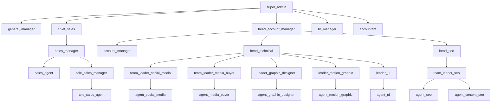
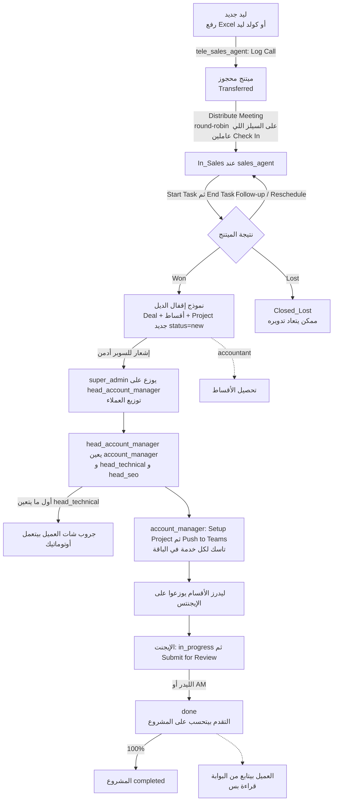

# دليل سيستم ثمرة ERP — كل رول، علاقته بالباقي، والداتا اللي بيشوفها

> **الإصدار:** مبني على الكود الحالي (commit `5d29c15` على `main`)، نوفمبر 2026.
> **المصدر:** الكود نفسه (`src/app/dashboard/**`، `src/app/api/**`، `src/server/**`، `src/lib/**`، `prisma/schema.prisma`) — مش ملفات التوثيق القديمة (`roles/*.md`، `شرح الادوار.md`، `WALKTHROUGH.md`)، لأن فيها حاجات اتغيرت.
> أي حاجة مكتوب جنبها **غير مؤكد** معناها إنها ماتأكدتش من الكود، ولازم تتجرب قبل ما تتقال في فيديو.

---

## تعليمات للإيجنت اللي هيصوّر الفيديوهات

**الهدف:** فيديو واحد لكل رول، بيتبعت للموظف اللي في الرول ده، يشرحله شغله على السيستم من أول الدخول لحد ما يسلّم شغله للي بعده.

### كل فيديو بيتكون من 3 أجزاء
1. **مقدمة مشتركة (2–3 دقايق، نفسها لكل الموظفين):** الدخول وتغيير الباسورد، شكل الشاشة والسايدبار، اللغة، الإشعارات، الحضور والانصراف، البروفايل. → من **الجزء 1** (القسم «الدخول والحساب» و«الإشعارات»).
2. **شغل الرول نفسه (الجزء الأساسي):** قسم الرول في الجزء بتاعه (2 إلى 5)، وبالأخص البند **«سيناريو الفيديو»** اللي فيه اللقطات بالترتيب. قبله اشرح في جملتين «دورة الحياة» بتاعة القسم (الليد / المشروع / التاسك) علشان الموظف يفهم هو فين في الصورة الكبيرة.
3. **شات الفريق (3–5 دقايق):** من **الجزء 1** القسم «شات الفريق» وسيناريو الفيديو بتاعه. للرولز اللي شغالة على عملاء ركّز على جروب العميل اللي بيتعمل أوتوماتيك.

### قواعد التصوير
- **أسماء الأزرار:** كتير منها مكتوب إنجليزي في الكود حتى والواجهة عربي (زي `Log Call`، `Push to Teams`، `Setup Project`، `Sign out`). اقراها زي ما هي ظاهرة على الشاشة، ماتترجمهاش.
- **ماتصوّرش داتا عملاء حقيقية:** صوّر على السيرفر اللوكل أو على حسابات التجربة. لو لازم البرودكشن، استخدم عميل تجربة ولا تظهر أرقام فلوس أو موبايلات حقيقية.
- **ماتقولش حاجة مكتوب عليها «مش موجود في الكود» أو «غير مؤكد»** كأنها شغالة. القايمة الكاملة في **الملحق: حاجات لازم تعرفها قبل التصوير**.
- **ماتعملش فيديو** للرولز القديمة `team_leader` و`operations_agent`: اللينك الوحيد بتاعهم بيرجّعهم للصفحة الرئيسية.
- **صفحة الرئيسية** لكل الرولز ما عدا السوبر أدمن والمدير العام هي كارت ترحيب إنجليزي بس. ابدأ الشرح من السايدبار مش منها.

### حسابات التجربة
- **السوبر أدمن:** `admin@thamaraa.com` / `admin123` (على السيرفر اللوكل).
- **باقي الرولز:** `<role>@test.thamaraa.com` من السكريبت `scripts/seed_test_accounts.cjs`. الباسورد بيتحدد وقت تشغيل السكريبت (`TEST_ACCOUNT_PASSWORD`)، مش مكتوب في الكود — اطلبه من صاحب السيستم. الجدول الكامل في الجزء 1، قسم «حسابات التجربة لكل رول».
- **رولز مالهاش حساب تجربة:** `tele_sales_agent`، `tele_sales_manager`، `sales_agent`، `sales_manager`، `general_manager`. صوّرها بحساب حقيقي، أو السوبر أدمن يعمل Impersonate للموظف (الشات والمكالمات بيتقفلوا وقت الـ Impersonation، فصوّر جزء الشات بحساب تاني).

### قايمة الفيديوهات المطلوبة

| # | الرول | الكود | اقرا القسم ده | ملاحظة |
|---|---|---|---|---|
| 1 | السوبر أدمن | `super_admin` | الجزء 5 | |
| 2 | المدير العام | `general_manager` | الجزء 5 | نفس شاشات السوبر أدمن + حدود الصلاحيات |
| 3 | Chief Sales | `chief_sales` | الجزء 2 | ماتفتحش «الديلز» (بترجّعه للرئيسية) |
| 4 | تيلي سيلز مانجر | `tele_sales_manager` | الجزء 2 | |
| 5 | موظف تيلي سيلز | `tele_sales_agent` | الجزء 2 | |
| 6 | سيلز مانجر | `sales_manager` | الجزء 2 | مايقدرش يقفل ديل بنفسه |
| 7 | موظف سيلز | `sales_agent` | الجزء 2 | |
| 8 | هيد أكونت مانجر | `head_account_manager` | الجزء 3 | |
| 9 | أكونت مانجر | `account_manager` | الجزء 3 | جرّب `Push to Teams` قبل التصوير |
| 10 | هيد تكنيكال | `head_technical` | الجزء 3 | |
| 11 | هيد SEO | `head_seo` | الجزء 4 | |
| 12 | تيم ليدر SEO | `team_leader_seo` | الجزء 4 | |
| 13 | موظف SEO | `agent_seo` | الجزء 4 | |
| 14 | موظف كونتنت SEO | `agent_content_seo` | الجزء 4 | |
| 15 | تيم ليدر سوشيال ميديا | `team_leader_social_media` | الجزء 4 | |
| 16 | موظف سوشيال ميديا | `agent_social_media` | الجزء 4 | |
| 17 | تيم ليدر ميديا باير | `team_leader_media_buyer` | الجزء 4 | |
| 18 | موظف ميديا باير | `agent_media_buyer` | الجزء 4 | |
| 19–21 | ليدرز الديزاين (جرافيك / موشن / UI) | `leader_graphic_designer`، `leader_motion_graphic`، `leader_ui` | الجزء 4 | فيديو لكل واحد، نفس الخطوات بالفروق المكتوبة |
| 22–24 | المصممين (جرافيك / موشن / UI) | `agent_graphic_designer`، `agent_motion_graphic`، `agent_ui` | الجزء 4 | فيديو لكل واحد |
| 25 | مدير الموارد البشرية | `hr_manager` | الجزء 5 | |
| 26 | المحاسب | `accountant` | الجزء 5 | |
| 27 | العميل (بوابة العميل) | — | الجزء 3، «بوابة العميل» | اختياري: فيديو للعملاء مش للموظفين |
| — | `team_leader`، `operations_agent` | — | — | **مفيش فيديو** (رولز قديمة) |

---

## الصورة الكبيرة

### أقسام الشركة في السيستم
| القسم | الرولز | شغلهم في جملة |
|---|---|---|
| الإدارة | `super_admin`، `general_manager` | بيشوفوا كل حاجة، بيعملوا المستخدمين، وبيوزعوا العملاء الجداد على Head AM |
| المبيعات | `tele_sales_agent` ← `tele_sales_manager`، `sales_agent` ← `sales_manager` ← `chief_sales` | التيلي بيكلم الليدز ويحجز ميتنجز، والسيلز بيقابل ويقفل الديل |
| الأكاونت مانجمنت | `head_account_manager`، `account_manager` | بيستلموا العميل بعد البيع، يجهزوا المشروع ويدفعوه للفرق ويتابعوه |
| التقني | `head_technical`، `head_seo` | بيوزعوا المشروع على ليدرز الأقسام |
| فرق التنفيذ | ليدرز وإيجنتس SEO، سوشيال، ميديا باير، جرافيك، موشن، UI | بينفذوا التاسكات ويسلموها للمراجعة |
| الدعم | `hr_manager`، `accountant` | الموظفين والحضور والإجازات والمرتبات، والأقساط والعمولات |
| العميل | بوابة العميل `/portal` | بيتابع مشروعه قراءة بس |

### الهيكل التنظيمي (المدير المباشر)
كل موظف ليه **مدير مباشر واحد** (الحقل `directManagerId`)، بيتحدد من صفحة المستخدمين أو من HR. ده الشكل الافتراضي (زي حسابات التجربة)، والأدمن يقدر يغيّره:

**المدير المباشر بيأثر في إيه:** فريق السيلز مانجر والتيلي مانجر (بيشوفوهم ويحطولهم تارجت، وعمولة المانجر محسوبة عليهم)، إشعار «Deal Closed!» للمدير، وملف الموظف في HR. **مش بيأثر** في توزيع المشاريع والتاسكات: دي ماشية بحقول المشروع نفسه (الأكونت مانجر، الهيد تكنيكال، الهيد SEO، تعيينات الفرق).

### رحلة العميل كاملة: مين بيسلّم لمين

**التلت دورات حياة اللي لازم الموظف يفهمها:**
- **الليد** (الجزء 2): `New` ← `Transferred` ← `In_Sales` ← `Closed_Won` / `Closed_Lost` (والحالات اللي في النص).
- **المشروع** (الجزء 3): حالة التشغيل `new` ← `setup` ← `assigned` ← `in_progress` ← `completed` (أو `delayed`)، وحالة العميل `Active` / `Hold` / `Renewer` / `Lost`.
- **التاسك** (الجزء 4): `pending` ← `in_progress` ← `review` ← `done`.

### الأجزاء
1. **الحاجات المشتركة:** مصفوفة الرولز والصفحات، الدخول، الإشعارات، الشات، حسابات التجربة.
2. **المبيعات:** التيلي سيلز، السيلز، Chief Sales.
3. **الأكاونت مانجمنت والمشاريع:** Head AM، AM، Head Technical، بوابة العميل.
4. **فرق التنفيذ:** SEO، سوشيال ميديا، ميديا باير، الديزاين.
5. **الإدارة والـ HR والمالية:** السوبر أدمن، المدير العام، HR، المحاسب، الإنذارات، مراقبة الأجهزة.

**الملحق:** حاجات لازم تعرفها قبل التصوير (اللي مش شغال زي ما الشاشة بتقول، واللي غير مؤكد).

---

# الجزء 1 — الحاجات المشتركة بين كل الموظفين

> المصادر: `src/app/dashboard/layout.tsx`, `src/components/DashboardShell.tsx`, `src/app/dashboard/page.tsx`, `src/lib/i18n/messages.ts`, `src/lib/auth.ts`, `src/app/login`, `src/app/change-password`, `src/app/dashboard/profile`, `src/components/NotificationBell.tsx`, `src/lib/notify.ts`, `src/components/chat/**`, `src/server/chat/**`, `src/lib/chat/**`, `scripts/seed_test_accounts.cjs`, `prisma/seed.js`.
> اللغة الافتراضية للسيستم **عربي** (`DEFAULT_LOCALE = "ar"`)، والأسماء اللي تحت هي اللي بتظهر في الواجهة العربي.

---

## مصفوفة الرولز والصفحات

### شكل الشاشة العام (لكل الرولز)
- **السايدبار (يمين في العربي)**: فوقه اسم السيستم «ثمرة ERP». على الموبايل/التابلت بيبقى درج بيتفتح من زرار ☰ في الهيدر، ويتقفل لوحده لما تختار صفحة.
- **الهيدر (فوق)**: زرار اللغة `AR | EN` + جرس الإشعارات 🔔.
- **أسفل السايدبار**: صورة الموظف (بتفتح `/dashboard/profile`) + الاسم + الرول (بالإنجليزي، زي `account manager`) + زرار **Sign out** (مكتوب إنجليزي في الكود).

### الروابط اللي بتظهر لكل الرولز (28 رول)
| الترتيب | اللينك (عربي) | Route |
|---|---|---|
| 1 | الرئيسية | `/dashboard` |
| 2 | الإشعارات (بعداد غير المقروء) | `/dashboard/notifications` |
| 3 | شات الفريق (بعداد غير المقروء، بيختفي وقت الـ impersonation) | `/dashboard/chat` |
| قسم «HR والمالية» | الحضور والانصراف | `/dashboard/hr` |
| قسم «حسابي» | بروفايلي | `/dashboard/profile` |

### الروابط الخاصة بكل رول (زيادة على المشترك)
ملاحظة مهمة: الكود بيستخدم `hasRole(...)` اللي بترجع **true دايمًا لـ `super_admin` و`general_manager`**، فهما بيشوفوا كل الأقسام. لكن الروابط المشروطة بـ `role === "..."` (زي «التارجت بتاعي» و«الميتنجز» والعمليات القديمة) **مش** بتظهر لهم.

| الرول | الأقسام والروابط (عربي → route) |
|---|---|
| `super_admin` / `general_manager` | **الإدارة**: المستخدمين `/dashboard/users`، الشركات `/dashboard/companies`، توزيع العملاء `/dashboard/client-assign`، إعدادات السيستم `/dashboard/settings`، مراقبة الأجهزة `/dashboard/monitoring` · **إدارة المبيعات**: نظرة عامة على السيلز `/dashboard/chief-sales`، الپايبلاين `/dashboard/chief-sales/pipeline`، سيلز مانجرز `/dashboard/chief-sales/sales-managers` · **تيلي سيلز**: الليدز `/dashboard/telesales`، رفع ليدز `/dashboard/leads-import`، إضافة كولد ليدز `/dashboard/telesales/cold-leads`، الفريق بتاعي `/dashboard/telesales/my-team`، تحليلات الفريق `/dashboard/telesales/analytics`، إعادة تدوير الهوت ليدز `/dashboard/telesales/recycle` · **الديلز**: الديلز `/dashboard/deals` · **سيلز**: الفرص `/dashboard/sales`، الفريق بتاعي `/dashboard/sales/my-team`، تحليلات الفريق `/dashboard/sales/analytics`، سلة إعادة التدوير `/dashboard/sales/recycle-bin` · **أكونت مانجمنت**: كل المشاريع `/dashboard/head-account-manager`، عملائي `/dashboard/account-manager`، المشاريع والتاسكات `/dashboard/operations`، الباقات والإعدادات `/dashboard/operations/packages` · **التقني**: نظرة عامة تقنية `/dashboard/head-technical`، كل مشاريع العملاء `/dashboard/operations` · **SEO**: مشاريع SEO `/dashboard/seo` · **سوشيال ميديا**: مشاريع السوشيال `/dashboard/social-media` · **ميديا باينج**: الحملات `/dashboard/media-buyer` · **ديزاين وكرييتف**: جرافيك ديزاين `/dashboard/design?team=graphic`، موشن جرافيك `/dashboard/design?team=motion`، UI/UX ديزاين `/dashboard/design?team=ui` · **HR والمالية**: دليل الموظفين `/dashboard/hr`، لوحة المالية `/dashboard/finance` · **التواصل**: مركز التحذيرات `/dashboard/warnings` · الماستر شيت `/dashboard/master-sheet` |
| `chief_sales` | **إدارة المبيعات**: نظرة عامة على السيلز، الپايبلاين، سيلز مانجرز، التارجت بتاعي `/dashboard/chief-sales/my-target` · **الديلز** `/dashboard/deals` · **التواصل**: مركز التحذيرات |
| `tele_sales_agent` | **تيلي سيلز**: الليدز `/dashboard/telesales`، رفع ليدز `/dashboard/leads-import`، الميتنجز `/dashboard/telesales/meets`، التقدم بتاعي `/dashboard/telesales/my-progress`، التارجت بتاعي `/dashboard/telesales/my-target`، إضافة كولد ليدز `/dashboard/telesales/cold-leads` · **الديلز** |
| `tele_sales_manager` | **تيلي سيلز**: الليدز، رفع ليدز، إضافة كولد ليدز، الفريق بتاعي `/dashboard/telesales/my-team`، تحليلات الفريق `/dashboard/telesales/analytics`، التارجت بتاعي `/dashboard/telesales/my-target`، إعادة تدوير الهوت ليدز `/dashboard/telesales/recycle` · **الديلز** |
| `sales_agent` | **الديلز** · **سيلز**: الفرص `/dashboard/sales`، التقدم بتاعي `/dashboard/sales/my-progress`، التارجت بتاعي `/dashboard/sales/my-target` |
| `sales_manager` | **الديلز** · **سيلز**: الفرص، الفريق بتاعي `/dashboard/sales/my-team`، تحليلات الفريق `/dashboard/sales/analytics`، التارجت بتاعي `/dashboard/sales/my-target`، سلة إعادة التدوير `/dashboard/sales/recycle-bin` · **التواصل**: مركز التحذيرات |
| `head_account_manager` | **أكونت مانجمنت**: كل المشاريع `/dashboard/head-account-manager`، المشاريع والتاسكات `/dashboard/operations`، الباقات والإعدادات `/dashboard/operations/packages` · **التواصل**: مركز التحذيرات |
| `account_manager` | **أكونت مانجمنت**: عملائي `/dashboard/account-manager`، المشاريع والتاسكات `/dashboard/operations` · **التواصل**: مركز التحذيرات |
| `head_technical` | **التقني**: نظرة عامة تقنية `/dashboard/head-technical`، كل مشاريع العملاء `/dashboard/operations` · **التواصل**: مركز التحذيرات |
| `head_seo` | **SEO**: مشاريع SEO `/dashboard/seo` · مركز التحذيرات |
| `team_leader_seo` | **SEO**: مشاريع SEO `/dashboard/seo` · مركز التحذيرات |
| `agent_seo` | **SEO**: التاسكات بتاعتي `/dashboard/seo` · مركز التحذيرات |
| `agent_content_seo` | **SEO**: التاسكات بتاعتي `/dashboard/seo` · مركز التحذيرات |
| `team_leader_media_buyer` | **ميديا باينج**: الحملات `/dashboard/media-buyer` · مركز التحذيرات |
| `agent_media_buyer` | **ميديا باينج**: التاسكات بتاعتي `/dashboard/media-buyer` · مركز التحذيرات |
| `team_leader_social_media` | **سوشيال ميديا**: مشاريع السوشيال `/dashboard/social-media` · مركز التحذيرات |
| `agent_social_media` | **سوشيال ميديا**: التاسكات بتاعتي `/dashboard/social-media` · مركز التحذيرات |
| `leader_graphic_designer` | **ديزاين وكرييتف**: جرافيك ديزاين `/dashboard/design?team=graphic` · مركز التحذيرات |
| `agent_graphic_designer` | **ديزاين وكرييتف**: جرافيك ديزاين `/dashboard/design?team=graphic` · مركز التحذيرات |
| `leader_motion_graphic` | **ديزاين وكرييتف**: موشن جرافيك `/dashboard/design?team=motion` · مركز التحذيرات |
| `agent_motion_graphic` | **ديزاين وكرييتف**: موشن جرافيك `/dashboard/design?team=motion` · مركز التحذيرات |
| `leader_ui` | **ديزاين وكرييتف**: UI/UX ديزاين `/dashboard/design?team=ui` · مركز التحذيرات |
| `agent_ui` | **ديزاين وكرييتف**: UI/UX ديزاين `/dashboard/design?team=ui` · مركز التحذيرات |
| `hr_manager` | **HR والمالية**: دليل الموظفين `/dashboard/hr` (نفس route الحضور، لينكين لنفس الصفحة). **مفيش** مركز تحذيرات في السايدبار |
| `accountant` | **HR والمالية**: لوحة المالية `/dashboard/finance`. **مفيش** مركز تحذيرات |
| `team_leader` (legacy) | **العمليات**: المشاريع والتاسكات `/dashboard/operations`. مفيش مركز تحذيرات |
| `operations_agent` (legacy) | **العمليات**: المشاريع والتاسكات `/dashboard/operations`. مفيش مركز تحذيرات |

ملاحظات على المصفوفة:
- «مركز التحذيرات» مش ظاهر لـ: `tele_sales_agent`, `tele_sales_manager`, `sales_agent`, `hr_manager`, `accountant`, `team_leader`, `operations_agent`. (الـ popup بتاع التحذيرات `WarningPopup` و`GlobalWarningAlert` شغالين لكل الرولز بغض النظر.)
- «الماستر شيت» وقسم «الإدارة» لـ `super_admin` و`general_manager` بس.
- عنوان قسم الديلز بيستخدم key `nav.deals` فبيظهر «الديلز» كعنوان وكلينك.

### الصفحة الرئيسية `/dashboard` حسب الرول
- **`super_admin` / `general_manager`**: عنوان «مركز القيادة» + `SuperAdminClient` فيه إحصائيات (النهاردة / الأسبوع / الشهر / الكل): عدد الليدز، المشاريع، الديلز المقفولة `Closed_Won`، الإيراد، + عدد الموظفين النشطين + عدد التحذيرات غير المحلولة.
- **باقي الـ 26 رول**: مفيش redirect حسب الرول. الصفحة بتعرض «Welcome back, <الاسم>» (إنجليزي ثابت) وكارت «بيانات الدور» بنص إنجليزي: "You are logged in as a <role>. Use the sidebar to navigate…". يعني الشغل الحقيقي بيبدأ من السايدبار.

---

## الدخول والحساب

### تسجيل الدخول `/login`
- الشاشة: لوجو «ThamaraaERP» + عنوان «تسجيل الدخول».
- حقل «الإيميل أو الموبايل» (placeholder: «اكتب الإيميل أو رقم الموبايل»). فعليًا السيرفر بيقبل **الإيميل أو رقم الموبايل أو كود الموظف (Employee ID من سجل HR `employeeCode`)**.
- حقل «كلمة المرور» → زرار «تسجيل الدخول» (بيتحول لـ «جاري الدخول...»).
- لو البيانات غلط أو الحساب `Inactive`: رسالة «بيانات الدخول غلط أو الحساب موقوف».
- لو انت داخل أصلًا وفتحت `/login` بيحولك لـ `/dashboard`.

### أول دخول — تغيير الباسورد الإجباري `/change-password`
- لو `mustChangePassword = true` الـ layout بيحولك إجباري لـ `/change-password` قبل أي صفحة. ده بيحصل للموظفين اللي اتعملوا من HR (`createEmployeeWithHrRecord` بيحط الفلاج `true`). الحسابات العادية الـ default بتاعها `false`.
- الشاشة: «اختار كلمة المرور بتاعتك» + «أهلاً بيك! للأمان، اختار كلمة مرور جديدة قبل ما تكمّل.»
- حقلين: «كلمة المرور الجديدة» (6 حروف على الأقل) و«تأكيد كلمة المرور» → زرار «حفظ ومتابعة».
- أخطاء: «كلمة المرور لازم تكون 6 حروف على الأقل.» / «كلمتا المرور مش متطابقتين.»
- بعد الحفظ السيستم **بيعمل تسجيل خروج** ويرجعك لـ `/login` تدخل بالباسورد الجديد.
- الـ super admin وهو بيعمل impersonation معفي من الشاشة دي.

### البروفايل `/dashboard/profile` («مساحة عملي وبروفايلي»)
- **الصورة**: دوس على صورتك → «غيّر الصورة» / «شيل الصورة». في cropper «ظبّط الصورة» (اسحب للتحريك، زوم بالعجلة أو بصباعين، «لف الصورة»). الحد 8 ميجا. نفس الصورة بتظهر في الشات والسايدبار.
- البيانات المعروضة: الاسم، الإيميل • الموبايل، شارات الرول / المستوى (Level) / الحالة (Active). مفيش حقول تعديل للاسم/الإيميل في الصفحة دي.
- زرار **+ Request Leave / Remote** (نص إنجليزي) → مودال «طلب جديد»: النوع (إجازة / شغل من البيت / إذن (ساعات))، التاريخ، «السبب / الملاحظات» → «إرسال». (الطلب بيروح كإشعار لأول HR Manager.)
- زرار **+ Upload Document** → «رفع لينك مستند»: «اسم المستند» + «لينك الملف (جوجل درايف، AWS، إلخ)» → حفظ. (لينك مش رفع ملف.)
- كروت: «آخر سجلات الحضور» (آخر 7)، «طلباتي»، «المستندات»، ولأي رول فيه كلمة `sales` كارت أداء (My Sales Performance / My Telesales Performance) بعدد الديلز والإيراد بالـ SAR.

### اللغة AR/EN
- زرار `AR | EN` في الهيدر. الاختيار بيتحفظ في كوكي `NEXT_LOCALE` على جهازك لمدة سنة، ومبيأثرش على حد تاني. الصفحة بتعمل refresh والاتجاه بيتقلب RTL/LTR.

### الجلسة والتحديث
- الجلسة JWT (NextAuth). الرول بيتقري من الداتابيز تاني كل ~60 ثانية، فلو اترقيت/اتغير رولك السايدبار بيتغير من غير ما تعمل logout.
- الداتا بتتحدث لوحدها: `RealtimeRefresher` (Soketi/Pusher) + `AutoRefresher` (كل 8 ثواني لو مفيش realtime، و30 ثانية كـ safety net لو realtime شغال).
- `super_admin`/`general_manager` يقدروا يعملوا impersonation لموظف (بيظهر `ImpersonationBanner`)، والـ GM مايقدرش يدخل كـ super admin أو GM تاني. وقت الـ impersonation الشات والمكالمات مقفولين.
- تسجيل الخروج: زرار «Sign out» أسفل السايدبار.

---

## الإشعارات

### فين بتظهر
- **الجرس في الهيدر**: دوس عليه يفتح dropdown بعنوان «الإشعارات» + «N New». كل إشعار: عنوان، رسالة، وقت، زرار «Open Link» (لو له لينك) و«Mark Read». تحت: «View All History».
- **لينك «الإشعارات» في السايدبار** بعداد غير المقروء → `/dashboard/notifications`.
- **صفحة `/dashboard/notifications`**: كل التاريخ (مقروء وغير مقروء)، «N in history · N unread» وزرار «Mark all read». لو فاضية: «مفيش إشعارات لسه».
- الضغط على إشعار = يتعلم مقروء + يوديك للينك بتاعه (لينك داخلي في نفس التاب، خارجي في تاب جديد).

### إزاي بتوصل (realtime)
- كل إشعار بيتسجل في جدول `Notification` وبيتبعت event `new-notification` على قناة `user-<id>` (Soketi self-hosted متوافق مع Pusher). الـ event مجرد إشارة «اعمل refetch» من غير محتوى، والمحتوى بيتجاب من API بتصريح.
- لو الـ realtime واقع: polling كل 15 ثانية (و60 ثانية لو realtime شغال).
- `notificationPolicy.canReceiveNotification`: أي حساب حالته `Inactive` مايستلمش إشعارات.
- التحذيرات (Warnings) ليها popup منفصل لازم تعمل له acknowledge (event `new-warning`).

### أنواع الإشعارات ومين بيستلمها (من الكود)
| النوع `type` / العنوان | بيروح لمين |
|---|---|
| `lead_assigned` «New Lead Assigned» / «Lead Reassigned» / «Recycled Lead Assigned» / «New Leads Assigned» / «New Leads Auto-Assigned» | التيلي سيلز إيجنت اللي الليد اتوزع عليه (والمانجر في التوزيع الأوتوماتيك — غير مؤكد بالتفصيل) |
| «Client No-Show — Follow Up» | التيلي سيلز إيجنت صاحب الليد لما العميل مايحضرش الميتنج |
| `meeting_link` | خاص بلينك الميتنج — المستلم بالظبط غير مؤكد |
| «Deal Closed!» | الـ direct manager بتاع اللي قفل الديل |
| `deal_closed` «New Client Awaiting Assignment» | كل `super_admin` النشطين (الدالة اسمها notifyHeadAccountManagers… لكن الكود بيبعت للسوبر أدمن) |
| «New Client Assigned» / `client_reassigned` «Client Assigned» / «Client Reassigned» | الـ Head Account Manager / الأكونت مانجر اللي اتعين على العميل |
| `project_assigned` «Team Assignment» / «New Project Assigned» / «New Project Assignment» | الموظف اللي اتضاف على فريق المشروع (توزيع المشاريع) |
| `task_assigned` «New Assignment» / «New Task Assigned»، `task_reassigned`، `task_flagged`، `task_review` «Task Ready for Review»، `task_progress` / «Task Completed» | الليدر/الإيجنت المعين على التاسك، والليدر/المسؤول لما التاسك يخلص أو يبقى جاهز للمراجعة |
| `payment_reminder` / `payment_overdue` | السيلز إيجنت بتاع الديل + أول Accountant نشط (تذكير قبل الاستحقاق ويوم الاستحقاق، ومتأخر بعد 1/3/7/15 يوم) |
| «New Leave/Remote/Permission Request»، «New Complaint»، «New Salary Advance Request» | أول HR Manager |
| «Request Approved/Rejected»، «Salary Advance Update»، «New Performance Review» | الموظف صاحب الطلب/التقييم |
| `promotion` «Promotion»، `hr_warning` «Performance Warning»، `hr_termination` «Account Inactive»، «Welcome to Thamara» | الموظف نفسه |
| `chat_mention` «<فلان> عمل لك منشن في #…» | الأعضاء اللي اتعملهم @منشن في الشات |
| `chat_thread` «<فلان> رد في thread في …» | صاحب الرسالة الأصلية وكل اللي ردوا في نفس الـ thread |
| `chat_missed_call` «مكالمة فايتة» | أعضاء المحادثة غير اللي بدأ المكالمة لما محدش يرد |

(العناوين أغلبها مكتوبة إنجليزي في الكود وماتتترجمش؛ إشعارات الشات بالعربي.)

---

## شات الفريق

`/dashboard/chat` — متاح لكل الـ 28 رول (ماعدا وقت الـ impersonation). الواجهة شبه Slack + WhatsApp.

### شكل الشاشة
- **شريط فوق**: «شات الفريق» + بحث «دوّر في الرسايل…» (بيدوّر في كل محادثاتك من أول حرفين، وبيفتح لوحة «بحث» على الجنب؛ الضغط على نتيجة يوديك للرسالة أو الـ thread).
- **السايدبار بتاع الشات**: فلتر «دوّر في المحادثات…» + زرار ✉️+ «رسالة جديدة»، تحته **شريط الليبلز** (chips: «الكل» + ليبلزك + «ظبّط الليبلز»)، وبعدين 3 أقسام قابلة للطي: **القنوات / الجروبات / الرسايل الخاصة**، ولينك «تصفح القنوات». كل قسم لما تقف عليه يظهر زرار 📁+ «فولدر جديد» وزرار + (رسالة جديدة / جروب جديد / قناة جديدة).
- **هيدر المحادثة**: الاسم (دوس عليه = التفاصيل)، أونلاين/مش موجود في الخاص، 📞 «مكالمة صوت» و🎥 «مكالمة فيديو»، صور الأعضاء وعددهم، 🏷 «الليبلز»، 🧭 «رحلة العميل» (لجروبات العملاء أو المربوطة بعميل)، 🖼 «الصور والملفات»، 📌 «الرسايل المثبّتة» بعددها، ℹ️ «التفاصيل».
- على الموبايل: قايمة المحادثات تاخد الشاشة كلها، ولما تفتح محادثة القايمة بتستخبى.

### المحادثات ومين يقدر يعمل إيه
| الحاجة | إزاي | مين يقدر |
|---|---|---|
| رسالة خاصة (DM) | زرار «رسالة جديدة» → «دوّر بالاسم أو الإيميل…» → «ابدأ الشات». واحدة بس لكل اتنين | أي موظف مع أي موظف نشط. لو الطرف التاني اتوقف: «الموظف ده مبقاش نشط — المحادثة للقراءة بس.» |
| جروب | + جنب «الجروبات» → «جروب جديد»: الاسم، الوصف، الأعضاء (لازم عضو واحد على الأقل، حد أقصى 200) → «إنشاء» | **أي موظف**. الجروب دايمًا خاص، واللي عمله بيبقى «المالك». حد أقصى 10 إنشاءات في الساعة |
| قناة | + جنب «القنوات» → «قناة جديدة»: الاسم، الوصف، «عامة — أي حد يقدر يدخل» أو «خاصة — بالدعوة بس» | `canCreateChannel`: `super_admin`, `general_manager`, `hr_manager`، وأي رول فيه `manager`/`head`/`chief`/`leader` أو بيبدأ بـ `team_leader`: يعني `tele_sales_manager`, `sales_manager`, `chief_sales`, `head_account_manager`, `account_manager`, `head_technical`, `head_seo`, `team_leader_seo`, `team_leader_media_buyer`, `team_leader_social_media`, `leader_graphic_designer`, `leader_motion_graphic`, `leader_ui`, `team_leader`. **مش متاح** للإيجنتس و`accountant` و`operations_agent` و`tele_sales_agent` و`sales_agent` (زرار + مش بيظهر) |
| تصفح القنوات والانضمام | «تصفح القنوات» → «انضم» | أي حد، للقنوات العامة بس |
| تغيير الاسم/الوصف/صورة الجروب أو القناة | ℹ️ التفاصيل → «تغيير الاسم»، ودوس على الصورة → «غيّر الصورة» | المالك والأدمن |
| إضافة أعضاء | التفاصيل → «إضافة أعضاء» | في الجروب العادي: أي عضو. في القناة وجروب العميل: المالك/الأدمن |
| شيل عضو | التفاصيل → زرار «شيل» جنب العضو | المالك والأدمن (الأدمن مايشيلش أدمن؛ محدش يشيل المالك؛ أعضاء جروب العميل الأوتوماتيك مايتشالوش يدوي) |
| «خليه أدمن» / «شيل الأدمن» | التفاصيل → أيقونة الدرع جنب العضو | المالك بس |
| خروج | التفاصيل → «خروج» | أي عضو (ماعدا الأعضاء اللي متضافين أوتوماتيك في جروب العميل). لو المالك خرج الملكية بتروح لأقدم أدمن/عضو |

### جروبات العملاء الأوتوماتيك (`projectChat.ts`) ورحلة العميل
- أول ما المشروع يدخل المرحلة التقنية (يتعين له Head Technical) بيتعمل **جروب خاص باسم العميل** تلقائي، وصفه «جروب العميل — اتعمل تلقائي لما المشروع دخل التيكنكل».
- الأعضاء بيمشوا مع الـ assign: الـ Head Technical (**مالك**)، الـ Head Account Manager (**أدمن**)، الأكونت مانجر، الـ Head SEO، أي حد في فريق المشروع النشط، والليدرز/الإيجنتس (`team_leader`, `leader_*`, `agent_*`, `operations_agent`) اللي عليهم تاسكات مش خلصانة. اللي يتشال من المشروع بيتشال من الجروب. تحت قايمة الأعضاء: «أعضاء جروب العميل بيتغيّروا مع الـ assign بتاع المشروع».
- **رحلة العميل** 🧭: لوحة جانبية بتايم لاين العميل (مكالمات التيلي سيلز، الديل، التاسكات…). لو انت مش من فريق العميل بتشوف «ملخص بس — التفاصيل بتظهر لفريق العميل». لو عندك صلاحية يظهر «افتح صفحة العميل».
- **ربط جروب عادي بعميل**: التفاصيل → «اربط بعميل» → «دوّر على عميل…». للمالك/الأدمن، في الجروبات العادية بس (مش القنوات)، وعلى العملاء اللي انت أصلًا تقدر تشوفهم. «شيل الربط» يفك الربط. بتتكتب رسالة سيستم «ربط الجروب بالعميل».

### الرسايل
- **الكتابة**: «اكتب رسالة…»، Enter للإرسال و«Shift + Enter لسطر جديد». تنسيق: عريض `*كلام*`، مايل `_كلام_`، مشطوب `~كلام~`، كود، بلوك كود. حد أقصى 4000 حرف.
- **إيموجي** 😊 و**منشن** @ («منشن لحد») → اللي اتعمله منشن بيوصله إشعار.
- **مرفقات** 📎 «إرفاق ملفات» أو سحب الملفات على المحادثة («سيب الملفات هنا عشان ترفعها»): لحد 10 ملفات في الرسالة، 50 ميجا للملف، البرامج والسكربتات ممنوعة ونوع الملف الحقيقي بيتفحص. الصور بتتضغط. الصور بتفتح في عارض بزرار «تحميل».
- **استيكرات**: 12 استيكر (منهم «بندق نمبر ون» بريميوم، «عاش يا وحش»، «تمام»، «صباح الفل»، «يلا بينا»، «تسلم إيدك»، «ثواني وجاي»، «خلصت»، «حبيبي والله»، «خليني أفكر»، «بريك قهوة»، «هههههه»).
- **رسالة صوتية** 🎤: «سجّل رسالة صوتية» → «بيسجّل…» → «ابعت الرسالة الصوتية» أو «امسح». بتظهر بموجة صوت وزرار «شغّل/وقّف».
- **أكشنز الرسالة** (بتظهر لما تقف بالماوس على الرسالة):
  - ↩️ **«رد»** = رد WhatsApp-style: بيظهر اقتباس الرسالة فوق خانة الكتابة (إلغاء بـ X)، والرد بيتبعت في نفس المحادثة ومعاه الاقتباس، والضغط على الاقتباس يوديك للرسالة الأصلية.
  - 😊+ **«تفاعل»**: 8 ريأكشنز ثابتة 👍 ❤️ 😂 🔥 🎉 👀 🙏 ✅ (الوقوف على الريأكشن يوريك مين عمله).
  - 💬 **«رد في thread»**: يفتح لوحة Thread جانبية؛ تحت الرسالة يظهر «N ردود · آخر رد…». الرد في thread مايطلعش المحادثة لفوق، وبيبعت إشعار لصاحب الرسالة واللي ردوا.
  - 📌 **«ثبّت في المحادثة» / «شيل التثبيت»**: أي عضو. المثبّت يظهر في لوحة «الرسايل المثبّتة».
  - ✏️ **«تعديل»**: صاحب الرسالة النصية بس (بتظهر «متعدّلة»).
  - 🗑 **«مسح»**: صاحب الرسالة، أو المالك/الأدمن في الجروب/القناة. «تمسح الرسالة دي عند الكل؟» — المسح بيشيل الملفات نهائي.
- علامات القراءة: ✓ «اتبعتت» و✓✓ زرقا «اتشافت» على آخر رسالة ليك.
- **الصور والملفات** 🖼: لوحة بتابات «صور / فيديو / ملفات / لينكات» + «روح للرسالة».
- **كارت الموظف**: دوس على صورة/اسم أي حد → كارت فيه الاسم والرول وأونلاين، وزراير «رسالة» و📞 و🎥.

### المكالمات (LiveKit)
- تشتغل بس لو LiveKit متظبط على السيرفر (`callsEnabled`)؛ لو لأ الزراير مش بتظهر. متاحة في الخاص والجروبات والقنوات لأي عضو.
- 📞/🎥 في الهيدر يبدأ مكالمة. الطرف التاني بيشوف «مكالمة صوت جاية / مكالمة فيديو جاية» بزراير «رد» / «فيديو» / «رفض». في المحادثة بيظهر بانر «في مكالمة شغالة» بزرار «انضم».
- أزرار المكالمة: «اقفل المايك/افتح المايك»، «افتح الكاميرا/اقفل الكاميرا»، **«شير سكرين»/«وقّف الشير»** (مش موجود في الوضع المصغّر)، **«سجّل المكالمة»/«وقّف التسجيل»**، «صغّر/كبّر»، «اخرج».
- **تسجيل المكالمة**: أي مشارك يقدر يسجل. التسجيل صوت بس (mix لكل المشاركين)، الكل بيشوف شارة حمرا «المكالمة دي بتتسجّل»، حد أقصى 3 ساعات، وبيتحفظ كرسالة «تسجيل مكالمة» في المحادثة («تسجيل المكالمة اتحفظ في المحادثة»). لو الرفع فشل بيتنزل على جهازك.
- المكالمة بتفضل شغالة وانت بتتنقل بين صفحات السيستم. لو محدش رد: إشعار «مكالمة فايتة».

### الليبلز الشخصية (WhatsApp Business style)
- خاصة بيك انت بس محدش بيشوفها. لحد 30 ليبل، 10 ألوان.
- الإنشاء: «ظبّط الليبلز» (في شريط الـ chips أو من 🏷 في هيدر المحادثة) → «اسم الليبل الجديد» + لون → «ضيف». مسح الليبل مايمسحش المحادثات.
- التطبيق: افتح المحادثة → 🏷 «الليبلز» → علّم على الليبلز. النقط الملونة بتظهر جنب الأيقونة.
- الفلترة: اضغط على chip الليبل فوق القايمة يعرض المحادثات دي بس؛ «الكل» يرجع كل حاجة.

### الفولدرات الشخصية جوه كل قسم
- لكل قسم (القنوات/الجروبات/الخاص) فولدرات خاصة بيك، لحد 20 فولدر في القسم، بلون.
- الإنشاء: وقف على عنوان القسم → 📁+ «فولدر جديد» → «اسم الفولدر» + لون.
- **ديسكتوب**: اسحب المحادثة وسيبها على الفولدر («اسحب محادثات هنا»)، أو اسحبها برة («سيبها هنا علشان تطلعها من الفولدر»). ممكن كمان ترتب الفولدرات بالسحب.
- **موبايل**: ضغطة طويلة على المحادثة → شيت «انقل لفولدر» فيه الفولدرات + «طلّعها من الفولدر» + «فولدر جديد» (ينشئ وينقل على طول).
- «عدّل الفولدر» ✏️ و«امسح الفولدر» 🗑 (المحادثات بترجع للقايمة).

### سيناريو الفيديو (لقطات تنفع لأي موظف)
1. شاشة `/login`: اكتب الإيميل (أو الموبايل/كود الموظف) والباسورد → «تسجيل الدخول».
2. (لو أول دخول) شاشة «اختار كلمة المرور بتاعتك» → كلمة مرور جديدة وتأكيدها → «حفظ ومتابعة» → دخول تاني.
3. جولة في السايدبار: الرئيسية، الإشعارات، شات الفريق، الأقسام الخاصة بالرول، «الحضور والانصراف»، «بروفايلي»؛ وعلى الموبايل افتح ☰.
4. بدّل `AR | EN` من الهيدر وارجع للعربي.
5. افتح الجرس 🔔 → اضغط إشعار يوديك للصفحة → «View All History» → «Mark all read».
6. «بروفايلي» → دوس على الصورة → «غيّر الصورة» → ظبّطها في الـ cropper → حفظ.
7. افتح «شات الفريق»: اشرح الأقسام الثلاثة وشريط البحث وشريط الليبلز.
8. «رسالة جديدة» → اختار زميل → «ابدأ الشات» → ابعت رسالة فيها `*عريض*` وإيموجي.
9. اعمل + «جروب جديد» بزميلين → ابعت @منشن + صورة/ملف + استيكر.
10. على رسالة: «رد» (اقتباس WhatsApp) ثم «رد في thread» ثم ريأكشن 👍 ثم «ثبّت في المحادثة» وافتح لوحة المثبّت.
11. سجّل رسالة صوتية وابعتها وشغّلها.
12. افتح 🖼 «الصور والملفات» → تاب «صور» → «روح للرسالة».
13. دوّر في «دوّر في الرسايل…» على كلمة وافتح النتيجة.
14. ظبّط ليبل «عملاء مهمين» وحطّه على محادثة وفلتر بيه؛ وبعدين اعمل «فولدر جديد» في «الجروبات» واسحب الجروب جواه (أو ضغطة طويلة → «انقل لفولدر» على الموبايل).
15. ابدأ «مكالمة فيديو» → «شير سكرين» → «سجّل المكالمة» → «اخرج»، ووري رسالة التسجيل في المحادثة. (لو بتصور لرول بيشتغل على مشاريع: افتح جروب عميل → 🧭 «رحلة العميل».)

---

## حسابات التجربة لكل رول

### `prisma/seed.js`
| الرول | الإيميل | الباسورد |
|---|---|---|
| `super_admin` | `admin@thamaraa.com` | `admin123` (باسورد default مكتوب في السكربت؛ لازم يتغير على البرودكشن) |

### `scripts/seed_test_accounts.cjs`
- الإيميل بالشكل: `<role>@test.thamaraa.com`، الشركة `Thamara`، الحالة Active، و`mustChangePassword` مش بيتحط (default `false`) فمفيش شاشة تغيير باسورد.
- **الباسورد مش مكتوب في السكربت**: كل الحسابات بباسورد واحد مشترك، بييجي من متغير البيئة `TEST_ACCOUNT_PASSWORD` (لازم 12 حرف على الأقل، وإجباري على البرودكشن)، ولو مش موجود بيتولد عشوائي ويتطبع في الكونسول («Shared password: …») وقت التشغيل. اطلبه من اللي شغّل السكربت.
- ملحوظة: الـ upsert مابيغيرش الباسورد لحساب موجود قبل كده (الـ `update` مافيهوش `passwordHash`).

| الرول | الإيميل | المدير المباشر |
|---|---|---|
| `hr_manager` | `hr_manager@test.thamaraa.com` | super_admin |
| `accountant` | `accountant@test.thamaraa.com` | super_admin |
| `chief_sales` | `chief_sales@test.thamaraa.com` | super_admin |
| `head_account_manager` | `head_account_manager@test.thamaraa.com` | super_admin |
| `account_manager` | `account_manager@test.thamaraa.com` | head_account_manager |
| `head_technical` | `head_technical@test.thamaraa.com` | head_account_manager |
| `head_seo` | `head_seo@test.thamaraa.com` | head_account_manager |
| `team_leader_seo` | `team_leader_seo@test.thamaraa.com` | head_seo |
| `agent_seo` | `agent_seo@test.thamaraa.com` | team_leader_seo |
| `agent_content_seo` | `agent_content_seo@test.thamaraa.com` | team_leader_seo |
| `team_leader_media_buyer` | `team_leader_media_buyer@test.thamaraa.com` | head_technical |
| `agent_media_buyer` | `agent_media_buyer@test.thamaraa.com` | team_leader_media_buyer |
| `team_leader_social_media` | `team_leader_social_media@test.thamaraa.com` | head_technical |
| `agent_social_media` | `agent_social_media@test.thamaraa.com` | team_leader_social_media |
| `leader_graphic_designer` | `leader_graphic_designer@test.thamaraa.com` | head_technical |
| `agent_graphic_designer` | `agent_graphic_designer@test.thamaraa.com` | leader_graphic_designer |
| `leader_motion_graphic` | `leader_motion_graphic@test.thamaraa.com` | head_technical |
| `agent_motion_graphic` | `agent_motion_graphic@test.thamaraa.com` | leader_motion_graphic |
| `leader_ui` | `leader_ui@test.thamaraa.com` | head_technical |
| `agent_ui` | `agent_ui@test.thamaraa.com` | leader_ui |

### رولز مالهاش حساب تجربة في السكربت
- مستبعدة عمدًا (موديولات frozen): `sales_agent`, `sales_manager`, `tele_sales_agent`, `tele_sales_manager`.
- مش موجودة في القايمة أصلًا: `general_manager`, `team_leader`, `operations_agent` (و`super_admin` جاي من `prisma/seed.js`).
- لتصوير الرولز دي: إما حساب حقيقي، أو `super_admin` يعمل impersonation للموظف (مع ملاحظة إن الشات والمكالمات مقفولين وقت الـ impersonation).

---

# الجزء 2 — المبيعات (التيلي سيلز، السيلز، Chief Sales)

> المصدر: الكود الحالي (`src/app/dashboard/**`، `src/app/api/**`، `src/server/services/**`، `src/lib/**`، `prisma/schema.prisma`، `src/lib/i18n/messages.ts`).
> أسماء الصفحات في السايدبار مكتوبة بالعربي زي ما بتظهر في الواجهة العربي، وبين قوسين الاسم الإنجليزي.
> **ملاحظة مهمة للتسجيل:** زراير كتير جوه الصفحات **مكتوبة إنجليزي في الكود ومش مترجمة** (زي `Log Call`، `Distribute Meeting`، `Toggle Status`، `No-Show`). كتبناها زي ما هي.

**عناصر مشتركة في السايدبار لكل الأدوار دي:** الرئيسية (`/dashboard`) — بتعرض بس رسالة "Welcome back" ودورك، الإشعارات (الجرس)، شات الفريق (`/dashboard/chat`)، الحضور والانصراف (`/dashboard/hr`)، بروفايلي (`/dashboard/profile`).

---

## دورة حياة العميل في المبيعات

### 1) الليد بييجي منين؟
| المصدر | مين يعمله | إيه اللي بيحصل |
|---|---|---|
| **رفع شيت Excel** (`/dashboard/leads-import`) | `tele_sales_agent`، `tele_sales_manager`، super_admin/GM | الشيت لازم فيه عمود اسم + موبايل (بيقبل عناوين عربي/إنجليزي زي `Name`/`الاسم`، `Phone`/`رقم الهاتف`). أعمدة اختيارية: Source، Classification (Hot/Warm/Cold — الفاضي = Cold)، Nationality، Gender، Customer Type، Store Link. **الأرقام المكررة بتتخطى** (Skipped). كل ليد بيتعمل بحالة `New`. |
| **كولد ليدز يدوي** (`/dashboard/telesales/cold-leads`) | `tele_sales_agent`، `tele_sales_manager` | بيتحفظ كـ `Draft` (مسودة) لحد ما تدوس `Add to Leads` فيتحول `New` ويتعيّن على اللي داس. الأرقام اللي موجودة فعلاً في النظام بتتخطى. |
| ميديا باير / فورم إعلانات أوتوماتيك | — | **مفيش** أي ربط أوتوماتيك في الكود (لا webhook ولا API من الميديا باير). المصدر الوحيد للحملات هو شيت Excel. |

**توزيع الليدز وقت الرفع (Tele):**
- لو اللي بيرفع `tele_sales_agent` → كل الليدز بتتعيّن عليه هو (السيرفر بيجبرها).
- لو مانجر/أدمن واختار موظف من "تعيين الليدز لموظف تيلي سيلز (اختياري)" → كلها للموظف ده (والمانجر مسموحله بس يختار موظف تحته مباشرة `directManagerId`)، والموظف بيوصله إشعار "New Leads Assigned".
- لو ساب الاختيار فاضي ("بدون تعيين — يتم التوزيع لاحقاً") → **في الحقيقة الكود بيوزّعها فورًا round-robin** على كل موظفي التيلي الـ Active في النظام كله: الليد الـ Hot يروح للموظفين اللي تخصصهم Hot، والباقي (Warm/Cold) يروح لموظفين Cold/Warm/بدون تخصص. كل موظف بيوصله "New Leads Auto-Assigned".
- الشركة (Company): المانجر يقدر يختار شركة للشيت؛ موظف التيلي الليدز بتاخد شركته تلقائيًا.

### 2) حالات الليد (`Lead.status`) ومين بيحطها
| الحالة | معناها | بتحصل إمتى |
|---|---|---|
| `Draft` | كولد ليد في المسودة | إضافة من صفحة الكولد ليدز |
| `New` | ليد جديد عند التيلي | رفع شيت، `Add to Leads`، أو إعادة تدوير من `Recycle Hot Leads` |
| `No_Answer` | مردش / مشغول | مكالمة بنتيجة `Busy`، أو السيلز دوس `No-Show` |
| `Contacted` | اتكلم معاه | أي نتيجة مكالمة مش معروفة (افتراضي) |
| `Interested` | مهتم | موجودة في الفلاتر بس **مفيش زرار في الكود بيحطها** |
| `Transferred` | اتحجزله ميتنج ومستني يتوزع على سيلز | نتيجة مكالمة `Accept and book meeting` |
| `Waiting` | الميتنج محجوز بس مفيش سيلز متاح وقت التوزيع | `Distribute Meeting` فشل |
| `In_Sales` | اتسلّم لموظف سيلز | التوزيع نجح، أو المانجر عمل Re-Assign |
| `Follow_Up` | السيلز قابله وهيتابع | نتيجة Task Feedback = Follow-up |
| `Rescheduled` | الميتنج اتأجل | نتيجة Task Feedback = Reschedule |
| `Closed_Won` | الديل اتقفل | إرسال نموذج إقفال الديل |
| `Closed_Lost` | ضاع | مكالمة `Wrong Number` أو `Accept but lost`، أو Task Feedback = Lost |
| `Archived` | أرشيف نهائي | `Final Archive` من سلة إعادة التدوير |

### 3) حالات الميتنج (`Meeting.status`)
`Scheduled` (اتحجز) → `Attended` (حضر: السيلز خلّص Task بنتيجة Follow-up أو Won) / `Lost` / `Scheduled` تاني لو Reschedule / `No_Show` (العميل محضرش).
**"الميتنجز الفعلية" (Actual Meetings)** = `Attended` + `Won` + `Lost` — دي اللي بتتحسب في تارجت التيلي والبونص والعمولة. `Scheduled` و`No_Show` مش بيتحسبوا.

### 4) الرحلة كاملة خطوة بخطوة
1. **التيلي سيلز** بيكلم الليد من `الليدز` ويدوس `Log Call` ويختار النتيجة:
   - `Busy` (مشغول) → `No_Answer` (يقدر يكلمه تاني).
   - `Wrong Number` (رقم غلط) أو `Accept but lost` (وافق بس ضاع) → `Closed_Lost`.
   - `Accept and book meeting` (وافق واحجزله ميتنج) → لازم تاريخ (النهاردة أو بعده، مينفعش تاريخ قديم) + وقت → الليد `Transferred` ويتعمل سجل Meeting بحالة `Scheduled`.
2. **التوزيع على السيلز مش أوتوماتيك** — لازم موظف التيلي (أو مانجره) يدوس زرار `Distribute Meeting` اللي بيظهر جنب الليد (بيظهر لما يكون فيه تاريخ ميتنج + مفيش سيلز + الحالة `Transferred` أو `Waiting`).
3. **محرك التوزيع (round-robin مع تخطي المشغول)** — `src/lib/autoAssign.ts`:
   - بياخد موظفي `sales_agent` اللي مش `Inactive` **في نفس شركة الليد** (أو شركة موظف التيلي لو الليد ملوش شركة).
   - بيلف بالدور (حسب تاريخ إنشاء الحساب) ويبدأ من بعد آخر واحد خد ميتنج.
   - بيتخطى أي حد: **مش عامل Check In النهاردة** (أو عمل Check Out)، أو حالته `Busy`/`In_Call`، أو جوه ميتنج بدأه (Start Task) ولسه مخلّصهوش.
   - لو لقى حد → الليد `In_Sales` ويتعين عليه، ويوصله إشعار "New Lead Assigned".
   - لو مفيش سيلز خالص في الشركة → `Waiting` ورسالة إن لازم تضيفوا سيلز للشركة دي.
   - لو كلهم مش متاحين → `Waiting` ورسالة فيها عدد (مش عامل check in / busy / جوه ميتنج) — تدوس `Distribute Meeting` تاني لما حد يفضى.
4. **السيلز** بيلاقي الليد في `الفرص` ويدوس **`ابدأ الشغل` (Start Task)** → حالته تبقى `In_Call` ويبدأ تايمر. أو لو العميل محضرش يدوس **`No-Show`** → الليد يرجع للتيلي بحالة `No_Answer`، يتشال السيلز والتاريخ، والميتنج يبقى `No_Show`، وموظف التيلي يوصله "Client No-Show — Follow Up".
5. بعد الميتنج يدوس **`إنهاء الشغل` (End Task)** → يفتح نموذج `ملاحظات الشغل` (Task Feedback) ويختار النتيجة:
   - `Won! Deal Closing` → يكمل على `نموذج إقفال الديل`.
   - `Lost / No Deal` → `Closed_Lost` (الميتنج `Lost`).
   - `Follow-up` → `Follow_Up` + تاريخ متابعة (الميتنج `Attended`).
   - `Reschedule` → `Rescheduled` + تاريخ ووقت جديد (الميتنج يرجع `Scheduled`).
6. **إقفال الديل** (`POST /api/deals`) بيعمل في transaction واحدة: Deal بحالة `Closed_Won` + أقساط (لو فيه) + الليد `Closed_Won` + **Project جديد** (`projectStatus = new`، `lifecycleState = Active`، من غير Account Manager) + سجل "Project created from deal… Awaiting Head AM distribution".
7. **التسليم بعد الإقفال:**
   - كل الـ `super_admin` الـ Active بيوصلهم إشعار "New Client Awaiting Assignment" (لينك `/dashboard/head-account-manager`) — هما اللي يوزعوا المشروع على Head Account Manager (من `/dashboard/client-assign`)، وبعدها الـ Head AM يوزع على Account Manager (ده في دليل الأكونت مانجمنت).
   - المدير المباشر للسيلز بيوصله "Deal Closed!" (لينك `/dashboard/sales/analytics`).
   - **حساب بوابة العميل (Client Portal) مش بيتعمل من السيلز** — بيعمله `account_manager`/`head_account_manager`/الأدمن.
   - السيلز يقدر يتابع العميل بعد البيع من تاب `Post-Sale Journey` ويفتح `Journey` (`/dashboard/clients/<projectId>`).

### 5) الباقات والدفع (زي ما السيلز بيدخلها)
- **خدمات الباقة:** SEO / Social Media / Media Buying (checkbox). اختيار التلاتة = "Full". وضعين: `Same every month` (نفس الباقة كل شهر) أو `Different per month` (لكل شهر خدمات مختلفة + `+ Add Month`) → بيتحفظ نص زي `M1: Full | M2: SEO`.
- **المبلغ الإجمالي** (إجباري) و**الدفعة الأولى** (لو فاضية = الإجمالي)، و"المتبقي" بيتحسب لوحده.
- **إعداد الدفع:** `دفع كامل مقدمًا` أو `أقساط` (لازم جدول أقساط: تاريخ استحقاق + مبلغ لكل قسط).
- **طريقة الدفع:** كاش / تحويل / تابي / تمارا، أو `Split across methods` (لازم مجموع التقسيمة = الإجمالي بالظبط).
- **بداية ونهاية العقد** إجباري، ولينك صورة العقد ولينك الإيصال (روابط http/https مش رفع ملفات).
- **الـ Net Target:** لو تابي/تمارا بيتخصم رسوم البوابة (`gateway_fee_pct` من إعدادات النظام، الافتراضي 7%) — في الـ Split بيتخصم من جزء تابي/تمارا بس.
- **تحصيل الأقساط مش من صلاحية السيلز** — بيعلّم القسط مدفوع الـ `accountant` أو الأدمن. السيلز بيشوف حالة الدفع بس في `الديلز`، وبيوصله تذكير قبل/بعد ميعاد القسط.

### 6) التارجت والعمولات
| الدور | نوع التارجت | مين بيحطه | بيتقاس بإيه |
|---|---|---|---|
| `tele_sales_agent` | عدد ميتنجز شهري | `tele_sales_manager` بتاعه (من الفريق بتاعي) | ميتنجز فعلية (Attended/Won/Lost) في الشهر |
| `tele_sales_manager` | ميتنجز شهري للفريق | `sales_manager` بتاعه (من الفريق بتاعي في السيلز) | ميتنجز فعلية لكل موظفي التيلي تحته |
| `sales_agent` | فَند (ريال) شهري | `sales_manager` بتاعه | مجموع `totalAmount` لديلزه (Closed_Won + Pending) في الشهر |
| `sales_manager` | فَند شهري | `chief_sales` | ديلز فريقه + ديلزه الشخصية |
| `chief_sales` | فَند شهري | super_admin بس (غير مؤكد من الواجهة) | كل ديلز السيلز في الشركة |

**العمولات** بيحسبها محرك `src/lib/commissions.ts` وبيعرضها ويعتمدها الـ `accountant` (صفحة المالية) — موظفين المبيعات **مش بيشوفوا صفحة عمولات** في السايدبار. ملخص القواعد الافتراضية (كلها قابلة للتعديل من إعدادات العمولات):
- **Sales Agent:** نسبة شرايح على الفَند الشهري (1.5% لحد 15,000 / 2% لحد 25,000 / 2.5% لحد 30,000 / 3% فوق كده) على صافي الديلز بعد رسوم البوابة + إضافات Cold/Hunt/VIP.
- **Sales Manager** (بيتسمى في المحرك "Sales Team Leader"): نسبة override على ديلز الفريق (0.5%–2% حسب شرايح 50k/75k/100k) + عمولة ديلزه الشخصية + بونص تارجت (1% لو حقق 100%، 0.5% لو 80%).
- **TeleSales Agent:** نسبة على ديلز الليدز بتاعته (Cold حسب عدد الديلز، Hot 0.25%، VIP) + بونص ثابت على تارجت الميتنجز (1500 لو بالظبط 100%، 2000 لو فوق 100%، 3000 لو ≥125%).
- **TeleSales Manager:** نسبة 0.25% / 0.5% / 0.75% على صافي إيراد الفريق حسب الأقل بين شريحة الـ Cold (ميتنجز لكل موظف) وشريحة الـ Hot (نسبة تحويل).

### 7) "سلة المهملات" / الحذف
- **مفيش soft delete لليدز.** زرار حذف الليد (للتيلي مانجر/الأدمن) **بيمسح نهائي** من الداتابيز. حذف الكولد ليدز من المسودة كمان نهائي.
- "سلة إعادة التدوير" (`/dashboard/sales/recycle-bin`) و"إعادة تدوير الهوت ليدز" (`/dashboard/telesales/recycle`) **مش سلة محذوفات** — دول صفحات بتعرض الليدز الـ `Closed_Lost` عشان تتوزع تاني (فرصة تانية).

---

## موظف تيلي سيلز (`tele_sales_agent`)
- **دوره في الشركة:** بيكلم الليدز (من الشيتات أو الكولد ليدز اللي بيجمعها)، يسجل نتيجة كل مكالمة، ويحجز ميتنج للعميل المهتم ويوزعه على موظف سيلز.
- **بيتبع مين / مين تحته:** بيتبع `tele_sales_manager` (عن طريق `directManagerId`). لو اتعمل حسابه من غير مدير، النظام بيختارله أقل تيلي مانجر عليه ضغط تلقائيًا. مفيش حد تحته.
- **الصفحات اللي بيشوفها:**

| اسم في السايدبار | Route | الغرض |
|---|---|---|
| الليدز (Leads) | `/dashboard/telesales` | مساحة عمل التيلي: الليدز المتعينة عليه، تسجيل المكالمات، توزيع الميتنج، لينكات الميتنج |
| رفع ليدز (Upload Leads) | `/dashboard/leads-import` | رفع شيت Excel (كل الليدز بتتعين عليه) |
| الميتنجز (Meets) | `/dashboard/telesales/meets` | كل الميتنجز اللي حجزها ونتايجها + ملخص أداءه |
| التقدم بتاعي (My Progress) | `/dashboard/telesales/my-progress` | أرقامه بفلتر تاريخ |
| التارجت بتاعي (My Target) | `/dashboard/telesales/my-target` | تارجت الميتنجز الشهري vs المحقق |
| إضافة كولد ليدز (Add Cold Leads) | `/dashboard/telesales/cold-leads` | يضيف ليدز جمعها بنفسه كمسودة ثم يحولها لليدز |
| الديلز (Deals) | `/dashboard/deals` | الديلز المقفولة من ليدز هو اللي جابها |

- **بيعمل إيه خطوة بخطوة:**
  1. **أول اليوم:** يفتح `الحضور والانصراف` ويدوس `Check In`.
  2. **يشوف الليدز:** يفتح `الليدز`. فوق فيه كروت فلترة: `إجمالي الليدز`، `وافق وحجز ميتنج`، `الميتنجز اللي تمت`، `وافق بس ضاع`، `مشغول`، `رقم غلط` (دوس على الكارت يفلتر). وفيه بحث بالاسم/الموبايل وفلتر الحالة والنوع (هوت/وورم/كولد) والتاريخ.
  3. **تفاصيل العميل:** السهم جنب اسم العميل (`عرض تفاصيل العميل`) يفتح الاسم، الموبايل، المصدر، الموعد، سجل الميتنجز وسجل المكالمات.
  4. **تسجيل مكالمة:** يدوس `Log Call` → يختار `حالة المكالمة` (مشغول / رقم غلط / وافق بس ضاع / وافق واحجزله ميتنج) → يكتب `الملاحظات` (إجباري) → `حفظ المكالمة`. الحالة بتتغير فورًا (شوف جدول الحالات فوق). زرار `Log Call` بيختفي لما الليد يبقى Transferred/In_Sales/Won/Lost.
  5. **حجز ميتنج:** في نفس النافذة يختار "وافق واحجزله ميتنج" → يظهر `تاريخ الميتنج` و`وقت الميتنج` (التاريخ مينفعش يكون قديم) → حفظ → الليد يبقى `Transferred`.
  6. **توزيع الميتنج:** يدوس `Distribute Meeting` (الأزرق، أيقونة Send) → لو نجح يظهر اسم موظف السيلز في عمود `موظف السيلز` وشارة `📅 Meeting Booked`. لو فشل تظهر رسالة توضح السبب والليد يبقى `Waiting` ويقدر يعيد المحاولة.
  7. **لينك الميتنج:** في أعلى صفحة الليدز بانل `لينكات الميتنج` — بيظهر فيه لينك Google Meet/Zoom اللي موظف السيلز بعته.
  8. **كولد ليدز:** في `إضافة كولد ليدز` يدوس `Add Cold Lead` → اسم العميل + رقم الموبايل (إجباري) + لينك المتجر + المجال → `Save Lead` (بيتحفظ مسودة). يختار ليدز من الجدول → `Add to Leads` (تتحول `New` وتظهر في الليدز) أو `Delete Selected` (حذف نهائي).
  9. **رفع شيت:** في `رفع ليدز` يدوس `Download Template` (قالب الليدز) → يملاه → يسحبه أو يختاره (xlsx/xls/csv) → يشوف `معاينة البيانات` → `استيراد N عميل` → يظهر عدد المستورد والمتخطى والأخطاء → `عرض الليدز في التيلي سيلز`.
  10. **متابعة نفسه:** `الميتنجز` (فلتر حالة: مجدول/حضر/مفقود/مكسوب، ودوس على أي صف يفتح الخط الزمني الكامل)، `التقدم بتاعي`، `التارجت بتاعي`.
- **الداتا اللي يشوفها والي مايشوفهاش:**
  - يشوف بس الليدز اللي `assignedTeleAgentId` = هو (ومش Draft). مايشوفش ليدز زمايله.
  - المسودات: بيشوف بس الكولد ليدز اللي هو عملها.
  - الميتنجز: بس اللي هو حاجزها. الديلز: بس الديلز اللي ليدها متعين عليه.
  - مايقدرش يحذف ليد، ولا يغير موظف التيلي، ولا يعدّل الأعمدة الإضافية (Custom Columns) غير إنه يكتب قيمة في الخانة.
- **بيستلم من مين وبيسلّم لمين:** بيستلم ليدز من التيلي مانجر (رفع شيت/إعادة تدوير) أو من التوزيع الأوتوماتيك وقت الرفع. بيسلّم الميتنج لموظف `sales_agent` (عن طريق `Distribute Meeting`). بيرجعله الليد تاني لو السيلز دوس `No-Show`.
- **الإشعارات اللي بتوصله:**
  - "New Leads Assigned" — المانجر رفع شيت عليه.
  - "New Leads Auto-Assigned" — التوزيع الأوتوماتيك وقت رفع شيت.
  - "Recycled Lead Assigned" — أي مرة ليد يتعين عليه يدويًا (إعادة تدوير أو تغيير الموظف من المانجر).
  - "Client No-Show — Follow Up" — العميل محضرش ميتنج السيلز.
  - "Meeting Link Added" — موظف السيلز بعتله لينك الميتنج (بيظهر كمان في بانل لينكات الميتنج).
  - إشعارات يدوية من المانجرز.
- **سيناريو الفيديو:**
  1. افتح `الحضور والانصراف` ودوس `Check In` — "أول حاجة كل يوم: سجّل حضورك".
  2. افتح `الليدز` — اشرح الكروت اللي فوق والفلاتر والبحث.
  3. دوس السهم جنب عميل — "هنا كل تفاصيل العميل وسجل مكالماته".
  4. دوس `Log Call` واختار `مشغول` واكتب ملاحظة و`حفظ المكالمة` — "الحالة بقت No_Answer وتقدر تكلمه تاني".
  5. على عميل تاني: `Log Call` ← `وافق واحجزله ميتنج` ← تاريخ ووقت ← حفظ — "الليد بقى Transferred".
  6. دوس `Distribute Meeting` — "النظام بيختار أول سيلز متاح بالدور، لازم يكون عامل Check In ومش مشغول"، ووضّح الشارة `📅 Meeting Booked` واسم السيلز.
  7. وضّح بانل `لينكات الميتنج` فوق — "هنا هيوصلك لينك الميتنج من السيلز".
  8. افتح `إضافة كولد ليدز` ← `Add Cold Lead` ← `Save Lead` ← حدّده ← `Add to Leads`.
  9. افتح `رفع ليدز` ← `Download Template` ← ارفع الشيت ← `استيراد`.
  10. افتح `الميتنجز` ثم `التارجت بتاعي` — "التارجت بيتحسب بالميتنجز اللي العميل حضرها فعلًا، مش المحجوزة بس".

---

## تيلي سيلز مانجر (`tele_sales_manager`)
- **دوره في الشركة:** بيدير فريق التيلي سيلز: يرفع الشيتات ويوزعها، يحدد تخصص وتارجت كل موظف، يعيد توزيع الليدز الضايعة، ويتابع أداء الفريق.
- **بيتبع مين / مين تحته:** بيتبع `sales_manager` (الـ Sales Manager هو اللي بيحطله تارجت الميتنجز). تحته موظفين `tele_sales_agent` اللي `directManagerId` = هو.
- **الصفحات اللي بيشوفها:**

| اسم في السايدبار | Route | الغرض |
|---|---|---|
| الليدز (Leads) | `/dashboard/telesales` | كل الليدز (مش Draft) مع عمود الموظف لإعادة التعيين، والحذف، والأعمدة الإضافية |
| رفع ليدز (Upload Leads) | `/dashboard/leads-import` | رفع شيت + اختيار موظف + شركة |
| إضافة كولد ليدز (Add Cold Leads) | `/dashboard/telesales/cold-leads` | كل مسودات الكولد ليدز |
| الفريق بتاعي (My Team) | `/dashboard/telesales/my-team` | موظفينه: KPIs، التخصص، التارجت الشهري |
| تحليلات الفريق (Team Analytics) | `/dashboard/telesales/analytics` | مكالمات، ميتنجز، حضور، ديلز، إيرادات لكل موظف بفلتر تاريخ + تفاصيل |
| التارجت بتاعي (My Target) | `/dashboard/telesales/my-target` | تارجت ميتنجز الفريق vs المحقق |
| إعادة تدوير الهوت ليدز (Recycle Hot Leads) | `/dashboard/telesales/recycle` | إعادة توزيع الليدز الضايعة |
| الديلز (Deals) | `/dashboard/deals` | ديلز ليدز فريقه |

(صفحة `/dashboard/telesales/meets` مفتوحة له وبتعرض كل الميتنجز، بس **مش موجودة في السايدبار** بتاعه.)

- **بيعمل إيه خطوة بخطوة:**
  1. **رفع وتوزيع:** `رفع ليدز` ← ارفع الشيت ← اختار موظف من "تعيين الليدز لموظف تيلي سيلز" (لازم يكون تحتك) أو سيبه فاضي للتوزيع الأوتوماتيك بالتخصص ← اختار `الشركة (Company)` ← `استيراد`.
  2. **ضبط التخصص:** `الفريق بتاعي` ← عمود `التخصص` ← اختار Hot / Warm / Cold — ده اللي بيحدد مين ياخد الليدز الهوت في التوزيع الأوتوماتيك.
  3. **حط التارجت:** في نفس الجدول عمود `التارجت` ← اكتب رقم الميتنجز واخرج من الخانة (بيتحفظ لوحده للشهر الحالي). متاح بس لموظفين `directManagerId` بتاعهم = أنت.
  4. **إعادة تعيين ليد:** في `الليدز` عمود `الموظف` ← اختار موظف جديد (بيوصله إشعار "Recycled Lead Assigned").
  5. **حذف ليد:** أيقونة الحذف الحمرا ← تأكيد → **حذف نهائي** (بس لليدز فريقك أو الغير متعينة).
  6. **أعمدة إضافية:** `Add Column` ← اسم العمود ← ✔ (العمود يظهر لكل فريق التيلي)؛ و`حذف العمود` بالـ X.
  7. **توزيع ميتنج نيابة عن موظف:** نفس زرار `Distribute Meeting` (لليدز فريقك).
  8. **إعادة التدوير:** `إعادة تدوير الهوت ليدز` ← تاب `Tele Lost Leads` (ضاعت عند التيلي، ملهاش ميتنج) أو `Sales Lost Leads` (ضاعت بعد ميتنج) ← فلتر بـ `ضاع من الموظف` والتصنيف ← علّم الليدز ← `وزّع على موظف` ← `Redistribute (N)` → الليدز ترجع `New` عند الموظف الجديد ويزيد عداد الـ recycle.
  9. **المتابعة:** `تحليلات الفريق` (فلتر تاريخ + `التفاصيل` لكل موظف)، و`الفريق بتاعي` (ترتيب بالليدز/المكالمات/الميتنجز/المحوّل).
- **الداتا اللي يشوفها والي مايشوفهاش:**
  - صفحة `الليدز` بتعرض **كل الليدز في النظام** (مش متفلترة على فريقه)، لكن التعديل/المكالمة/الحذف/التوزيع مسموح بس لليدز فريقه أو الليدز الغير متعينة.
  - قايمة الموظفين في عمود `الموظف` وفي صفحة إعادة التدوير بتعرض كل موظفي التيلي، لكن السيرفر بيرفض التعيين لموظف مش تحتك ("Invalid TeleSales assignee").
  - `الفريق بتاعي` بيعرض موظفينه + الموظفين اللي ملهمش مدير (orphans)، لكن التارجت والتخصص بيتحفظوا بس لموظفينه المباشرين.
  - `تحليلات الفريق` و`الديلز`: موظفينه المباشرين بس.
  - صفحة الكولد ليدز: بيشوف كل المسودات.
  - ملاحظة: زرار `Log Call` بيظهر بس لدور `tele_sales_agent`، فالمانجر مش بيسجل مكالمات من الواجهة.
- **بيستلم من مين وبيسلّم لمين:** بيستلم تارجت الميتنجز من `sales_manager`. بيسلّم ليدز لموظفي التيلي. الميتنجز بتتسلم للسيلز عن طريق التوزيع.
- **الإشعارات اللي بتوصله:** مفيش إشعارات أوتوماتيك مخصوصة للدور ده في الكود (أخطاء التوزيع بتظهر كرسالة على الشاشة مش إشعار) — غير الإشعارات اليدوية والشات. (غير مؤكد لو فيه إشعارات من أنظمة تانية زي HR.)
- **سيناريو الفيديو:**
  1. افتح `رفع ليدز` ← نزّل القالب ← ارفع شيت ← اختار موظف وشركة ← `استيراد`.
  2. اشرح إنك لو سبت الموظف فاضي، النظام بيوزع بالتخصص (الهوت للهوت).
  3. افتح `الفريق بتاعي` ← غيّر `التخصص` لموظف ← اكتب `التارجت` واخرج من الخانة.
  4. افتح `الليدز` ← غيّر الموظف من عمود `الموظف` ← وضّح زرار الحذف (نهائي).
  5. `Add Column` ← أضف عمود "ملاحظات إضافية" ← اكتب قيمة في خانة.
  6. افتح `إعادة تدوير الهوت ليدز` ← التابين ← علّم ليدز ← اختار موظف ← `Redistribute`.
  7. افتح `تحليلات الفريق` ← فلتر الشهر ← دوس `التفاصيل` لموظف.
  8. افتح `التارجت بتاعي` — "تارجتك هو مجموع الميتنجز الفعلية لفريقك، والسيلز مانجر هو اللي بيحدده".
  9. افتح `الديلز` — "دي الديلز اللي اتقفلت من ليدز فريقك".

---

## موظف سيلز (`sales_agent`)
- **دوره في الشركة:** بيستلم الميتنجز اللي التيلي حجزها، يعمل الميتنج مع العميل، يسجل النتيجة، ويقفل الديل (الباقة + الدفع) ويبعته للعمليات.
- **بيتبع مين / مين تحته:** بيتبع `sales_manager` (`directManagerId`؛ لو اتعمل من غير مدير النظام بيختار أقل سيلز مانجر عليه ضغط). مفيش حد تحته.
- **الصفحات اللي بيشوفها:**

| اسم في السايدبار | Route | الغرض |
|---|---|---|
| الديلز (Deals) | `/dashboard/deals` | ديلزه المقفولة وحالة الدفع |
| الفرص (Opportunities) | `/dashboard/sales` | مساحة عمل السيلز: الميتنجز، Start/End Task، إقفال الديل، تاب ما بعد البيع |
| التقدم بتاعي (My Progress) | `/dashboard/sales/my-progress` | ليدز، ميتنجز، ديلز مكسوبة/ضايعة، إيرادات، نسبة التحويل |
| التارجت بتاعي (My Target) | `/dashboard/sales/my-target` | تارجت الفَند الشهري (ريال) vs المحقق |

- **بيعمل إيه خطوة بخطوة:**
  1. **Check In** من `الحضور والانصراف` — **مهم جدًا: من غيره مش هيوصلك أي ميتنج.**
  2. افتح `الفرص` → تاب `Active Leads Workspace`. فوق: `حالتي` (أخضر Active / أصفر Busy / أحمر In_Call) وزرار `Toggle Status` — لو عملت Busy التوزيع بيتخطاك.
  3. الكروت: `إجمالي الليدز`، `إجمالي الميتنجز`، `اكسب الديل`، `متابعة`، `إعادة جدولة`، `الديل ضاع` (دوس عليها تفلتر) + بحث + فلتر تاريخ.
  4. **ابعت لينك الميتنج:** أيقونة Send جنب اسم موظف التيلي (`ابعت لينك الميتنج`) ← حط اللينك ← `Send Link` → يوصل للتيلي.
  5. **ابدأ الميتنج:** `ابدأ الشغل` → حالتك `In_Call` وتايمر بيشتغل (لو قفلت الصفحة بيرجع لما تفتحها). مينفعش تبدأ ميتنج تاني وإنت في واحد.
  6. **العميل محضرش:** `No-Show` ← تأكيد → الليد يرجع للتيلي.
  7. **خلّص الميتنج:** `إنهاء الشغل` ← نموذج `ملاحظات الشغل`: اختار `النتيجة` (Won! Deal Closing / Lost / No Deal / Follow-up / Reschedule) ← (تاريخ متابعة أو تاريخ ووقت جديد) ← `ملف العميل` (عنده متجر؟، نوع العميل، لينك المتجر) ← `ملاحظات الميتنج الجديدة` (إجباري) ← `Meeting Recording Link` (اختياري) ← `تأكيد ومتابعة`. تقدر تقفل النموذج مؤقتًا (بيتحفظ كمسودة) بس مش هتقدر تغير حالتك لحد ما تكمّله.
  8. **إقفال الديل:** لو Won يفتح `نموذج إقفال الديل`: `خدمات الباقة` ← `المبلغ الإجمالي` ← `مبلغ الدفعة الأولى` ← `إعداد الدفع` (دفع كامل / أقساط + `جدول الأقساط`) ← `طريقة الدفع` أو `Split across methods` ← `بداية العقد`/`نهاية العقد` ← لينك العقد والإيصال ← **`أكّد الديل وابعته للعمليات`** → الليد `✓ Won` والمشروع اتعمل وحالتك ترجع Active.
  9. **بعد البيع:** تاب `Post-Sale Journey (N)` ← جدول بالمشاريع اللي قفلتها: الأكونت مانجر، الحالة، نسبة التقدم، التحذيرات النشطة ← `Journey` يفتح صفحة العميل، و`Warning` يفتح نموذج إنشاء تحذير على المشروع.
  10. سجل مكالمات التيلي لليد: السهم في عمود `آخر ملاحظة` (`شوف كل سجل المكالمات`) — بيعرض كمان لينكات تسجيل الميتنجات.
- **الداتا اللي يشوفها والي مايشوفهاش:**
  - في `الفرص` بيشوف بس الليدز اللي `assignedSalesAgentId` = هو وحالتها واحدة من: `In_Sales`, `Waiting`, `Follow_Up`, `Rescheduled`, `Closed_Won`, `Closed_Lost`.
  - `Post-Sale Journey` والـ `الديلز`: بس الديلز اللي هو قفلها. يقدر يفتح Journey لمشاريعه بس.
  - مايقدرش يعيد تعيين ليد لسيلز تاني، ولا يرجّع عميل Lost للمتابعة، ولا يعلّم قسط مدفوع.
  - مفيش لينك `مركز التحذيرات` في السايدبار بتاعه (رغم إنه يقدر يعمل تحذير من تاب ما بعد البيع).
- **بيستلم من مين وبيسلّم لمين:** بيستلم الميتنج من `tele_sales_agent` (التوزيع الأوتوماتيك) أو من `sales_manager` (Reassign / Re-Assign). بيسلّم الديل للعمليات: المشروع بيتعمل تلقائي والـ `super_admin` يوزعه على Head Account Manager. بيرجّع الليد للتيلي في حالة No-Show.
- **الإشعارات اللي بتوصله:**
  - "New Lead Assigned" — اتوزعله ميتنج (أوتوماتيك أو من المانجر).
  - "Lead Reassigned" — المانجر نقل ميتنجه لحد تاني.
  - "Payment Reminder: N days left / DUE TODAY" — قبل ميعاد قسط بـ 15/10/5/1 يوم ويوم الاستحقاق.
  - "Payment OVERDUE: N days" — القسط متأخر (1/3/7/15 يوم).
  - تحذيرات المشاريع اللي قفلها (بيتضاف كـ receipt على أي تحذير جديد على مشروعه).
- **سيناريو الفيديو:**
  1. `الحضور والانصراف` ← `Check In` — "من غير Check In مش هتستلم ميتنجز".
  2. افتح `الفرص` ← وضّح `حالتي` و`Toggle Status` (Busy = التوزيع بيتخطاك).
  3. اشرح الكروت والفلاتر، وافتح سجل مكالمات التيلي لليد.
  4. دوس أيقونة `ابعت لينك الميتنج` ← حط لينك ← `Send Link`.
  5. `ابدأ الشغل` ← وضّح التايمر وحالة In_Call.
  6. `إنهاء الشغل` ← اختار `Won! Deal Closing` ← املا ملف العميل والملاحظات ← `تأكيد ومتابعة`.
  7. في `نموذج إقفال الديل`: اختار خدمات، مبلغ، أقساط مع قسطين، تواريخ العقد ← `أكّد الديل وابعته للعمليات`.
  8. افتح تاب `Post-Sale Journey` ← `Journey` — "هنا تتابع العميل بعد ما اتسلم للعمليات".
  9. وضّح زرار `No-Show` على ليد تاني — "لو العميل محضرش، بيرجع للتيلي يحجز تاني".
  10. افتح `الديلز` و`التارجت بتاعي` — "تارجتك فَند بالريال: مجموع قيمة العقود اللي قفلتها في الشهر".

---

## سيلز مانجر (`sales_manager`)
- **دوره في الشركة:** بيدير فريق السيلز: يوزع/ينقل الميتنجز بين الموظفين، يحيي العملاء الضايعين، يحط تارجت الفَند لموظفينه وتارجت الميتنجز للتيلي سيلز مانجر، ويتابع الأداء.
- **بيتبع مين / مين تحته:** بيتبع `chief_sales` (هو اللي بيحطله تارجت). تحته `sales_agent` (مباشرين) و`tele_sales_manager` (مباشرين) — بيشوف كمان الموظفين اللي ملهمش مدير.
- **الصفحات اللي بيشوفها:**

| اسم في السايدبار | Route | الغرض |
|---|---|---|
| الديلز (Deals) | `/dashboard/deals` | ديلز موظفينه المباشرين |
| الفرص (Opportunities) | `/dashboard/sales` | كل الليدز (ماعدا Archived) + نقل الميتنج + إرجاع Lost للمتابعة |
| الفريق بتاعي (My Team) | `/dashboard/sales/my-team` | (عنوان الصفحة "تحليلات فريق السيلز") تارجت التيلي مانجر + موظفين السيلز: تخصص وتارجت فَند |
| تحليلات الفريق (Team Analytics) | `/dashboard/sales/analytics` | ليدز، ميتنجز، ديلز مكسوبة/ضايعة، إيرادات، نسبة تحويل لكل موظف |
| التارجت بتاعي (My Target) | `/dashboard/sales/my-target` | فَند الفريق + ديلزه الشخصية vs التارجت |
| سلة إعادة التدوير (Recycle Bin) | `/dashboard/sales/recycle-bin` | الديلز الضايعة: إعادة تعيين مرة واحدة ثم أرشيف |
| مركز التحذيرات (Warnings Center) | `/dashboard/warnings` | التحذيرات (شوف دليل التحذيرات) |

- **بيعمل إيه خطوة بخطوة:**
  1. **متابعة الفانل:** `الفرص` ← كارت إضافي `في التيلي سيلز` (الليدز اللي لسه عند التيلي، عليها شارة `In TeleSales`) + عمود `موظف السيلز`.
  2. **نقل ميتنج:** أيقونة Repeat جنب اسم موظف السيلز ← `موظف السيلز الجديد` ← `Reassign`. لو الميتنج كان Lost بيرجع `In_Sales` كفرصة جديدة للموظف الجديد. لو الموظف القديم كان بدأ الـ Task بيتصفّر. الجديد يوصله "New Lead Assigned" والقديم "Lead Reassigned". (ينفع كمان مع ليد `Waiting` — يتعين يدوي.)
  3. **إرجاع عميل Lost للمتابعة:** على ليد `✗ Lost` زرار `Follow-Up` ← `تاريخ المتابعة` + `موظف السيلز` + ملاحظة ← `Move to Follow-Up`. (ده مسموح للسيلز مانجر والأدمن بس.)
  4. **تارجت التيلي مانجر:** `الفريق بتاعي` ← بانل `تيلي سيلز مانجر - تارجت الميتنجز الشهري` ← اكتب الرقم واخرج من الخانة.
  5. **تارجت موظفين السيلز:** في نفس الصفحة عمود `تارجت الفَند الشهري (ريال)` ← اكتب واخرج. وعمود `التخصص` (Hot/Warm/Cold — في السيلز ده تصنيف بس، التوزيع مش بيستخدمه).
  6. **سلة إعادة التدوير:** لكل ليد ضايع لسه متدورش: اختار موظف ← `Re-Assign` (الليد يرجع `In_Sales` ويزيد العداد). لو اتدور قبل كده (`Recycled (1)`) يظهر بس `Final Archive` ← تأكيد → `Archived` ويختفي من الشغل.
  7. **التحليلات:** `تحليلات الفريق` بفلتر تاريخ + `التفاصيل`.
- **الداتا اللي يشوفها والي مايشوفهاش:**
  - `الفرص`: بيشوف **كل الليدز في النظام** ماعدا Archived (حتى اللي عند التيلي)، لكن التعديل/النقل مسموح بس لليدز موظفينه المباشرين أو الموظفين اللي ملهمش مدير أو الليدز الغير متعينة. قايمة النقل فيها موظفينه + اللي ملهمش مدير.
  - تاب `Post-Sale Journey` بيعرض **كل المشاريع**، لكن زرار `Journey` بيفتح بس لو هو stakeholder في المشروع (غالبًا هيرجعه للرئيسية).
  - `الديلز` و`تحليلات الفريق`: موظفينه المباشرين بس (مش الـ orphans).
  - سلة إعادة التدوير: كل الليدز الـ Closed_Lost في النظام (حتى اللي ضاعت عند التيلي)، وقايمة كل موظفي السيلز الـ Active.
  - **مايقدرش يقفل ديل:** API `POST /api/deals` بيسمح بس لـ `sales_agent` والأدمن، رغم إن زرار `ابدأ الشغل` بيظهرله.
- **بيستلم من مين وبيسلّم لمين:** بيستلم تارجت الفَند من `chief_sales`. بيسلّم تارجت للتيلي مانجر ولموظفين السيلز، وبيوزع/ينقل ميتنجز للسيلز.
- **الإشعارات اللي بتوصله:**
  - "Deal Closed!" — لما موظف تحته يقفل ديل ("Agent X closed a new deal (...) for N SAR")، لينك `/dashboard/sales/analytics`. **ملحوظة:** الكود بيبعته بس لو متغير `PUSHER_APP_ID` متظبط على السيرفر.
  - تحذيرات + إشعارات يدوية.
- **سيناريو الفيديو:**
  1. افتح `الفرص` ← وضّح كارت `في التيلي سيلز` وعمود موظف السيلز.
  2. دوس أيقونة النقل على ميتنج ← اختار موظف ← `Reassign`.
  3. على ليد Lost ← `Follow-Up` ← تاريخ وموظف ← `Move to Follow-Up`.
  4. افتح `الفريق بتاعي` ← حط تارجت التيلي مانجر في البانل اللي فوق.
  5. حط `تارجت الفَند الشهري` لموظف سيلز ← وضّح عمود نسبة الكسب.
  6. افتح `سلة إعادة التدوير` ← `Re-Assign` لليد، ووضّح `Final Archive` لليد متدور قبل كده.
  7. افتح `تحليلات الفريق` ← فلتر تاريخ ← `التفاصيل`.
  8. افتح `التارجت بتاعي` — "تارجتك = ديلز فريقك + ديلزك الشخصية".
  9. افتح `الديلز` ← دوس على ديل يفتح الخط الزمني الكامل وجدول الأقساط.

---

## Chief Sales (`chief_sales`)
- **دوره في الشركة:** قائد المبيعات كلها: يتابع الإيرادات والتحصيل وأداء التيلي والسيلز على مستوى الشركة، ويحط تارجت الفَند للسيلز مانجرز.
- **بيتبع مين / مين تحته:** فوقه super_admin / general_manager. تحته `sales_manager` (اللي `directManagerId` = هو أو ملهمش مدير).
- **الصفحات اللي بيشوفها:**

| اسم في السايدبار | Route | الغرض |
|---|---|---|
| نظرة عامة على السيلز (Sales Overview) | `/dashboard/chief-sales` | "نظرة قيادة المبيعات": إيرادات، محصّل، ديلز، ميتنجز، Leaderboards |
| الپايبلاين (Pipeline) | `/dashboard/chief-sales/pipeline` | "پايبلاين المبيعات": مشاريع حسب الحالة (Kanban/Table) |
| سيلز مانجرز (Sales Managers) | `/dashboard/chief-sales/sales-managers` | تارجت الفَند لكل سيلز مانجر وفَند الشهر |
| التارجت بتاعي (My Target) | `/dashboard/chief-sales/my-target` | فَند الشركة كلها vs تارجته |
| الديلز (Deals) | `/dashboard/deals` | **اللينك ظاهر بس الصفحة بترجّعه للرئيسية** (chief_sales مش في قايمة المسموحين للصفحة) |
| مركز التحذيرات (Warnings Center) | `/dashboard/warnings` | التحذيرات |

- **بيعمل إيه خطوة بخطوة:**
  1. `نظرة عامة على السيلز` ← اختار الفترة: `النهاردة` / `الأسبوع ده` / `الشهر ده` / `كل الوقت` ← الكروت: `إجمالي الإيرادات` (Closed_Won + Pending)، `المدفوعات المحصّلة` (الدفعة الأولى + الأقساط المدفوعة)، `حجم التحويلات`، `ميتنجز محجوزة`.
  2. يتابع `Sales Performance Leaderboard` (ديلز، إيرادات، متوسط الديل لكل سيلز) و`TeleSales Leaderboard` (محجوز/حضر/ضاع لكل تيلي) وآخر الديلز.
  3. `الپايبلاين` ← `Projects Pipeline` (أعمدة: New Leads=new، In Sales=setup، Assigned، In Progress، Completed حسب `projectStatus` للمشروع) ← بدّل `Kanban` / `Table`.
  4. `سيلز مانجرز` ← لكل مانجر: حجم الفريق، `فَند الشهر ده (ريال)` ← اكتب `تارجت الفَند الشهري (ريال)` واخرج من الخانة. فوق: `فَند الشهر ده` و`التارجت المجمّع`.
  5. `التارجت بتاعي` يعرض فَند الشركة كله شهر بشهر.
- **الداتا اللي يشوفها والي مايشوفهاش:**
  - كل حاجة على مستوى الشركة في صفحاته (مش متفلتر بفريق). يقدر يفتح أي مشروع (`userCanAccessProject` بيسمحله).
  - مايقدرش يدخل `/dashboard/sales` ولا `/dashboard/telesales` (بيترجّع). صفحة `/dashboard/sales/my-team` مفتوحة له بالـ URL (بيشوف كل موظفين السيلز) بس مش في السايدبار.
  - التارجت: يقدر يحطه بس للـ `sales_manager` اللي تحته أو ملهمش مدير.
  - العمولات: مش بيشوفها.
- **بيستلم من مين وبيسلّم لمين:** بيسلّم تارجت للسيلز مانجرز. تارجته هو بيحطه الأدمن (غير مؤكد من أي صفحة بالظبط).
- **الإشعارات اللي بتوصله:** مفيش إشعارات أوتوماتيك مخصوصة للدور ده في كود المبيعات (غير التحذيرات والإشعارات اليدوية).
- **سيناريو الفيديو:**
  1. افتح `نظرة عامة على السيلز` ← بدّل بين `النهاردة`/`الشهر ده`/`كل الوقت`.
  2. اشرح الفرق بين `إجمالي الإيرادات` و`المدفوعات المحصّلة` ("الفلوس الفعلية في البنك").
  3. انزل للـ Leaderboards (سيلز وتيلي).
  4. افتح `الپايبلاين` ← `Projects Pipeline` ← بدّل `Kanban`/`Table`.
  5. افتح `سيلز مانجرز` ← حط تارجت لمانجر واخرج من الخانة ← وضّح `التارجت المجمّع`.
  6. افتح `التارجت بتاعي`.
  7. افتح `مركز التحذيرات` بسرعة (تفاصيله في دليل التحذيرات).

---

## Team Leader (`team_leader`)
- **دوره في الشركة:** **دور قديم (Legacy) مش تبع المبيعات.** موجود في قايمة الأدوار (`src/contracts/roles.ts`، "Team Leader") ومكتوب في السايدبار تحت تعليق `LEGACY OPERATIONS (team_leader / operations_agent)`. مش له أي علاقة بالتيلي سيلز أو السيلز في الكود. (في محرك العمولات "Sales Team Leader" اسم الخطة بتاعة `sales_manager`، مش الدور ده.)
- **بيتبع مين / مين تحته:** مفيش منطق خاص بيه.
- **الصفحات اللي بيشوفها:**

| اسم في السايدبار | Route | الغرض |
|---|---|---|
| (سكشن العمليات) المشاريع والتاسكات | `/dashboard/operations` | **الصفحة بترجّعه للرئيسية** — `team_leader` مش في قايمة المسموحين لصفحة العمليات |
| + العناصر المشتركة (الرئيسية، الشات، الحضور، بروفايلي) | | |

- **بيعمل إيه خطوة بخطوة:** عمليًا مفيش شغل ليه في النظام الحالي.
- **الداتا اللي يشوفها والي مايشوفهاش:** بيظهر في الشات كـ "قائد" (`role.startsWith("team_leader")`)، وفي شات المشاريع كدور تاسكات. غير كده مفيش.
- **بيستلم من مين وبيسلّم لمين:** لا شيء.
- **الإشعارات اللي بتوصله:** لا شيء خاص.
- **سيناريو الفيديو:** **مايتعملهوش فيديو** — يُنصح بعدم إنشاء مستخدمين بالدور ده، واستخدام أدوار الليدرز المتخصصة (`team_leader_seo`، `team_leader_social_media`، `team_leader_media_buyer`، `leader_*`).

---

# الجزء 3 — الأكاونت مانجمنت والمشاريع وبوابة العميل

> المصدر: الكود الحالي (`src/app/dashboard/**`، `src/server/services/**`، `src/lib/**`، `prisma/schema.prisma`، `src/lib/i18n/messages.ts`).
> أسماء الصفحات والأزرار مكتوبة زي ما بتظهر في الواجهة العربي. لو الزرار مكتوب إنجليزي في الكود (مش مترجم) سبناه إنجليزي زي ما هو.
> الأدوار اللي في الملف ده: `head_account_manager`، `account_manager`، `head_technical`، `operations_agent`، وكمان بوابة العميل (Portal).

---

## دورة حياة المشروع

في المشروع حالتين منفصلتين، والاتنين بيظهروا في الشاشات:

1. **حالة التشغيل `projectStatus`**: بتوصف الشغل ماشي فين.
   القيم: `new` (جديد) → `setup` (إعداد) → `assigned` (معيّن) → `in_progress` (شغال عليه) → `completed` (مكتمل). وفيه كمان `delayed` (متأخر) و`on_hold` و`cancelled`.
2. **حالة العميل `lifecycleState`**، واسمها في الواجهة "حالة العميل": `Active` (نشط)، `Hold` (هولد)، `Renewer` (تم التجديد)، `Lost` (مفقود).

### الرحلة خطوة بخطوة (من الكود)

| # | إيه اللي بيحصل | مين بيعمله | النتيجة في السيستم |
|---|---|---|---|
| 1 | **الديل بيتقفل** (Closed Won) من شاشة السيلز | `sales_agent` (أو `sales_manager` / الأدمن) | في نفس العملية (transaction) بيتعمل Deal وProject. المشروع بيبدأ بـ `projectStatus = new` و`lifecycleState = Active`، ومن غير أكونت مانجر ولا هيد تكنيكال ولا هيد أكونت مانجر. الليد بيتحول لـ `Closed_Won`، وبيتسجل Log فيه "Project created from deal… Awaiting Head AM distribution". |
| 2 | **إشعار "New Client Awaiting Assignment"** | تلقائي | بيروح لكل `super_admin` نشط بس، **مش** للهيد أكونت مانجر. |
| 3 | **توزيع العميل على هيد أكونت مانجر** | `super_admin` / `general_manager` من صفحة "توزيع العملاء" `/dashboard/client-assign` أو من الجدول اللي فوق في `/dashboard/head-account-manager` | `headAccountManagerId` بيتسجل، والهيد أكونت مانجر بيوصله إشعار "New Client Assigned". العميل مش بيظهر في شاشة الهيد أكونت مانجر غير بعد الخطوة دي. |
| 4 | **تعيين أكونت مانجر** | `head_account_manager` من قائمة "الأكونت مانجر" في جدول "القائمة الرئيسية الشاملة" | `accountManagerId` بيتسجل، والأكونت مانجر بيوصله إشعار "New Project Assigned". الحالة بتفضل `new`. |
| 5 | **تعيين هيد تكنيكال / هيد SEO** | الهيد أكونت مانجر (زرار "Assign Head Technical" / "Assign Head SEO") أو الأكونت مانجر بتاع المشروع (من "حوكمة العميل") | `headTechnicalId` / `headSeoId` بيتسجلوا. **أول ما يتعيّن هيد تكنيكال بيتعمل جروب شات للعميل تلقائي** (التفاصيل في آخر القسم ده). |
| 6 | **إعداد المشروع** | الأكونت مانجر (زرار "Setup Project" لما الحالة `new`) | بيتسجل المجال والديدلاين التقني والديدلاين النهائي ولينك المتجر ولينك الدرايف والبريف، والحالة بتبقى `setup`. |
| 7 | **دفع الشغل للفرق** | الأكونت مانجر (زرار "Push to Teams" لما الحالة `setup`) | السيستم بيقرا خدمات الباقة من جدول الباقات (`Package.servicesJson`) وبيعمل تاسك واحد لكل خدمة (SEO / Social / Media) ويسنده لتيم ليدر. الحالة بتبقى `assigned`، وكل ليدر بيوصله إشعار "New Assignment". |
| 8 | **الهيد تكنيكال بيوزّع على الأقسام** | `head_technical` (زرار "Distribute to Depts" → تاب "👥 Team Assignment") | بيختار تيم ليدر السوشيال ميديا وتيم ليدر الميديا باير بس. التاسكات الموجودة للقسم ده بتنتقل للّيدر الجديد. |
| 9 | **التيم ليدرز بيوزّعوا على الموظفين** | التيم ليدرز (برا نطاق الملف ده) | التاسك بيمشي `pending` ← `in_progress` ← `review` ← `done`. |
| 10 | **التقدم بيتحسب تلقائي** | تلقائي لما حد يحدّث نسبة التقدم في التاسك | نسب SEO / SMM / Media على المشروع بتتحدث. لو التقدم الكلي وصل 100% الحالة بتبقى `completed`. لو الديدلاين النهائي عدى قبل 100% بتبقى `delayed`. لو الحالة كانت `new` أو `setup` بتبقى `in_progress`. |
| 11 | **العميل بيتابع** | العميل من البوابة `/portal` | بيشوف التقدم والتسليمات والمدفوعات. **العرض للقراءة بس، ومفيش فيه زرار موافقة أو طلب تعديل** (شوف "ملاحظات وغير مؤكد"). |
| 12 | **قفل العلاقة أو تجديدها** | الأكونت مانجر بتاع المشروع، أو الهيد أكونت مانجر، أو الأدمن (زرار "Change" / "Manage State") | `lifecycleState` بيتغير لـ Active / Hold / Renewer / Lost. **أي حالة ممكن تتحول لأي حالة تانية**، وكل تغيير بيتسجل Log بنوع `lifecycle_changed`. |

### مين يقدر يغيّر إيه
- **حالة العميل (lifecycle)**: `head_account_manager` و`super_admin` و`general_manager` على أي مشروع، و`account_manager` **على مشروعه هو بس**. الكود: `canChangeLifecycle` في `src/lib/lifecycle.ts`.
- **حالة التشغيل (projectStatus) يدوي** من نافذة "تغيير الحالة" في `/dashboard/operations`: الأكونت مانجر بتاع المشروع، والهيد أكونت مانجر، والأدمن، والهيد تكنيكال **المعيّن على المشروع**.
  - **شرط مهم:** مش ممكن تحوّل المشروع لـ `in_progress` أو `completed` طول ما عليه **تحذير مش متقفل** (Resolved). نفس الشرط على التاسك: مش هينفع يتحول لـ `in_progress` أو `review` أو `done` طول ما فيه تحذير مفتوح على المشروع.

### جروب شات العميل التلقائي (`src/server/chat/projectChat.ts`)
- **إمتى بيتعمل:** أول ما المشروع يبقى له هيد تكنيكال (المشروع "دخل التيكنكل"). اسم الجروب هو اسم العميل، ووصفه "جروب العميل — اتعمل تلقائي لما المشروع دخل التيكنكل"، وهو جروب خاص (Private).
- **مين بيتضاف تلقائي:** الهيد تكنيكال (**Owner**)، والهيد أكونت مانجر (**Admin**)، والأكونت مانجر، والهيد SEO (الاتنين Member)، وأي حد عليه TeamAssignment نشط، وأي ليدر أو موظف ماسك تاسك **مش خلصان** على المشروع (بشرط يكون دوره من نوع `team_leader*` أو `leader_*` أو `agent_*` أو `operations_agent`). لازم كمان يكون حسابه Active.
- **مين بيتشال تلقائي:** أي حد اتضاف تلقائي (autoAdded) وبعد كده اتشال من المشروع، سواء اتلغى تعيينه، أو اتنقل لحد تاني، أو التاسك بتاعه خلص `done`. وبتتمسح كمان من الفولدرات الشخصية بتاعته في الشات. **اللي اتضاف بإيد Owner أو Admin بيفضل** ومحدش بيشيله.
- لو اتعيّن هيد تكنيكال جديد بياخد الـ Owner، والقديم بيخرج من الجروب لو مبقاش على المشروع.
- في الجروب بتظهر رسايل نظام زي created / joined / left. وجوه الشات فيه لوحة "رحلة العميل": اللي يقدر يفتح صفحة العميل بيشوف التفاصيل كاملة، واللي مايقدرش بيشوف "الخطوط العريضة بس" من غير فلوس ولا ملاحظات.
- إعدادات أعضاء الجروب بتظهر فيها الرسالة: "Members of a client group follow the project assignment".

---

## هيد أكونت مانجر (`head_account_manager`)

- **دوره في الشركة:** مسؤول عن محفظة العملاء اللي السوبر أدمن وزّعها عليه. بيعيّن أكونت مانجر لكل عميل، وبيعيّن الهيد تكنيكال والهيد SEO، وبيتابع التقدم والتحذيرات، وبيدير الباقات.
- **بيتبع مين / مين تحته:** بيتبع `super_admin` / `general_manager`، وهم اللي بيوزعوا عليه العملاء. تحته `account_manager`، وبيوزّع على `head_technical` و`head_seo` (من `DISTRIBUTION_MAP`).

- **الصفحات اللي بيشوفها:**

| اسمها في السايدبار | الرابط | بتستخدم في إيه |
|---|---|---|
| الرئيسية | `/dashboard` | صفحة ترحيب عامة |
| الإشعارات | (من الجرس) | الإشعارات |
| شات الفريق | `/dashboard/chat` | الشات، وفيه جروبات العملاء (هو Admin فيها) |
| أكونت مانجمنت ← كل المشاريع | `/dashboard/head-account-manager` | لوحة الهيد أكونت مانجر: مؤشرات، وأحمال الأكونت مانجرز، والقائمة الرئيسية، والتاسكات |
| أكونت مانجمنت ← المشاريع والتاسكات | `/dashboard/operations` | "مركز العمليات"، فيه العملاء اللي متوزعين عليه بس |
| أكونت مانجمنت ← الباقات والإعدادات | `/dashboard/operations/packages` | إنشاء الباقات وتحديد خدمات كل باقة |
| التواصل ← مركز التحذيرات | `/dashboard/warnings` | كل التحذيرات (بيشوفها كلها) |
| HR والمالية ← الحضور والانصراف | `/dashboard/hr` | الحضور |
| حسابي ← بروفايلي | `/dashboard/profile` | البروفايل |
| (من غير لينك) رحلة العميل الكاملة | `/dashboard/clients/[projectId]` | بيفتحها من زرار "Full Portal UI" |

- **بيعمل إيه خطوة بخطوة:**
  1. **يستلم عميل جديد:** يوصله إشعار "New Client Assigned" بعد ما السوبر أدمن يوزّعه، ويلاقي العميل في "القائمة الرئيسية الشاملة". لو مفيش أكونت مانجر الصف بيظهر في كارت KPI "Unassigned".
  2. **يعيّن أكونت مانجر:** في عمود "التعيينات" يختار اسم من قائمة "الأكونت مانجر" (أول اختيار فيها "⚠️ Unassigned"). النتيجة: الأكونت مانجر بيتعيّن وبيوصله إشعار، والأكونت مانجر بيدخل جروب الشات لو الجروب موجود. لو اختار "⚠️ Unassigned" التعيين بيتلغى.
  3. **يعيّن هيد تكنيكال:** زرار "Assign Head Technical" بيفتح نافذة فيها الهيد تكنيكالز النشطين وحمل كل واحد، ويدوس "Assign". النتيجة: الهيد تكنيكال بيتعيّن ويوصله إشعار "New Project Assigned"، و**جروب العميل بيتعمل لو ماكانش موجود**.
  4. **يعيّن هيد SEO:** زرار "Assign Head SEO"، بنفس الطريقة.
  5. **ينقل عميل من أكونت مانجر لأكونت مانجر تاني:** زرار "Reassign AM" (بيظهر بس لو فيه أكونت مانجر)، يختار "New Account Manager"، ويأكد. النتيجة: التاريخ كله بيفضل زي ما هو، الأكونت مانجر الجديد بيوصله "Client Assigned"، والقديم بيوصله "Client Reassigned"، والشات بيتظبط.
  6. **يغيّر حالة العميل:** في عمود "حالة العميل" يدوس "Change"، ونافذة "تغيير حالة العميل" بتعرض الحالة الحالية والاختيارات، ويدوس "Confirm Change".
  7. **يبعت تحذير:** "⚠ Send Warning" بيفتح نافذة فيها: الموضوع، و"درجة الخطورة" (منخفضة / متوسطة / عالية / حرجة - بتوقف التسليم)، و"بلّغ الأدوار"، و"تفاصيل الرسالة"، وبعدين "إرسال تحذير للسيستم".
  8. **يفتح تفاصيل العميل:** "Client Center →" بيفتح نافذة فيها بيانات العميل والديل ورحلته. "Full Portal UI" بيفتح `/dashboard/clients/[projectId]`.
  9. **يفلتر:** فيه بحث، وفلتر الحالة (جديد / معيّن / إعداد / شغال عليه / متأخر / مكتمل)، والتحذيرات، والتأخير، و"حالة العميل". كروت KPI (Total Projects، New Today، Active، Unassigned، Delayed، Completed، Warnings، Avg Progress) بتفلتر لما تدوس عليها. ولما يدوس على كارت أكونت مانجر في "أحمال الأكونت مانجرز" بيفلتر بيه.
  10. **يدير الباقات:** من `/dashboard/operations/packages` بيدوس "إنشاء باقة جديدة"، ويكتب Package Name (مثال: SEO، Social، Full) والخدمات (مثال: seo، social، media). **اسم الباقة لازم يطابق بالظبط نص الباقة اللي في المشروع**، وإلا زرار "Push to Teams" هيفشل.
  11. **يتابع التاسكات:** قسم "تنفيذ التاسكات العام" في نفس الصفحة.
  12. في رحلة العميل يقدر يعيّن ليدر أو موظف لأي قسم من تاب "👥 Team Assignment"، ويعيّن ليدر أو موظف لأي تاسك من تاب "✅ Tasks".

- **الداتا اللي يشوفها والي مايشوفهاش:**
  - صفحة "كل المشاريع" و"مركز العمليات": **بس المشاريع اللي `headAccountManagerId` بتاعها هو** (العملاء اللي السوبر أدمن وزّعهم عليه).
  - في نفس الوقت `userCanAccessProject` بيعامله على إنه يشوف على مستوى الشركة كلها، فيقدر يفتح `/dashboard/clients/[id]` لأي مشروع، ويشوف كل التاسكات من الـ API، ويشوف كل التحذيرات في مركز التحذيرات.
  - قايمة الأكونت مانجرز اللي بيختار منها فيها **كل** الأكونت مانجرز النشطين في الشركة.
  - توزيع العملاء على الهيد أكونت مانجرز (`/dashboard/client-assign`) والماستر شيت والشركات: **مش متاحين ليه** (للسوبر أدمن والجنرال مانجر بس).

- **بيستلم من مين وبيسلّم لمين:** بيستلم العميل من `super_admin` بعد ما السيلز يقفل الديل. بيسلّم لـ `account_manager` (التشغيل اليومي)، و`head_technical` (السوشيال والميديا)، و`head_seo` (SEO).

- **الإشعارات اللي بتوصله:**
  - "New Client Assigned" لما السوبر أدمن يوزّع عليه عميل.
  - كل تحذير على أي مشروع: الكود بيعمل WarningReceipt لكل `head_account_manager` في الشركة، وبيظهر Popup، وبيتبعت إيميل لو الإيميل موجود.
  - رسايل جروبات الشات (هو Admin فيها).

- **سيناريو الفيديو:**
  1. افتح السايدبار ووقّف على قسم "أكونت مانجمنت" وقول: "دي أدواتك: كل المشاريع، والمشاريع والتاسكات، والباقات والإعدادات".
  2. افتح "كل المشاريع" واشرح كروت KPI، ودوس "Unassigned" وقول: "دول عملاء محتاجين أكونت مانجر".
  3. في صف عميل اختار أكونت مانجر من القائمة وقول: "كده الأكونت مانجر وصله إشعار وبقى مسؤول".
  4. دوس "Assign Head Technical"، واختار شخص، ودوس "Assign"، وقول: "هنا كمان جروب الشات بتاع العميل بيتعمل تلقائي".
  5. دوس "Change" تحت حالة العميل واشرح Active / Hold / Renewer / Lost، وبعدين "Confirm Change".
  6. دوس "⚠ Send Warning" واشرح درجات الخطورة، ونبّه إن التحذير المفتوح بيوقف تقدم المشروع لحد ما اللي بعته يقفله.
  7. دوس "Reassign AM" واشرح إن التاريخ كله بيتنقل.
  8. دوس "Full Portal UI" وعدّي على تابات رحلة العميل.
  9. افتح "الباقات والإعدادات" واعمل باقة، وأكّد إن الاسم لازم يطابق اسم الباقة في الديل.
  10. اختم بمركز التحذيرات وجروب العميل في شات الفريق.

---

## أكونت مانجر (`account_manager`)

- **دوره في الشركة:** صاحب علاقة العميل اليومية. بيعمل إعداد المشروع، ويدفع الشغل للفرق، ويتابع التاسكات والتقدم، وبيطلع بيانات دخول البوابة للعميل، وبيبعت تحذيرات، وبيغيّر حالة العميل.
- **بيتبع مين / مين تحته:** بيتبع `head_account_manager`. مالوش حد تحته مباشرة، لكن يقدر يوزّع على `head_technical` و`head_seo` في مشروعه (من `DISTRIBUTION_MAP`).

- **الصفحات اللي بيشوفها:**

| اسمها في السايدبار | الرابط | بتستخدم في إيه |
|---|---|---|
| الرئيسية | `/dashboard` | صفحة ترحيب |
| الإشعارات / شات الفريق | الجرس / `/dashboard/chat` | الإشعارات، وجروبات العملاء بتوعه |
| أكونت مانجمنت ← عملائي | `/dashboard/account-manager` | "لوحة عملائي": مؤشرات، وجدول "عملائي"، و"متابعة التاسكات العامة" |
| أكونت مانجمنت ← المشاريع والتاسكات | `/dashboard/operations` | "مركز العمليات" لعملائه: Setup، وPush، وتغيير الحالة |
| التواصل ← مركز التحذيرات | `/dashboard/warnings` | تحذيرات مشاريعه |
| HR والمالية ← الحضور والانصراف | `/dashboard/hr` | الحضور |
| حسابي ← بروفايلي | `/dashboard/profile` | البروفايل |
| (من غير لينك) رحلة العميل الكاملة | `/dashboard/clients/[projectId]` | من "View Full Journey" أو من لوحة التاسكات |

- **بيعمل إيه خطوة بخطوة:**
  1. **يستلم العميل:** يوصله إشعار "New Project Assigned"، والعميل يظهر في "عملائي" وحالته `new`.
  2. **إعداد المشروع:** يدوس "Setup Project" (أو "1. Setup Project" من مركز العمليات)، ويملا: مجال العميل، والديدلاين التقني، والديدلاين النهائي، ولينك المتجر / الموقع، ولينك جوجل درايف، وملاحظات الأكونت مانجر (البريف)، وبعدين "Save Setup". النتيجة: الحالة بتبقى `setup`، وبيتسجل Log بنوع "project_setup".
  3. **دفع الشغل:** يدوس "Push to Teams" (أو "2. Push to Teams"). النتيجة: لكل خدمة في الباقة بيتعمل تاسك واحد بـ checklist جاهزة:
     - SEO: Keyword Research، On-Page، Technical Audit، Backlink.
     - Social: Competitor Analysis، Content Calendar، Design Assets، Schedule Posts.
     - Media: Audience Targeting، Pixel، Campaign Launch، A/B Testing.

     الديدلاين بيبقى الديدلاين النهائي، أو 7 أيام من دلوقتي لو مفيش. الليدر بيتختار تلقائي: **أول تيم ليدر نشط من النوع المطلوب** (ولو مفيش تيم ليدر SEO بيروح للهيد SEO). الحالة بتبقى `assigned`. لو التاسكات موجودة قبل كده مفيش حاجة بتتكرر.
  4. **تعيين هيد تكنيكال / هيد SEO:** يدوس على صف العميل يفتحه، وفي قسم "حوكمة العميل" يدوس "Assign Head Technical" (أو "Change" لو فيه واحد متعيّن)، و"Distribute SEO Scope" للهيد SEO، وبعدين "Assign".
  5. **حالة العميل:** في "حوكمة العميل" ← "Manage State" ← نافذة "تغيير حالة العميل" ← "Confirm Change". ده مسموح على مشاريعه بس.
  6. **بيانات دخول العميل:** زرار "بيانات دخول العميل" بيفتح نافذة "بيانات دخول بورتال العميل":
     - لو مفيش حساب، يدوس "إنشاء حساب للعميل". النتيجة: اسم المستخدم = رقم موبايل العميل أرقام بس، وكلمة مرور مؤقتة من 10 حروف **بتظهر مرة واحدة بس**.
     - "نسخ الرابط والبيانات" بينسخ رابط `/portal` واسم المستخدم وكلمة المرور عشان يبعتهم واتساب.
     - "كلمة مرور جديدة" بتطلع كلمة مرور مؤقتة جديدة، والعميل هيضطر يغيّرها.
     - "إيقاف الدخول" / "إعادة التفعيل" لتعليق الحساب أو تفعيله.
     - النافذة بتعرض كمان: الحالة (مفعّل / موقوف) وآخر دخول.
  7. **إصدار تحذير:** "إصدار تحذير" بيفتح نفس نافذة التحذير، وده مسموح على مشروعه بس.
  8. **متابعة التاسكات:** قسم "متابعة التاسكات العامة" فيه فلاتر بالعميل والحالة والفريق، ومنه يفتح رحلة العميل.
  9. **في رحلة العميل:** تاب "✅ Tasks" ← "إسناد تاسك جديد": يختار الفريق (SEO / كونتنت SEO / سوشيال / ميديا باير / جرافيك / موشن / UI/UX / تقني (ويب))، والأولوية، والديدلاين، والبريف، واللينك. النتيجة:
     - تاسكات الجرافيك والموشن والـ UI بتروح لليدر القسم المعيّن على المشروع، أو أول ليدر نشط لو مفيش.
     - الكونتنت SEO بيروح للهيد SEO.
     - "تقني" بيروح لأول هيد تكنيكال نشط.

     وكمان يقدر يضيف ملاحظة من "📝 Notes" ويختار تصنيفها (عام / تيلي سيلز / سيلز / أكونت مانجر / تقني / ديزاين)، ويرفع لينك ملف من "📁 Files" (عقد / سكرين شوت / تقرير / بريف / أخرى).
  10. **تغيير حالة التشغيل يدوي:** في مركز العمليات يدوس على شارة الحالة، ونافذة "تغيير الحالة" بتعرض new / setup / in_progress / on_hold / delayed / completed / cancelled.

- **الداتا اللي يشوفها والي مايشوفهاش:**
  - "عملائي" و"مركز العمليات": بس المشاريع اللي `accountManagerId` بتاعها هو.
  - رحلة العميل: بس لو هو الأكونت مانجر بتاع المشروع (`userCanAccessProject`)، ولو مش هو بيترجع لـ `/dashboard`.
  - مركز التحذيرات: تحذيرات مشاريعه بس.
  - مايقدرش: يعيّن أكونت مانجر لنفسه أو لغيره، ولا ينقل العميل، ولا يدير الباقات، ولا يعيّن ليدرز الأقسام في تاب الفريق (القوائم بتبقى مقفولة)، ولا يعيّن ليدر للتاسك.
  - الـ API بيسمحله يقفل تاسك `done` في مشروعه، **لكن** زراير "▶ Start / 📋 Review / ✓ Done" في تاب التاسكات بتظهر بس للأدمن أو ليدر التاسك أو الموظف بتاعه.

- **بيستلم من مين وبيسلّم لمين:** بيستلم من `head_account_manager`. بيسلّم الشغل للتيم ليدرز (من "Push to Teams")، وللهيد تكنيكال والهيد SEO. وبيسلّم العميل بيانات البوابة.

- **الإشعارات اللي بتوصله:**
  - "New Project Assigned" (رابطه `/dashboard/operations`).
  - "Client Assigned" / "Client Reassigned" لما عميل يتنقل.
  - "Task Ready for Review" لما تاسك يدخل `review`.
  - "Task Completed" لما تاسك يوصل `done` أو تقدمه يوصل 100%.
  - تحذيرات مشاريعه (Popup + إيميل).
  - رسايل جروب العميل.

- **سيناريو الفيديو:**
  1. افتح "عملائي" واشرح الكروت: عملاء نشطين، وعملاء عندهم تحذيرات، وتاسكات شغالة، وتاسكات متأخرة، وتاسكات خلصت الأسبوع ده.
  2. على عميل حالته "new" دوس "Setup Project"، واملا الديدلاينز والبريف، ودوس "Save Setup".
  3. وضّح إن الزرار اتحول لـ "Push to Teams"، ودوسه وقول: "كده كل خدمة في الباقة بقى ليها تاسك عند التيم ليدر".
  4. افتح الصف، وفي "حوكمة العميل" دوس "Assign Head Technical"، وقول إن جروب الشات بيتعمل هنا.
  5. دوس "بيانات دخول العميل" ← "إنشاء حساب للعميل" ← "نسخ الرابط والبيانات"، ونبّه إن كلمة المرور مش هتظهر تاني.
  6. دوس "Manage State" وغيّر الحالة لـ Hold كمثال.
  7. دوس "إصدار تحذير" واشرح إن التحذير بيوقف التقدم لحد ما انت تقفله.
  8. افتح "View Full Journey"، وعدّي على التابات، واعمل "إسناد تاسك جديد" لجرافيك ديزاين.
  9. ارجع لـ "متابعة التاسكات العامة" وفلتر بالحالة.

---

## هيد تكنيكال (`head_technical`)

- **دوره في الشركة:** مسؤول عن الجانب التقني لمشاريعه، وتحديدًا قسمي **السوشيال ميديا والميديا باير**. بيعيّن تيم ليدرز الأقسام دي ويتابع تنفيذهم. وهو Owner جروب شات العميل.
- **بيتبع مين / مين تحته:** بيتعيّن من `head_account_manager` أو `account_manager`. تحته `team_leader_social_media` و`team_leader_media_buyer` بس (الـ SEO بيعدّي على الهيد SEO).

- **الصفحات اللي بيشوفها:**

| اسمها في السايدبار | الرابط | بتستخدم في إيه |
|---|---|---|
| الرئيسية / الإشعارات / شات الفريق | `/dashboard` / الجرس / `/dashboard/chat` | عام، وهو Owner جروبات عملائه |
| التقني ← نظرة عامة تقنية | `/dashboard/head-technical` | "لوحة الهيد تكنيكال" |
| التقني ← كل مشاريع العملاء | `/dashboard/operations` | مركز العمليات لمشاريعه، وفيه تغيير الحالة |
| التواصل ← مركز التحذيرات | `/dashboard/warnings` | تحذيرات مشاريعه |
| الحضور والانصراف / بروفايلي | `/dashboard/hr` / `/dashboard/profile` | عام |
| (من غير لينك) رحلة العميل | `/dashboard/clients/[projectId]?tab=team` | توزيع الأقسام |

- **بيعمل إيه خطوة بخطوة:**
  1. **يستلم مشروع:** يوصله إشعار "New Project Assigned" (رابطه `/dashboard/head-technical`)، والمشروع يظهر في "قائمة العملاء الرئيسية"، ويتضاف Owner لجروب العميل.
  2. **يقرا المؤشرات:** My Total Projects، وNeeds TL (مشاريع محتاجة ليدر سوشيال أو ميديا حسب خدمات الباقة)، وActive Clients، وDelayed Clients، وWarnings، وTasks In Progress. لما يدوس على كارت بيفلتر بيه.
  3. **يشوف "أحمال التيم ليدرز التقنيين":** عدد التعيينات النشطة لكل تيم ليدر سوشيال وميديا.
  4. **يوزّع على الأقسام:** يدوس "Distribute to Depts" فيفتح تاب "👥 Team Assignment" في رحلة العميل. في صف "Social Media" أو "Media Buyer" يختار من "عيّن ليدر...". النتيجة:
     - أي ليدر قديم لنفس القسم بيتشال.
     - **كل تاسكات القسم ده في المشروع بتتنقل للّيدر الجديد.**
     - الليدر بيوصله إشعار "Team Assignment" فيه عدد التاسكات اللي بقت بتاعته.
     - الليدر بيدخل جروب الشات.

     مايقدرش يعيّن Agent ولا أي قسم تاني (SEO والديزاين).
  5. **يتابع التاسكات:** قسم "تنفيذ التاسكات العام" بيعرض تاسكات السوشيال والميديا بس، وفيه فلتر بالحالة.
  6. **يفتح الرحلة الكاملة:** "Full Journey →".
  7. **ينشئ تاسك:** من تاب "✅ Tasks" ← "إسناد تاسك جديد" (مسموح له لأنه من MANAGEMENT_ROLES). ويقدر يرفع ملفات من "📁 Files".
  8. **يغيّر حالة التشغيل:** من "كل مشاريع العملاء" ← شارة الحالة ← "تغيير الحالة" (على المشاريع المعيّن عليها بس).

- **الداتا اللي يشوفها والي مايشوفهاش:**
  - كل الصفحات والـ API بيتفلتروا على `headTechnicalId = هو`، ومش هيشوف أي مشروع مش متعيّن عليه.
  - في تاب التاسكات الواجهة مش بتعامله كأدمن، فزراير الحالة وتعيين الموظف بتظهر له بس في التاسكات اللي هو ليدرها. الـ API بيسمحله يعدّل أي تاسك في مشروعه، لكن مفيش زرار في الواجهة لده.
  - **مايقدرش يبعت تحذير.** دوره مش موجود في `WARNING_ISSUER_ROLES`، فزرار "🚨 Create Warning" في الرحلة هيرجع رفض.
  - مايقدرش يغيّر حالة العميل (lifecycle).
  - يقدر يشيل تعيين سوشيال أو ميديا من مشروعه عن طريق الـ API (`removeTeamAssignment`). مفيش زرار واضح لده في الواجهة (غير مؤكد).

- **بيستلم من مين وبيسلّم لمين:** بيستلم من الهيد أكونت مانجر أو الأكونت مانجر. بيسلّم لتيم ليدر السوشيال وتيم ليدر الميديا باير. وتاسكات النوع "تقني (ويب)" بتوصله هو كليدر.

- **الإشعارات اللي بتوصله:**
  - "New Project Assigned".
  - "New Task Assigned" لتاسكات النوع `technical`.
  - "Task Ready for Review" / "Task Completed" لو هو ليدر التاسك.
  - تحذيرات مشاريعه (Popup + إيميل).
  - رسايل جروبات العملاء.

- **سيناريو الفيديو:**
  1. افتح "نظرة عامة تقنية" واشرح الكروت، وركّز على "Needs TL".
  2. وضّح "أحمال التيم ليدرز التقنيين" وقول: "قبل ما توزّع شوف مين عليه شغل أقل".
  3. في جدول العملاء دوس "Distribute to Depts".
  4. في تاب Team Assignment اختار ليدر لـ Social Media وقول: "التاسكات كلها اتنقلت له، ووصله إشعار، ودخل جروب العميل".
  5. اعمل نفس الحاجة لـ Media Buyer، ووضّح إن SEO والديزاين مقفولين قدامك.
  6. ارجع وافتح "تنفيذ التاسكات العام"، وفلتر "متأخر".
  7. افتح شات الفريق ← جروب العميل، ووضّح إنك Owner وإن لوحة "رحلة العميل" موجودة جوه الشات.

---

## أوبريشنز إيجنت (`operations_agent`)

- **دوره في الشركة:** **دور قديم (Legacy).** موجود في قايمة الأدوار (`src/contracts/roles.ts` باسم "Operations Agent")، ومفيش ليه أي workflow حالي.
- **بيتبع مين / مين تحته:** مش متعرّف في `DISTRIBUTION_MAP`. غير مؤكد.
- **الصفحات اللي بيشوفها:**

| اسمها في السايدبار | الرابط | بتستخدم في إيه |
|---|---|---|
| الرئيسية / الإشعارات / شات الفريق | `/dashboard` / الجرس / `/dashboard/chat` | عام |
| العمليات ← المشاريع والتاسكات | `/dashboard/operations` | **اللينك ظاهر، لكن الصفحة بترجّعه لـ `/dashboard`** لأن الدور مش موجود في `allowedRoles` بتاعة الصفحة |
| الحضور والانصراف / بروفايلي | `/dashboard/hr` / `/dashboard/profile` | عام |

- **بيعمل إيه خطوة بخطوة:** مفيش flow شغال. مفيش تاسك بيتسند للدور ده (مش موجود في `TASK_AGENT_ROLE_MAP` ولا في خرايط الأقسام).
- **الداتا اللي يشوفها والي مايشوفهاش:** عمليًا مالوش وصول لأي مشروع. نظريًا لو كان ماسك تاسك مش خلصان على مشروع كان هيتضاف لجروب الشات (الـ regex بتاع `TASK_ROLES` فيه `operations_agent`)، بس مفيش طريق في الواجهة يخليه ماسك تاسك.
- **بيستلم من مين وبيسلّم لمين:** غير مؤكد / مش موجود.
- **الإشعارات اللي بتوصله:** الإشعارات العامة بس (حضور، شات).
- **سيناريو الفيديو:** مقترح **مانعملش فيديو للدور ده**. لو لازم، يبقى لقطة واحدة: "الدور ده قديم، استخدم دور الفريق بتاعك (agent_* أو team_leader_*)"، والقرار يرجع للإدارة.

---

## بوابة العميل (Portal)

- **دوره:** العميل بيتابع مشروعه بنفسه: التقدم، والشغل اللي اتسلّم، والمدفوعات، ورحلة المشروع. **قراءة بس.**
- **بيتبع مين:** حسابه بيتعمل من الأكونت مانجر بتاعه (أو الهيد أكونت مانجر أو الأدمن عن طريق الـ API).
- **White-label:** البوابة مقصود إنها مفيهاش اسم الشركة في أي مكان، حتى عنوان التاب في المتصفح "متابعة مشروعك". مفيهاش سايدبار ولا إشعارات ولا Popups ولا أسماء موظفين، والاتجاه RTL.

- **الصفحات اللي بيشوفها:**

| الصفحة | الرابط | بتستخدم في إيه |
|---|---|---|
| تسجيل الدخول | `/portal/login` | "متابعة مشروعك"، والحقول: اسم المستخدم (placeholder: "رقم موبايلك") وكلمة المرور، والزرار "دخول" |
| تغيير كلمة المرور | `/portal/change-password` | "غيّر كلمة المرور"، والحقول: كلمة المرور المؤقتة، وكلمة المرور الجديدة، وتأكيد كلمة المرور، والزرار "حفظ ومتابعة" |
| الصفحة الرئيسية | `/portal` | رحلة مشروعه |

- **بيعمل إيه خطوة بخطوة:**
  1. يستلم من الأكونت مانجر (واتساب غالبًا): رابط `/portal`، واسم المستخدم (رقم موبايله أرقام بس)، وكلمة مرور مؤقتة.
  2. يفتح `/portal/login`، ويدخل البيانات، ويدوس "دخول".
     - لو غلط 5 مرات ورا بعض الحساب بيتقفل 15 دقيقة، وبتظهر رسالة "تم إيقاف المحاولات مؤقتًا… حاول تاني بعد X دقيقة".
     - الحساب الموقوف بيدّي نفس رسالة "بيانات غلط" عشان محدش يعرف الحساب موجود ولا لأ.
  3. أول دخول بيتحول إجباري لـ `/portal/change-password`. كلمة المرور الجديدة 8 حروف على الأقل، وبعدين "حفظ ومتابعة".
  4. في `/portal` بيشوف:
     - "أهلاً بيك" واسمه، وزرار "خروج".
     - لو عنده أكتر من مشروع: تابات "باقة …".
     - الباقة ومدة العقد (من … إلى …)، وحالة المشروع بلغة العميل: جاري التجهيز (new / setup / assigned)، جاري التنفيذ، متوقف مؤقتًا، متأخر عن الموعد، مكتمل، ملغي.
     - "نسبة الإنجاز الكلية"، وبارات: تحسين محركات البحث (SEO)، السوشيال ميديا، الإعلانات المموّلة.
     - لينك "متجرك" لو موجود.
     - "الشغل الجاري": مقسم بالأقسام (SEO، المحتوى، السوشيال ميديا، الإعلانات المموّلة، التصميم). كل تاسك ليه حالة (في الانتظار / جاري التنفيذ / تحت المراجعة / تم التسليم)، والديدلاين، ولينكات التسليمات (files)، وعدّاد "X من Y تم".
     - "المدفوعات": إجمالي العقد، والمدفوع، والمتبقي، و"الدفعة الأولى (عند التعاقد)"، والأقساط (مدفوع / مستحق / متأخر).
     - "رحلة مشروعك": بداية التعاقد، وبدء العمل على المشروع، وكل "تم تسليم: …"، ونهاية العقد.
  5. لو مفيش مشروع بتظهر الرسالة: "لسه مفيش مشروع شغال على حسابك. مدير حسابك هيتواصل معاك قريب."

- **الداتا اللي يشوفها والي مايشوفهاش:**
  - النطاق جاي من الـ session cookie (`leadId`)، ومفيش ID في الرابط، فمستحيل يشوف عميل تاني.
  - **مش بيشوف أبدًا:** التحذيرات، وكل الملاحظات، وملاحظات السيلز والمكالمات والميتنجز، وصافي التارجت والعمولات، وبريف التاسك وسبب الـ Flag، والـ Project Logs، وأي اسم أو دور لموظف.
  - تاسكات النوع `technical` مش بتظهر له، لأن مالهاش عرض للعميل.
- **بيستلم من مين:** من الأكونت مانجر (البيانات)، ومن الفرق (لينكات التسليمات اللي بتترفع على التاسك).
- **الإشعارات:** مفيش إشعارات في البوابة.
- **سيناريو الفيديو** (من وجهة نظر الأكونت مانجر وهو بيشرح للعميل):
  1. من "عملائي" دوس "بيانات دخول العميل" ← "إنشاء حساب للعميل" ← "نسخ الرابط والبيانات".
  2. افتح `/portal/login` في نافذة Incognito، ودخّل الموبايل وكلمة المرور، ودوس "دخول".
  3. وضّح صفحة "غيّر كلمة المرور" الإجبارية، وبعدين "حفظ ومتابعة".
  4. اشرح "نسبة الإنجاز الكلية" والبارات.
  5. افتح "الشغل الجاري" ووضّح لينكات التسليمات.
  6. افتح "المدفوعات" والأقساط.
  7. انزل لـ "رحلة مشروعك".
  8. دوس "خروج"، وارجع للنافذة واعرض "إيقاف الدخول" و"كلمة مرور جديدة".

---

## صفحات إدارية مرتبطة (للعلم، مش للأدوار اللي فوق)

| الصفحة | الرابط | مين يشوفها | بتستخدم في إيه |
|---|---|---|---|
| توزيع العملاء | `/dashboard/client-assign` | `super_admin`، `general_manager` | تابين (pending / assigned) وبحث، وتختار "اختار هيد أكونت مانجر…" لكل عميل |
| الماستر شيت | `/dashboard/master-sheet` | `super_admin`، `general_manager` | "Global Master Sheet": آخر 500 ليد ورحلتهم كاملة |
| الشركات | `/dashboard/companies` | `super_admin`، `general_manager` | إضافة شركة، أو إعادة تسميتها، أو حذفها، وعدد المستخدمين والليدز لكل شركة. **مالهاش علاقة بالـ white-label في البوابة.** |

---

## التحذيرات والتصعيد (ملخص)

- **مين يبعت تحذير:** `account_manager` (مشروعه بس)، و`head_account_manager`، و`super_admin` / `general_manager`، و`sales_agent` (مشروع الديل بتاعه)، و`sales_manager` (مشاريع فريقه).
- **مين بيستلم:** كل المرتبطين بالمشروع (الأكونت مانجر، والهيد تكنيكال، والهيد SEO، والسيلز اللي قفل الديل، وكل أعضاء الفريق النشطين)، **وكل الهيد أكونت مانجرز**، ماعدا اللي بعته. التسليم بيبقى Popup ولحظي (realtime) وإيميل. وأي حد يتضاف للمشروع بعدين بياخد التحذيرات المفتوحة.
- **"بلّغ الأدوار" في النافذة بتتسجل بس**، لكن التسليم الفعلي بيتحدد من المرتبطين بالمشروع (شوف الملاحظات).
- **الأثر:** التحذير المفتوح **بيوقف** تحويل التاسكات لـ in_progress / review / done، وبيوقف تحويل المشروع لـ in_progress / completed. "Acknowledge" بيقفل الـ Popup بس. **اللي بعت التحذير هو بس اللي يقدر يعمله Resolve.**
- **Flag للتاسك:** الموظف المعيّن على التاسك بس هو اللي يقدر يعمل Flag، ولازم يكتب سبب. التاسك بيرجع `pending`، والليدر بيوصله "Task Flagged" ومعاه السبب.

---

# الجزء 4 — فرق التنفيذ (SEO، سوشيال، ميديا باير، ديزاين)

> المصدر: الكود الحالي (`src/app/dashboard/**`, `src/server/services/taskWorkflowService.ts`, `projectDistributionService.ts`, `warningService.ts`, `src/lib/distribution.ts`, `constants.ts`, `progress.ts`, `taskNotifications.ts`, `src/app/dashboard/layout.tsx`).
> ملحوظة للتصوير: أغلب زراير صفحات الفرق مكتوبة **إنجليزي ثابت في الكود** (مش مترجمة) زي `Assign SEO Agent` و `Open Workspace` و `+ Cross-Team Task`. العناوين والقوائم اللي فيها ترجمة مكتوبة هنا بالعربي زي ما بتظهر في الواجهة العربية.

---

## روابط مشتركة بتظهر لكل أدوار فرق التنفيذ في السايدبار

| Sidebar label | Route | الاستخدام |
|---|---|---|
| الرئيسية | `/dashboard` | صفحة ترحيب بس ("Welcome back" + اسم الدور). مفيهاش أرقام للفرق دي |
| الإشعارات | `/dashboard/notifications` | كل الإشعارات، وكل إشعار فيه لينك بيوديك للصفحة اللي فيها التاسك |
| شات الفريق | `/dashboard/chat` | الشات. أي حد عنده تاسك مفتوح أو متعيّن على المشروع بيتضاف أوتوماتيك لجروب العميل (الجروب بيتعمل لما المشروع يوصل للمرحلة التقنية، يعني لما يتعيّن Head Technical) |
| الحضور والانصراف | `/dashboard/hr` | الحضور والانصراف (خارج نطاق الدليل ده) |
| مركز التحذيرات | `/dashboard/warnings` | قراءة التحذيرات على عملائك. فرق التنفيذ **مش بتقدر تبعت** تحذير |
| بروفايلي | `/dashboard/profile` | البروفايل |

صفحات مش في السايدبار بس بتتفتح من جوه الصفحات أو من الإشعارات:
- `/dashboard/clients/<projectId>` = **Client Full Journey** (تابات: 📋 Timeline، 👤 Client Info، 💰 Deal Info، 👥 Team Assignment، ✅ Tasks، 📊 Progress، 📝 Notes، 📁 Files، ⚙️ System Logs). بيفتح بس لو إنت متعيّن على المشروع (TeamAssignment active) أو Head SEO بتاع المشروع.
- `/dashboard/operations` (المشاريع والتاسكات): مفتوح لكل أدوار التنفيذ، وإشعارات "Task Ready for Review" و "Task Completed" بتوديك عليه.

بوب أب التحذير (`WarningPopup`) بيظهر فوق أي صفحة لأي حد عنده تحذير متقريش.

---

## دورة حياة التاسك

### حالات التاسك (من الكود: `pending`, `in_progress`, `review`, `done` بس)
| القيمة في الكود | الاسم في الواجهة العربية | زرار/اختيار في الواجهة |
|---|---|---|
| `pending` | في الانتظار / منتظر / هولد | `Pending / On Hold` في الـ Workspace |
| `in_progress` | شغال عليه | `Start / In Progress` في الـ Workspace، أو "ابدأ الشغل" في صفحة الديزاين |
| `review` | مراجعة / تحت المراجعة | "إرسال للمراجعة" (`Submit for Review`) |
| `done` | تم / اتسلّم | الليدر بس: "تم" من الـ dropdown، أو "علّم كمُسلّم" في الديزاين |

**مفيش حالة اسمها "revision" في السيستم.** التعديلات (revision) بتتعمل كده: الليدر بيرجّع التاسك من `review` لـ `in_progress` (أو `pending`) من نفس الـ dropdown، أو من الـ Workspace. **مفيش إشعار** بيروح للموظف لما الحالة ترجع، فلازم الليدر يكتب ملاحظة أو يكلمه في الشات.

### مين يحرّك كل خطوة
1. **إنشاء التاسك (`pending`)** بيحصل بطريقة من دول:
   - **توليد تلقائي من الباكدج** (`POST /api/tasks/generate`): الـ Account Manager (زرار Push to Teams) أو Head Account Manager أو Head Technical أو Head SEO أو الأدمن. بيعمل تاسك واحد لكل خدمة في باكدج العميل (SEO / Social / Media) ويحطه على ليدر القسم، الديدلاين = الديدلاين النهائي للمشروع أو بعد 7 أيام، ومعاه checklist جاهزة. لو القسم عنده تاسك أصلاً مش بيتكرر.
   - **طلب من فريق تاني (Cross-Team)** (`POST /api/tasks`): زرار `+ Cross-Team Task` → فورم "طلب تاسك من فريق تاني". الأنواع: `graphic_design`، `motion_graphic`، `ui_design`، `content_seo`. التاسك بيروح لليدر القسم المطلوب أوتوماتيك (لو القسم عنده ليدر متعيّن على المشروع بياخده، غير كده أول ليدر Active). `content_seo` بيروح لـ **Head SEO بتاع المشروع**.
   - **تاسك من تاب ✅ Tasks في Client Full Journey** (زرار `Create Task`).
   - **تاسك شخصي** `Add My Task` → "📝 Create My Task" (`POST /api/tasks/self`): بيبقى إنت الليدر وإنت الموظف (شارة `🔓 Self-Managed`).
2. **التوزيع على موظف**: الليدر بيختار الموظف (الطريقة بتختلف حسب القسم، مشروحة تحت كل دور). الحالة بتفضل `pending`.
3. **`pending` → `in_progress`**: الموظف المعيّن (أو الليدر). أول مرة بيتسجّل `startedAt`.
4. **`in_progress` → `review`**: الموظف ("إرسال للمراجعة"). إشعار "Task Ready for Review" بيروح لـ **ليدر التاسك** ولـ **الأكونت مانجر بتاع المشروع**.
5. **`review` → `done`**: **الموظف ممنوع** (السيرفر بيرد: "Submit the task for review before it can be marked done."). اللي يقدر: ليدر التاسك، أو Head SEO على مشاريعه، أو Head Technical على مشاريعه، أو الأكونت مانجر بتاع المشروع، أو Head Account Manager، أو الأدمن/GM. بعد `done` بيتسجّل `completedAt` وبيروح إشعار "Task Completed" للأكونت مانجر.
6. **رجوع/تعديل**: الليدر يرجّع الحالة. أو الموظف يعمل **⚑ Flag**: بيكتب سبب → التاسك بيتشال من عليه (`agentId = null`) ويرجع `pending` والليدر بياخد إشعار "Task Flagged" فيه السبب.
7. **Reassign**: الليدر يختار موظف تاني من نفس القسم ونوع التاسك → التاسك يرجع `pending` (إلا لو كان `done`)، وإشعار للموظف الجديد "Task Assigned" وللقديم "Task Reassigned".

### قواعد مهمة
- **التحذيرات بتقفل الشغل**: لو على المشروع تحذير مش متحل (Resolved)، أي محاولة لنقل تاسك في المشروع ده لـ `in_progress` أو `review` أو `done` بترجع خطأ "Action blocked by unresolved project warnings." لحد ما **اللي بعت التحذير** يعمله Resolve. تأكيد القراءة (Acknowledge) لوحده مش بيفك القفل.
- **العميل** بيشوف في البورتال حالة التاسك بالعربي (في الانتظار / جاري التنفيذ / تحت المراجعة / تم التسليم) ولينكات التسليمات (Deliverables) بس. **مبيوافقش ولا بيرفض** من السيستم، ومبيشوفش البريف ولا أسماء الموظفين.
- **التقدم (Progress)**: الموظف بيحدد % من الـ Workspace (سلايدر + `Save Progress`) أو بتعليم الـ checklist (بتحسب % أوتوماتيك). تقدم القسم على المشروع = متوسط % التاسكات:
  - `seo` + `content_seo` → `seoProgress`
  - `social_media` → `socialMediaProgress`
  - `media_buyer` → `mediaBuyerProgress`
  - تاسكات الديزاين (`graphic/motion/ui`) بتتحسب على قسم التاسك الأب لو ليها أب، **ولو ملهاش أب (وده حال كل طلبات Cross-Team) بتتحسب على السوشيال**.
  - لما المتوسط العام يوصل 100% المشروع بيبقى `completed`. لو عدّى الديدلاين النهائي وهو أقل من 100% بيبقى `delayed`.
  - لما تاسك يوصل 100% بيروح إشعار "Task Completed" للأكونت مانجر وللّيدر.
- **الديدلاين والتأخير**: أي تاسك مش `done` وعدّى الديدلاين بيظهر عليه `⚠️ OVERDUE` / `DELAYED` / "متأخر" وبيتعد في كارت `Delayed`. **مفيش إشعار تلقائي ولا جزاء تلقائي على التأخير في الكود.** فورم الـ Cross-Team **مفيهاش خانة ديدلاين** (التاسك بيتعمل من غير ديدلاين).

---

## هيد SEO (`head_seo`)
- **دوره في الشركة:** مدير قسم SEO كله. بيستلم مشاريع SEO من الأكونت مانجر، يوزّعها على التيم ليدرز، وهو نفسه "ليدر" فريق الكونتنت: كل طلبات `content_seo` بتوصله هو ويوزّعها على موظفين الكونتنت.
- **بيتبع مين / مين تحته:** بيستلم من `account_manager` أو `head_account_manager` (هما اللي بيقدروا يعيّنوه على المشروع). تحته: `team_leader_seo` (توزيع المشاريع) و `agent_content_seo` (توزيع تاسكات الكونتنت مباشرة).
- **الصفحات اللي بيشوفها:**

| Sidebar label | Route | الاستخدام |
|---|---|---|
| SEO ← مشاريع SEO | `/dashboard/seo` | صفحة "SEO Department": كل المشاريع اللي هو Head SEO عليها |
| مركز التحذيرات | `/dashboard/warnings` | التحذيرات على مشاريعه |
| + الروابط المشتركة | | الإشعارات، الشات، الحضور، البروفايل |
| (من جوه الصفحة) | `/dashboard/clients/<id>` | Client Full Journey. في تاب 👥 Team Assignment يقدر يغيّر **ليدر SEO** بس |

- **بيعمل إيه خطوة بخطوة:**
  1. يفتح **مشاريع SEO**. فوق فيه كروت KPI (بتفلتر لما تدوس عليها): `Total Projects`، `Unassigned` (مشاريع مفيهاش تيم ليدر SEO)، `SEO Active`، `Content Active`، `Delayed`، `Warnings`.
  2. تحتها كارت "أحمال تيم ليدرز SEO": كل تيم ليدر وعدد "مشاريع نشطة" عليه.
  3. شريط فلتر: بحث باسم/تليفون العميل + فلتر حالة التاسك + `Clear Filters`.
  4. في كارت المشروع اللي ملوش ليدر: يدوس **`Distribute to Team Leader`** → تظهر لوحة "Select SEO Team Leader" بأسماء التيم ليدرز وأحمالهم → يختار واحد. النتيجة: رسالة "Team Leader assigned successfully"، الكارت يكتب "✓ Distributed to <الاسم>"، الليدر بيتعيّن على المشروع، و**كل تاسكات SEO و content_seo في المشروع بيبقى الليدر بتاعها هو التيم ليدر ده**، والتيم ليدر بياخد إشعار "Team Assignment".
  5. يتابع في الكارت: "تقدم SEO" (بار %)، "حالة كونتنت SEO" (Active / Total)، "ملاحظات مهمة" + "آخر ملاحظات السيلز / الأكونت".
  6. **توزيع تاسكات الكونتنت**: قسم "تاسكات كونتنت SEO — التوزيع" في كارت المشروع. لكل تاسك كونتنت ملوش موظف فيه قايمة `Assign to content agent…` → يختار موظف كونتنت → "Content task assigned to agent"، والموظف بياخد إشعار "New Task Assigned".
  7. قسم "التاسكات بتاعتي" في كل مشروع: بيعرض كل تاسكات SEO/كونتنت في المشروع ولكل تاسك dropdown حالة فيه (منتظر / هولد، شغال عليه، تحت المراجعة، تم). **هنا بيوافق** على أي تاسك في `review` بإنه يختار "تم"، أو يرجّعه لـ "شغال عليه" للتعديل.
  8. أزرار في نفس السطر: `+ Cross-Team Task` (يطلب Graphic Design / UI Design / Content SEO)، `⚑ Flag` (بيشتغل بس لو هو نفسه الموظف على التاسك)، و `+ Add My Task` لتاسك شخصي.
  9. `Client Full Journey` لكل مشروع.
- **الداتا اللي يشوفها والي مايشوفهاش:** يشوف المشاريع اللي `headSeoId` = هو بس (مش كل مشاريع الشركة)، كل تاسكات SEO/كونتنت فيها، التحذيرات المفتوحة، آخر 5 ملاحظات (سيلز/تيلي سيلز/أكونت/تكنيكال/SEO/كونتنت/عام). مايشوفش تاسكات السوشيال والميديا في صفحة SEO (بيشوفها في Client Full Journey). مايقدرش يعمل Reassign بالزرار (الزرار للتيم ليدر بس)، ومايقدرش يبعت تحذير.
- **بيستلم من مين وبيسلّم لمين:** بيستلم المشروع من الأكونت مانجر/هيد الأكونت (إشعار "New Project Assigned" لينكه `/dashboard/seo`)، أو تاسك SEO متولّد من الباكدج لو مفيش تيم ليدر SEO. بيستلم طلبات `content_seo` من التيم ليدر / موظفين SEO / الأكونت مانجر. بيسلّم المشاريع لـ `team_leader_seo` وتاسكات الكونتنت لـ `agent_content_seo`، وبيوافق على تسليم الكونتنت لأنه ليدر التاسك.
- **الإشعارات اللي بتوصله:** "New Project Assigned" (اتعيّن Head SEO)، "Content SEO Task to Distribute" (طلب كونتنت جديد)، "New Assignment" (تاسك SEO متولّد لو اتحط عليه)، "Task Ready for Review" (لما موظف كونتنت يبعت للمراجعة، لينكه `/dashboard/operations`)، "Task Completed" (تاسك وصل 100%)، "Task Flagged" (موظف كونتنت رجّع تاسك)، + بوب أب وإيميل التحذيرات.
- **سيناريو الفيديو:**
  1. السايدبار → قسم SEO → "مشاريع SEO". قول: "دي لوحة قسم SEO، بتظهر المشاريع اللي إنت هيد SEO عليها بس."
  2. وضّح كروت الـ KPI ودوس على `Unassigned`: "دي المشاريع اللي لسه محتاجة تيم ليدر."
  3. اعرض كارت "أحمال تيم ليدرز SEO": "قبل ما توزّع، شوف مين عليه مشاريع أقل."
  4. في مشروع: دوس `Distribute to Team Leader` واختار ليدر. قول: "كده كل تاسكات SEO في المشروع راحت لليدر ده، وهو جاله إشعار."
  5. انزل لقسم "تاسكات كونتنت SEO — التوزيع": اختار موظف من `Assign to content agent…`. "طلبات الكونتنت بتيجي لك إنت، وإنت اللي بتوزّعها."
  6. في "التاسكات بتاعتي": غيّر تاسك من "تحت المراجعة" لـ "تم". "ده التسليم النهائي. لو محتاج تعديل رجّعه لـ شغال عليه وابعت ملاحظة."
  7. اعرض `+ Cross-Team Task`: "لو محتاج ديزاين أو UI أو كونتنت للعميل."
  8. افتح `Client Full Journey` ← تاب 👥 Team Assignment: "من هنا كمان تقدر تغيّر ليدر SEO."
  9. السايدبار → مركز التحذيرات: "طول ما فيه تحذير مش متحل على مشروع، محدش يقدر يحرّك تاسكاته."

---

## تيم ليدر SEO (`team_leader_seo`)
- **دوره في الشركة:** بيدير فريق SEO على المشاريع اللي الهيد وزّعها عليه: يعيّن موظف SEO، يبعت طلبات كونتنت، ويراجع ويوافق.
- **بيتبع مين / مين تحته:** بيتبع `head_seo`. تحته `agent_seo` (ومسموح له في الصلاحيات يوزّع على `agent_content_seo` كمان، بس الواجهة مش فيها زرار لده؛ الكونتنت بيعدّي على الهيد).
- **الصفحات اللي بيشوفها:**

| Sidebar label | Route | الاستخدام |
|---|---|---|
| SEO ← مشاريع SEO | `/dashboard/seo` | صفحة "SEO Team Leader": مشاريعه |
| مركز التحذيرات | `/dashboard/warnings` | تحذيرات مشاريعه |
| + الروابط المشتركة | | |

- **بيعمل إيه خطوة بخطوة:**
  1. يفتح **مشاريع SEO**. كروت KPI: `My Projects`، `Pending Tasks`، `In Progress`، `In Review`، `Delayed`، `Warnings`.
  2. كارت "أحمال موظفي SEO": لكل موظف (SEO وكونتنت) عدد "العملاء" و "تاسكات نشطة".
  3. في كارت المشروع يدوس **`Assign SEO Agent`** → لوحة "Select SEO Agent" → يختار. النتيجة: "SEO Agent assigned successfully"، الزرار يبقى `SEO: <الاسم>`، **كل تاسكات SEO في المشروع بتتحط على الموظف ده**، والموظف بياخد إشعار "New Assignment". (لو دوس عليه تاني ممكن يغيّر الموظف.)
  4. **طلب كونتنت**: زرار **`Send Content Task`** (أو `Send Content Task (current: <اسم>)`) → مودال "إرسال تاسك كونتنت SEO" ومكتوب تحته "بيروح لهيد SEO وهو يوزّعه على موظف كونتنت." → يملا الأولوية، لينك التاسك (اختياري)، "بريف التاسك" → `Request Task`. التاسك بيروح للهيد.
  5. قسم "الموظفين المعيّنين": لكل موظف تاسكاته وحالتها، وجنب كل تاسك **`Reassign`** → مودال "إعادة إسناد التاسك" → "اختار موظف..." → `Reassign`.
  6. قسم "التاسكات بتاعتي" (كل تاسكات SEO في المشروع): dropdown الحالة فيه "تم" → **هنا المراجعة والموافقة**. للتعديل يرجّعه "شغال عليه".
  7. `+ Cross-Team Task` (Graphic Design / UI Design / Content SEO)، `⚑ Flag` (على تاسكه الشخصي بس)، `+ Add My Task`.
  8. جدول "نظرة على تاسكاتي" تحت: العميل، النوع، البريف، الديدلاين، الحالة (أو DELAYED).
- **الداتا اللي يشوفها والي مايشوفهاش:** المشاريع اللي متعيّن عليها، أو فيها تاسك هو ليدره ولسه مش done. يشوف كل تاسكات SEO/كونتنت في المشاريع دي. مايشوفش مشاريع ليدرز تانيين، ومايقدرش يغيّر ليدر المشروع، ومايبعتش تحذيرات.
- **بيستلم من مين وبيسلّم لمين:** بيستلم من `head_seo` (Distribute) أو من توليد تاسكات الباكدج (الأكونت مانجر بيختار أول `team_leader_seo`). بيسلّم لـ `agent_seo`، وبيبعت طلبات الكونتنت لـ `head_seo`، وطلبات ديزاين/UI لليدرز الديزاين.
- **الإشعارات اللي بتوصله:** "Team Assignment" (الهيد عيّنه)، "New Assignment" (تاسكات متولّدة)، "Task Ready for Review"، "Task Completed"، "Task Flagged"، + التحذيرات.
- **سيناريو الفيديو:**
  1. افتح "مشاريع SEO" واشرح الكروت ودوس `In Review`: "دي التاسكات اللي مستنياك تراجعها."
  2. كارت "أحمال موظفي SEO": "شوف مين فاضي."
  3. دوس `Assign SEO Agent` واختار موظف: "كل شغل SEO على العميل ده بقى عنده."
  4. دوس `Send Content Task`، اكتب بريف، `Request Task`: "الكونتنت مش بتوزّعه إنت، بيروح للهيد."
  5. في "التاسكات بتاعتي" غيّر تاسك من "تحت المراجعة" لـ "تم".
  6. وضّح الرجوع للتعديل: رجّع تاسك لـ "شغال عليه" واكتب ملاحظة في الشات.
  7. دوس `Reassign` على تاسك واختار موظف تاني.
  8. افتح `Client Full Journey` وبص على تاب ✅ Tasks.

---

## موظف SEO (`agent_seo`)
- **دوره في الشركة:** بينفّذ شغل SEO للعملاء المتعيّن عليهم.
- **بيتبع مين / مين تحته:** بيتبع `team_leader_seo`. مفيش حد تحته.
- **الصفحات اللي بيشوفها:**

| Sidebar label | Route | الاستخدام |
|---|---|---|
| SEO ← التاسكات بتاعتي | `/dashboard/seo` | صفحة "My SEO Tasks" |
| مركز التحذيرات | `/dashboard/warnings` | |
| + الروابط المشتركة | | |

- **بيعمل إيه خطوة بخطوة:**
  1. يفتح **التاسكات بتاعتي**. كروت: `My Projects`، `Pending`، `In Progress`، `Completed`.
  2. في كل كارت مشروع، تحت "التاسكات بتاعتي"، يشوف التاسك: النوع، الأولوية، %، البريف، `Requested by: <الدور>`، والديدلاين (بالأحمر + `⚠️ OVERDUE` لو متأخر).
  3. يدوس **`Open Workspace`** → المودال فيه:
     - "البريف".
     - "الحالة": `Pending / On Hold` / `Start / In Progress` / `Submit for Review`. ومكتوب "Submit for review — your team leader approves the final Done".
     - "التقدم": سلايدر بخطوة 5% + `Save Progress`.
     - "الشيك ليست" (Keyword research and intent map، Technical and on-page audit، On-page optimization updates، Progress report and next actions): كل علامة بتحسب الـ % أوتوماتيك.
     - "التسليمات / اللينكات": تسمية + `https://…` + `Add` → اللينك بيتحفظ على التاسك وبيتضاف لتاب 📁 Files بتاع العميل (والعميل بيشوفه في البورتال).
     - "ملاحظات عن العميل" + "إضافة ملاحظة" → `Post Note` (الملاحظة بتتسجل بكاتيجوري `seo`).
     - تحت: `Client Full Journey` و `Flag / Return`.
  4. أو يغيّر الحالة مباشرة من الـ dropdown في الكارت: منتظر / هولد، شغال عليه، إرسال للمراجعة. **مفيش "تم"** للموظف.
  5. `+ Cross-Team Task` لطلب Graphic Design / UI Design / Content SEO.
  6. `⚑ Flag` → مودال "Flag / Return Task" → يكتب السبب → `Flag Task`: التاسك بيتشال من عليه ويرجع لليدر.
  7. `+ Add My Task` لتاسك شخصي (Self-managed).
  8. يفتح "👁️ Other Teams Tasks (عدد)" يشوف تاسكات الفرق التانية على نفس العميل (النوع، الحالة/DELAYED، الموظف، الديدلاين، البريف) قراءة بس.
- **الداتا اللي يشوفها والي مايشوفهاش:** يشوف المشاريع اللي متعيّن عليها أو عنده فيها تاسك، وتاسكاته هو بس، وتاسكات الفرق التانية على نفس العملاء (قراءة). مايشوفش تاسكات زمايله في SEO، ولا أحمال الفريق، ومايقدرش يقفل التاسك "تم"، ولا يعمل Reassign، ولا يبعت تحذير.
- **بيستلم من مين وبيسلّم لمين:** بيستلم من `team_leader_seo` (`Assign SEO Agent` أو `Reassign`). بيسلّم لليدر بـ "إرسال للمراجعة". ممكن يطلب شغل من الديزاين/UI/الكونتنت.
- **الإشعارات اللي بتوصله:** "New Assignment" (اتعيّن على مشروع)، "Task Assigned" / "Task Reassigned"، "New Task Assigned"، + بوب أب وإيميل التحذيرات.
- **سيناريو الفيديو:**
  1. افتح "التاسكات بتاعتي" واشرح الكروت.
  2. وريه تاسك والديدلاين و `⚠️ OVERDUE`.
  3. دوس `Open Workspace` ← `Start / In Progress`.
  4. علّم بند في الشيك ليست وبص الـ % بيزيد لوحده.
  5. ضيف لينك تسليم (مثلاً Google Doc) بـ `Add`: "ده اللي الليدر والعميل هيشوفوه."
  6. اكتب ملاحظة و `Post Note`.
  7. دوس `Submit for Review`: "مش بتقفل التاسك بنفسك، الليدر هو اللي بيوافق."
  8. وريه `⚑ Flag` لو التاسك فيه مشكلة.
  9. افتح "👁️ Other Teams Tasks".

---

## موظف كونتنت SEO (`agent_content_seo`)
- **دوره في الشركة:** بيكتب المحتوى المتوافق مع SEO.
- **بيتبع مين / مين تحته:** عملياً بيتبع `head_seo` (هو اللي بيوزّع عليه تاسكات الكونتنت ويوافق عليها). مفيش حد تحته.
- **الصفحات اللي بيشوفها:** زي `agent_seo` بالظبط (`/dashboard/seo` باسم "التاسكات بتاعتي" + مركز التحذيرات + الروابط المشتركة).
- **بيعمل إيه خطوة بخطوة:** نفس خطوات `agent_seo` (Open Workspace، الحالة، التقدم، التسليمات، Flag، Cross-Team، Add My Task). **الفروق:**
  - تاسكاته نوعها `content_seo`، والشيك ليست بتاعتها: Review keyword brief and client context، Prepare SEO content outline، Write and optimize content draft، Attach final document link.
  - ليدر التاسك هو **Head SEO**، فإرسال للمراجعة بيروح إشعاره للهيد (وللأكونت مانجر).
  - ملاحظاته بتتسجل بكاتيجوري `content_seo`.
  - التاسك الشخصي بتاعه بيتعمل بنوع `content_seo`.
- **الداتا اللي يشوفها والي مايشوفهاش:** زي `agent_seo`.
- **بيستلم من مين وبيسلّم لمين:** بيستلم من `head_seo` (قايمة `Assign to content agent…`) أو Reassign. بيسلّم للهيد.
- **الإشعارات اللي بتوصله:** "New Task Assigned" (الهيد وزّع عليه)، "Task Assigned" / "Task Reassigned"، + التحذيرات.
- **سيناريو الفيديو:**
  1. افتح "التاسكات بتاعتي": "طلبات الكونتنت بتوصلك من هيد SEO."
  2. افتح تاسك كونتنت ووضّح `Requested by`.
  3. `Open Workspace` ← `Start / In Progress`.
  4. امشي على الشيك ليست لحد "Attach final document link" وضيف لينك المستند.
  5. `Submit for Review`: "الهيد هو اللي بيعلّم تم."
  6. `+ Cross-Team Task` لطلب جرافيك للمقال.

---

## تيم ليدر سوشيال ميديا (`team_leader_social_media`)
- **دوره في الشركة:** بيدير فريق السوشيال: يعيّن موظف لكل عميل، ويتابع ويوافق على الشغل.
- **بيتبع مين / مين تحته:** بيتبع `head_technical` (هو اللي بيعيّن ليدر Social Media من تاب Team Assignment). تحته `agent_social_media`.
- **الصفحات اللي بيشوفها:**

| Sidebar label | Route | الاستخدام |
|---|---|---|
| سوشيال ميديا ← مشاريع السوشيال | `/dashboard/social-media` | صفحة "Social Media Leader Dashboard" |
| مركز التحذيرات | `/dashboard/warnings` | |
| + الروابط المشتركة | | |

- **بيعمل إيه خطوة بخطوة:**
  1. يفتح **مشاريع السوشيال**. كروت: `My Projects`، `Pending Tasks`، `In Progress`، `Delayed`، `Completed`، `Warnings`.
  2. فلتر بحث + حالة + `Clear Filters`. عنوان القسم "Social Media Projects".
  3. كارت المشروع: اسم العميل، حالة العميل، عدد `Active`/`Done`، التحذيرات، الأكونت مانجر، الباكدج، و**بار تقدم السوشيال %**.
  4. **`Assign Agent`** → "اختار موظف سوشيال ميديا" (بعدد عملاء كل موظف) → يختار. النتيجة: "Agent assigned successfully" وكل تاسكات السوشيال في المشروع بتتحط على الموظف، وبيوصله إشعار "New Assignment". (الموظف القديم على نفس القسم بيتشال.)
  5. "آخر ملاحظات السيلز / الأكونت".
  6. "الموظفين المعيّنين": لكل تاسك dropdown (في الانتظار / شغال عليه / مراجعة / تم) والتاسك اللي في review مكتوب جنبه `· needs review`. **هنا الموافقة** (يختار "تم") أو الرجوع للتعديل. و `Reassign`.
  7. "🎨 Design / Motion / UI Requests (عدد)": يفتحها يشوف طلبات الديزاين على العميل وحالتها والموظف.
  8. جدول "نظرة على تاسكاتي".
- **الداتا اللي يشوفها والي مايشوفهاش:** المشاريع اللي متعيّن عليها أو فيها تاسك سوشيال هو ليدره ولسه مش done. **في صفحته مفيش** `+ Add My Task` ولا `+ Cross-Team Task` ولا `Open Workspace` (دول للموظف بس)، لكن يقدر يعمل تاسك من تاب ✅ Tasks في Client Full Journey. التاسكات اللي ملهاش موظف بتظهر بس في جدول "نظرة على تاسكاتي" (مش تحت "الموظفين المعيّنين").
- **بيستلم من مين وبيسلّم لمين:** بيستلم من `head_technical` (تاب Team Assignment) أو من توليد الباكدج (الأكونت مانجر). بيسلّم لـ `agent_social_media`. الموظفين عنده بيطلبوا جرافيك/موشن/UI من ليدرز الديزاين.
- **الإشعارات اللي بتوصله:** "Team Assignment"، "New Assignment"، "Task Ready for Review"، "Task Completed"، "Task Flagged"، + التحذيرات.
- **سيناريو الفيديو:**
  1. افتح "مشاريع السوشيال" واشرح الكروت ودوس `Delayed`.
  2. في مشروع دوس `Assign Agent` واختار موظف.
  3. وريه بار التقدم: "ده متوسط تقدم تاسكات السوشيال على العميل."
  4. في "الموظفين المعيّنين" لاقي تاسك عليه `· needs review` وغيّره لـ "تم".
  5. رجّع تاسك لـ "شغال عليه" للتعديل.
  6. دوس `Reassign`.
  7. افتح "🎨 Design / Motion / UI Requests".
  8. افتح `Client Full Journey`.

---

## موظف سوشيال ميديا (`agent_social_media`)
- **دوره في الشركة:** بينفّذ خطة السوشيال (كاليندر، بوستات، جدولة) ويطلب تصميمات.
- **بيتبع مين / مين تحته:** بيتبع `team_leader_social_media`.
- **الصفحات اللي بيشوفها:**

| Sidebar label | Route | الاستخدام |
|---|---|---|
| سوشيال ميديا ← التاسكات بتاعتي | `/dashboard/social-media` | صفحة "My Social Media Clients" |
| مركز التحذيرات | `/dashboard/warnings` | |
| + الروابط المشتركة | | |

- **بيعمل إيه خطوة بخطوة:** نفس فلو `agent_seo` (كروت `My Projects`/`Pending`/`In Progress`/`Completed`، `Open Workspace`، dropdown الحالة من غير "تم"، `+ Cross-Team Task`، `⚑ Flag`، `+ Add My Task`، "👁️ Other Teams Tasks"). **الفروق:**
  - الشيك ليست للتاسك المتولّد: Competitor Analysis، Content Calendar Creation، Prepare Design Assets، Schedule Initial Posts.
  - الـ Cross-Team بيسمح بـ **Graphic Design / Motion Graphic / UI Design** (مش Content SEO). الطلب بيروح لليدر القسم ده.
  - الملاحظات بكاتيجوري `social_media`.
- **الداتا اللي يشوفها والي مايشوفهاش:** تاسكاته بس + تاسكات الفرق التانية على عملائه (قراءة). مايشوفش تاسكات زمايله ولا الأحمال.
- **بيستلم من مين وبيسلّم لمين:** من `team_leader_social_media`، وبيسلّم له بالمراجعة. بيطلب من ليدرز الجرافيك/الموشن/UI.
- **الإشعارات اللي بتوصله:** "New Assignment"، "Task Assigned" / "Task Reassigned"، + التحذيرات.
- **سيناريو الفيديو:**
  1. افتح "التاسكات بتاعتي".
  2. `Open Workspace` ← `Start / In Progress`.
  3. علّم "Content Calendar Creation" في الشيك ليست.
  4. دوس `+ Cross-Team Task` ← Graphic Design، اكتب البريف وحط لينك، `Request Task`: "الطلب راح لليدر الجرافيك."
  5. افتح "👁️ Other Teams Tasks" وتابع طلب الديزاين.
  6. ضيف لينك التسليم و `Submit for Review`.

---

## تيم ليدر ميديا باير (`team_leader_media_buyer`)
- **دوره في الشركة:** بيدير الحملات الإعلانية المموّلة وفريق الميديا باينج.
- **بيتبع مين / مين تحته:** بيتبع `head_technical`. تحته `agent_media_buyer`.
- **الصفحات اللي بيشوفها:**

| Sidebar label | Route | الاستخدام |
|---|---|---|
| ميديا باينج ← الحملات | `/dashboard/media-buyer` | صفحة "Media Buying Leader Dashboard" |
| مركز التحذيرات | `/dashboard/warnings` | |
| + الروابط المشتركة | | |

- **بيعمل إيه خطوة بخطوة:** نفس فلو ليدر السوشيال (نفس الكروت، `Assign Agent` → "اختار موظف ميديا باير"، بار تقدم الميديا، "الموظفين المعيّنين" مع dropdown فيه "تم" و `· needs review` و `Reassign`، "🎨 Design / Motion / UI Requests"، "نظرة على تاسكاتي"). عنوان القسم "Media Buyer Campaigns". **الفروق عن ليدر السوشيال:**
  - عنده قسم **"التاسكات بتاعتي"** في كل مشروع (بيعرض كل تاسكات الميديا في المشروع) فيه `+ Add My Task`، و dropdown حالة (منتظر / هولد، شغال عليه، تم، **من غير "تحت المراجعة"**)، و `+ Cross-Team Task` (Graphic / Motion / UI)، و `⚑ Flag` (على تاسكه الشخصي بس).
- **الداتا اللي يشوفها والي مايشوفهاش:** المشاريع اللي متعيّن عليها أو فيها تاسك ميديا هو ليدره ولسه مش done. **مفيش في الكود أي ربط بين الميديا باينج وليدز السيلز** (الحملات مش بتولّد ليدز في السيستم).
- **بيستلم من مين وبيسلّم لمين:** من `head_technical` أو توليد الباكدج. بيسلّم لـ `agent_media_buyer`. بيطلب كرييتيف من ليدرز الديزاين.
- **الإشعارات اللي بتوصله:** زي ليدر السوشيال.
- **سيناريو الفيديو:**
  1. افتح "الحملات" واشرح الكروت.
  2. `Assign Agent` واختار موظف.
  3. وريه بار التقدم (البرتقالي).
  4. وافق على تاسك `· needs review`.
  5. `+ Add My Task` لتاسك شخصي، و `+ Cross-Team Task` لطلب Motion Graphic لإعلان.
  6. افتح "🎨 Design / Motion / UI Requests".

---

## موظف ميديا باير (`agent_media_buyer`)
- **دوره في الشركة:** بينفّذ الحملات (الاستهداف، البيكسل، الإطلاق، A/B Testing).
- **بيتبع مين / مين تحته:** بيتبع `team_leader_media_buyer`.
- **الصفحات اللي بيشوفها:**

| Sidebar label | Route | الاستخدام |
|---|---|---|
| ميديا باينج ← التاسكات بتاعتي | `/dashboard/media-buyer` | صفحة "My Media Buying Campaigns" |
| مركز التحذيرات | `/dashboard/warnings` | |
| + الروابط المشتركة | | |

- **بيعمل إيه خطوة بخطوة:** نفس فلو `agent_social_media` بالظبط. **الفروق:** الشيك ليست: Audience Targeting Research، Pixel & Tracking Setup، Ad Campaign Launch، A/B Testing & Optimization. الملاحظات بكاتيجوري `media_buyer`. التاسك الشخصي نوعه `media_buyer`.
- **الداتا اللي يشوفها والي مايشوفهاش:** زي موظف السوشيال.
- **بيستلم من مين وبيسلّم لمين:** من `team_leader_media_buyer`، ويسلّم له. يطلب Graphic/Motion/UI.
- **الإشعارات اللي بتوصله:** "New Assignment"، "Task Assigned" / "Task Reassigned"، + التحذيرات.
- **سيناريو الفيديو:**
  1. افتح "التاسكات بتاعتي".
  2. `Open Workspace` ← `Start / In Progress`.
  3. علّم "Pixel & Tracking Setup" وبص الـ %.
  4. `+ Cross-Team Task` ← Motion Graphic لفيديو الإعلان.
  5. ضيف لينك الحملة/الريبورت و `Submit for Review`.

---

## ليدرز الديزاين: جرافيك / موشن / UI (`leader_graphic_designer`، `leader_motion_graphic`، `leader_ui`)
- **دوره في الشركة:** بيستقبل طلبات التصميم من الفرق التانية، يوزّعها على المصممين، ويوافق على التسليم.
- **بيتبع مين / مين تحته:** مفيش حد بيعيّنهم على المشاريع في الواجهة. الطلبات بتوصلهم أوتوماتيك. مكتوب مين مديرهم في الكود؟ غير مؤكد (مش ظاهر في التوزيع). تحتهم:

| الدور | السايدبار (ديزاين وكرييتف) | Route | نوع التاسك | المصممين تحته |
|---|---|---|---|---|
| `leader_graphic_designer` | جرافيك ديزاين | `/dashboard/design?team=graphic` | `graphic_design` | `agent_graphic_designer` |
| `leader_motion_graphic` | موشن جرافيك | `/dashboard/design?team=motion` | `motion_graphic` | `agent_motion_graphic` |
| `leader_ui` | UI/UX ديزاين | `/dashboard/design?team=ui` | `ui_design` | `agent_ui` |

- **الصفحات اللي بيشوفها:** اللينك بتاع قسمه بس (الجدول اللي فوق) + مركز التحذيرات + الروابط المشتركة. عنوان الصفحة مثلاً "Graphic Design Queue".
- **بيعمل إيه خطوة بخطوة:**
  1. يفتح صفحة قسمه. كروت: `Incoming New` (تاسكات ملهاش مصمم)، `In Progress`، `Done This Week`، `Delayed`، `Team Size`.
  2. 3 تابات: **`📥 Incoming (عدد)`**، **`👥 My Team`**، **`📋 All Tasks`**.
  3. في **Incoming**: كل كارت طلب فيه العميل، الحالة، الأولوية، `From: <نوع التاسك الأب>` لو ليه أب، التحذيرات، البريف، الديدلاين، "الطالب" (دور اللي طلب)، "الموظف المعيّن"، تاريخ الإنشاء، بار التقدم.
  4. يختار من **"عيّن لمصمم"** → "اختار مصمم..." → التاسك بيتعيّن على المصمم (حالته `pending`)، المصمم بيتضاف على المشروع وبياخد إشعار "New Task Assigned".
  5. **`👥 My Team`**: كارت لكل مصمم: شغال عليه، مكتمل، متأخر، إجمالي المعيّن.
  6. **`📋 All Tasks`**: بحث + فلتر حالة (في الانتظار، شغال عليه، تحت المراجعة، اتسلّم) + أولوية.
  7. لما المصمم يبعت للمراجعة يظهر للّيدر زرار **"علّم كمُسلّم"** → التاسك `done`. للتعديل: يفتح `🎨 Open Workspace` ويدوس `Start / In Progress` يرجّعه.
  8. **`⇄ Reassign Agent`** لأي تاسك عليه مصمم ومش done.
  9. `Client Full Journey` على كل كارت.
- **الداتا اللي يشوفها والي مايشوفهاش:** كل التاسكات اللي هو ليدرها (`leaderId` = هو). مفيش عندهم `Add My Task` ولا `+ Cross-Team Task` في الصفحة. **ملحوظة:** صفحة الديزاين بتجيب كل تاسكات الليدر من غير ما تفلتر بالقسم، والـ `?team=` بيحدد بس قايمة المصممين والعنوان.
- **بيستلم من مين وبيسلّم لمين:** بيستلم طلبات Cross-Team من: موظفين وليدرز SEO والكونتنت وهيد SEO (Graphic و UI بس)، موظفين وليدرز السوشيال والميديا (Graphic و Motion و UI)، والأكونت مانجر/الإدارة من تاب ✅ Tasks. لو الليدر متعيّن على المشروع بياخد الطلب، غير كده أول ليدر Active من الدور ده. بيسلّم للمصممين، وبعد ما يعلّم "مُسلّم" الأكونت مانجر بياخد إشعار.
- **الإشعارات اللي بتوصله:** **"Cross-Team Task Request"** (طلب جديد، لينكه صفحة قسمه)، "New Design Request" (طلب Sub-Task، غير مؤكد إنه بيتعمل من الواجهة)، "Task Ready for Review"، "Task Completed"، "Task Flagged"، + التحذيرات.
- **سيناريو الفيديو:**
  1. السايدبار → "ديزاين وكرييتف" → قسمك. اشرح الكروت.
  2. تاب `📥 Incoming`: اشرح كارت الطلب ("الطالب"، البريف، الديدلاين).
  3. "عيّن لمصمم" واختار: "الطلب اختفى من Incoming وراح للمصمم."
  4. تاب `👥 My Team`: "شوف مين عليه شغل كتير أو متأخر."
  5. تاب `📋 All Tasks` وفلتر "تحت المراجعة".
  6. افتح `🎨 Open Workspace` وبص على لينكات التسليم.
  7. دوس "علّم كمُسلّم". وللتعديل وضّح `Start / In Progress`.
  8. `⇄ Reassign Agent`.

---

## المصممين: جرافيك / موشن / UI (`agent_graphic_designer`، `agent_motion_graphic`، `agent_ui`)
- **دوره في الشركة:** بينفّذ طلبات التصميم.
- **بيتبع مين / مين تحته:**

| الدور | بيتبع | السايدبار | Route | الملاحظات بكاتيجوري |
|---|---|---|---|---|
| `agent_graphic_designer` | `leader_graphic_designer` | جرافيك ديزاين | `/dashboard/design?team=graphic` | `design` |
| `agent_motion_graphic` | `leader_motion_graphic` | موشن جرافيك | `/dashboard/design?team=motion` | `motion_graphic` |
| `agent_ui` | `leader_ui` | UI/UX ديزاين | `/dashboard/design?team=ui` | `ui_design` |

- **الصفحات اللي بيشوفها:** لينك قسمه + مركز التحذيرات + الروابط المشتركة. عنوان الصفحة مثلاً "Graphic Design Tasks".
- **بيعمل إيه خطوة بخطوة:**
  1. كروت: `Pending`، `In Progress`، `Completed`، `Delayed`.
  2. فلتر بحث/حالة/أولوية + زرار `+ Add My Task` (بيعمل التاسك الشخصي على مشروع أول تاسك ظاهر في القايمة).
  3. على كارت التاسك: **"ابدأ الشغل"** (`in_progress`) ← **"إرسال للمراجعة"** (`review`) ← يظهر "في انتظار مراجعة الليدر".
  4. `🎨 Open Workspace`: التقدم، الشيك ليست (Review Brief & Requirements، Create Initial Draft، Internal Review، Final Delivery لو الطلب Sub-Task؛ طلبات Cross-Team العادية ملهاش شيك ليست)، "التسليمات / اللينكات" (Figma/Canva/Drive)، ملاحظة.
  5. `⚑ Flag / Return Task` لو الطلب مش واضح أو فيه مشكلة.
  6. "👁️ Other Teams Tasks" تحت.
- **الداتا اللي يشوفها والي مايشوفهاش:** التاسكات المعيّنة عليه بس + تاسكات الفرق التانية على نفس العملاء. **مايقدرش يطلب Cross-Team** (مفيش زرار، والسيرفر بيرفض دوره في إنشاء التاسكات العادية). مايقدرش يعلّم مُسلّم.
- **بيستلم من مين وبيسلّم لمين:** بيستلم من الليدر بتاعه ("عيّن لمصمم" أو Reassign). بيسلّم لليدر بالمراجعة. لينكات التسليم بتوصل لملف العميل والأكونت مانجر والعميل في البورتال.
- **الإشعارات اللي بتوصله:** "New Task Assigned"، "Task Assigned" / "Task Reassigned"، + التحذيرات.
- **سيناريو الفيديو:**
  1. افتح صفحة قسمك واشرح الكروت.
  2. افتح كارت ووضّح `From:` و"الطالب": "ده مين طلب التصميم."
  3. "ابدأ الشغل".
  4. `🎨 Open Workspace`: ضيف لينك Figma بالتسمية.
  5. اكتب ملاحظة للطالب.
  6. "إرسال للمراجعة" ووريه "في انتظار مراجعة الليدر".
  7. وريه `⚑ Flag / Return Task`.

---

# الجزء 5 — الإدارة والـ HR والمالية

> المرجع: الكود الحالي (main @ 5d29c15). أي حاجة مش متأكدين منها مكتوب جنبها **غير مؤكد**.
> أسماء الصفحات في السايدبار مكتوبة بالعربي (زي ما بتظهر لما اللغة عربي) وبين قوسين الاسم الإنجليزي.
> كتير من الشاشات (HR Workspace، Finance، Settings) أزرارها مكتوبة بالإنجليزي في الكود حتى لو اللغة عربي، فمكتوبة هنا زي ما هي.

---

## الهيكل التنظيمي

### الحقل اللي بيربط الناس ببعض
- في جدول `User` فيه حقل اسمه **`directManagerId`** (مش `managerId`). العلاقة اسمها `ManagerToSubordinates`: كل موظف ليه **مدير مباشر واحد** (`directManager`) والمدير ليه قائمة **`subordinates`**.
- لو المدير اتمسح، الحقل بيبقى فاضي تلقائيًا (`onDelete: SetNull`).

### مين بيحدد المدير المباشر
| من فين | مين يقدر | ملاحظات |
|---|---|---|
| `/dashboard/users` ← "+ Create New User" أو "تعديل المستخدم" ← خانة **المدير المباشر** | `super_admin`, `general_manager` (لو معاه صلاحية تعديل في حالة التعديل)، `hr_manager` | القائمة فيها بس المستخدمين **Active** اللي دورهم من `DIRECT_MANAGER_ROLES`: super_admin, general_manager, head_account_manager, chief_sales, head_technical, head_seo, hr_manager, tele_sales_manager, sales_manager, وكل التيم ليدرز (SEO/سوشيال/ميديا باير/جرافيك/موشن/UI). |
| `/dashboard/hr` ← Employees ← "New Employee" ← خانة Direct Manager | `hr_manager`, `super_admin`, `general_manager` | هنا القائمة فيها **أي موظف Active** (مش متفلترة بالدور). |
| تلقائي وقت إنشاء مستخدم من صفحة Users | السيستم | لو الدور `tele_sales_agent` ومفيش مدير متحدد ← بيتربط بأقل `tele_sales_manager` عنده موظفين. نفس الكلام لـ `sales_agent` ← أقل `sales_manager`. (ده في صفحة Users بس، مش في HR "New Employee".) |

### الأدوار التانية بتستخدم الهيكل ده في إيه
- **Sales Manager:** "فريقه" = الـ `sales_agent` اللي `directManagerId` بتاعهم = هو. بيشوف صفقاتهم وليدزهم، يحدد التارجت ليهم، والعمولة بتاعته (Team override) محسوبة على صفقاتهم.
- **TeleSales Manager:** فريقه = الـ `tele_sales_agent` التابعين ليه؛ يحدد تارجت الميتنجز ليهم، يغيّر حالتهم/تخصصهم (Hot/Cold/Warm)، وعمولته محسوبة على أداء فريقه.
- **Chief Sales:** يحدد تارجت الـ Sales Managers اللي تابعين ليه (أو اللي مالهمش مدير).
- **Sales Manager** كمان يقدر يحط تارجت للـ TeleSales Manager التابع ليه.
- **التحذيرات:** Sales Manager يقدر يطلع تحذير على مشروع صفقته اتقفلت بواسطة واحد من فريقه.
- **إشعار قفل صفقة:** لما موظف يقفل صفقة، المدير المباشر بتاعه بيوصله إشعار.
- **Account Management / Operations** مش معتمدين على `directManagerId` في توزيع الشغل؛ بيعتمدوا على حقول المشروع نفسه (`accountManagerId`, `headTechnicalId`, `headSeoId`, وتعيينات التيم).
- **ملف الموظف في HR** بيعرض "Direct Manager".

### الشركات (Companies)
- كل مستخدم ممكن يتربط بشركة (`companyId`) من `/dashboard/companies`. ده للتصنيف/الفلترة في صفحة Users و HR، مش بيأثر على الصلاحيات.

---

## السوبر أدمن (`super_admin`)

- **دوره في الشركة:** صاحب السيستم/المدير الأعلى. شايف كل حاجة ويقدر يعمل كل حاجة: المستخدمين، الصلاحيات، الإعدادات، المالية، HR، المراقبة، وكل أقسام الشغل. هو الوحيد اللي يعمل أو يعدّل أو يمسح `super_admin` و `general_manager`، والوحيد اللي يدّي الجنرال مانجر صلاحيات التعديل والمسح.
- **بيتبع مين / مين تحته:** مش تابع لحد. ممكن يتحط كمدير مباشر لأي حد (دوره من ضمن `DIRECT_MANAGER_ROLES`).
- **الصفحات اللي بيشوفها:**

> ملحوظة مهمة للفيديو: الدالة `hasRole` في السايدبار بترجّع "أيوه" دايمًا للـ super_admin والـ general_manager، فالسايدبار بتاعهم فيه **كل أقسام كل الأدوار** (تيلي سيلز، سيلز، أكونت مانجمنت، تكنيكال، SEO، سوشيال، ميديا باير، ديزاين...). الجدول ده بيركز على صفحات الإدارة والـ HR والمالية.

| اسم في السايدبار | الـ route | بتاعة إيه |
|---|---|---|
| الرئيسية (Dashboard Home) | `/dashboard` | "مركز القيادة": كروت Leads / Deals Won / Revenue (SAR) / Projects / Active Employees / Active Warnings مع فلتر الفترة Today / This Week / This Month (الافتراضي) / All Time، وتحتها "Quick links" للإدارة. كل كارت بيفتح الموديول بتاعه. |
| الإشعارات | `/dashboard/notifications` | كل الإشعارات (فيه كمان الجرس فوق). |
| شات الفريق | `/dashboard/chat` | الشات الداخلي (بيختفي وقت الانتحال). |
| **قسم الإدارة (Administration):** | | |
| المستخدمين (Users) | `/dashboard/users` | إنشاء/تعديل/حذف المستخدمين، الأدوار، المستوى، المدير المباشر، الشركة، الراتب الأساسي، التارجت، صلاحيات الجنرال مانجر، والانتحال. |
| الشركات (Companies) | `/dashboard/companies` | إضافة/إعادة تسمية/حذف الشركات. |
| توزيع العملاء (Client Assign) | `/dashboard/client-assign` | توزيع العملاء الجداد على الـ Head Account Managers (تفاصيله في دليل الأكونت مانجمنت). |
| إعدادات السيستم (System Config) | `/dashboard/settings` | 5 تابات: Finance Rules / Commission Rules / System Config / Permission Matrix / Testing (مسح بيانات التجربة). |
| مراقبة الأجهزة (Device Monitoring) | `/dashboard/monitoring` | تسجيل أجهزة الموظفين، مدة اللقطة، مدة الاحتفاظ، مراجعة اللقطات. |
| **قسم HR والمالية:** | | |
| الحضور والانصراف (Attendance) | `/dashboard/hr` | للسوبر أدمن بيفتح **HR Workspace** (مش ساعة الحضور). |
| دليل الموظفين (Employee Directory) | `/dashboard/hr` | نفس الصفحة بالظبط (HR Workspace). |
| لوحة المالية (Finance Dashboard) | `/dashboard/finance` | الإيرادات، الأقساط، العمولات، المرتبات. |
| **التواصل:** مركز التحذيرات (Warnings Center) | `/dashboard/warnings` | كل التحذيرات في السيستم + إنشاء تحذير. |
| الماستر شيت (Global Master Sheet) | `/dashboard/master-sheet` | رحلة الليد كاملة لحد المشروع. |
| بروفايلي (My Profile) | `/dashboard/profile` | البيانات الشخصية/الصورة/كلمة المرور. |
| (مش في السايدبار) | `/dashboard/hr/hiring` | Hiring Pipeline (كانبان للمتقدمين). |
| (مش في السايدبار) | `/dashboard/hr/requests` | "Leave & Remote Work Requests" — قبول/رفض. |

- **بيعمل إيه خطوة بخطوة:**
  1. **إنشاء مستخدم:** `/dashboard/users` ← زرار **"+ Create New User"** ← نافذة "إنشاء مستخدم جديد": الاسم*، كلمة المرور*، الإيميل*، الموبايل، الدور*، المستوى* (متدرب/جونيور/ميد/سينيور)، المدير المباشر، الشركة، الراتب الأساسي (ريال)، التارجت الشهري (ريال) ← **"حفظ المستخدم"**. النتيجة: يتعمل User + HrRecord (فيه الراتب والتارجت). المستخدم بيدخل على طول بالإيميل/الموبايل والباسورد اللي اتكتب (من هنا **مش** بيتطلب منه يغيّر الباسورد، و**مفيش** كود موظف يتولّد — بعكس إنشاء الموظف من HR).
  2. **تعديل مستخدم:** أيقونة القلم "تعديل المستخدم" ← غيّر الاسم/الإيميل/الموبايل/الدور/المستوى/المدير المباشر/الحالة (Active / Inactive)/الشركة، و"كلمة مرور جديدة" (سيبها فاضية عشان تفضل زي ما هي) ← **"حفظ التعديلات"**. لو الحالة Inactive المستخدم مش هيقدر يعمل Login.
  3. **صلاحيات الجنرال مانجر:** افتح تعديل مستخدم دوره `general_manager` ← هيظهر صندوق أصفر **"صلاحيات الجنرال مانجر"** (الجنرال مانجر بيشوف كل حاجة ويضيف. التعديل والمسح محتاجين إذن منك) ← علّم **"يقدر يعدّل البيانات"** و/أو **"يقدر يمسح البيانات"** ← "حفظ التعديلات". التأثير فوري (الميدل وير بيقرأ الصلاحية من الداتابيز في كل طلب).
  4. **حذف مستخدم:** أيقونة السلة "حذف المستخدم" ← تأكيد. لو للمستخدم تاريخ شغل (صفقات/ميتنجز/مكالمات/مشاريع/تحذيرات/ملاحظات) السيستم بيعمل **Soft delete**: يقفله Inactive ويغيّر الإيميل/الموبايل لـ `deleted_...` عشان يتحرروا، والداتا تفضل. لو مفيش تاريخ يتمسح نهائي. مينفعش تمسح نفسك.
  5. **الانتحال (Impersonation):** أيقونة السهم "ادخل على لوحة المستخدم ده (انتحال)" ← تتحوّل لـ `/dashboard` وانت شايف السيستم بالظبط زي الموظف ده، وفوق شريط أصفر: "Viewing as <الاسم> (الدور) — actions you take affect this user." وزرار **"Exit impersonation"** يرجعك لنفسك. (التفاصيل في قسم الجنرال مانجر تحت.)
  6. **الشركات:** `/dashboard/companies` ← اكتب في "اسم شركة جديدة…" ← **Add**. القلم "إعادة تسمية" ← علامة ✓ للحفظ. السلة للحذف — بيترفض لو فيه مستخدمين أو ليدز لسه مربوطين بالشركة (رسالة: Cannot delete: N user(s) and M lead(s)...).
  7. **إعدادات السيستم** `/dashboard/settings`:
     - تاب **💵 Finance Rules**: "نسبة رسوم البوابة" `gateway_fee_pct` (رقم عشري، 0.07 = 7% بتتخصم من مبالغ تابي/تمارا) — دي **مستخدمة فعلاً** في حساب الصافي والعمولات. تحتها جدول Tier Brackets (`commission_tiers`) وقسم TeleSales Bonus Rules (`telesales_bonus_rules`) — حسب الكود الحالي الاتنين دول **مش مستخدمين** في محرك العمولات الفعلي (شوف الملاحظات). بيتحفظ لما تخرج من الخانة (onBlur).
     - تاب **🧮 Commission Rules**: نسبة لكل دور + "Create Rule" — حسب الكود الحالي جدول `CommissionRule` **مش بيتقري** في حساب العمولات (غير مؤكد إن ليه أي تأثير).
     - تاب **⚙️ System Config**: مفاتيح/قيم عامة + "إضافة باراميتر".
     - تاب **🔐 Permission Matrix**: للعرض فقط (ملخص صلاحيات كل دور)، مش بيغيّر حاجة.
     - تاب **🧪 Testing** (Danger Zone — مسح البيانات التجريبية): اكتب `WIPE` ← **"امسح البيانات التجريبية"**. بيمسح: الليدز/العملاء، الميتنجز، المكالمات، الصفقات + الأقساط، المشاريع + التاسكات، الإشعارات/التارجت/الملاحظات/التحذيرات. بيسيب: المستخدمين، الشركات، الباقات، بيانات HR، الإعدادات. **على الداتابيز اللايف ومفيش رجوع.**
  8. **HR Workspace و المالية والتحذيرات والمراقبة:** نفس اللي في أقسام `hr_manager` و `accountant` و "نظام الإنذارات" و "مراقبة الأجهزة" تحت — السوبر أدمن عنده كل ده.

- **الداتا اللي يشوفها والي مايشوفهاش:** بيشوف كل حاجة: كل المستخدمين (ما عدا الممسوحين Soft delete)، الرواتب، العمولات، كل التحذيرات، كل اللقطات. مفيش حاجة مستخبية عنه. الحاجة الوحيدة: الشات بيقفل وقت الانتحال.
- **بيستلم من مين وبيسلّم لمين:**
  - يستلم: إشعار "New Client Awaiting Assignment" لما صفقة تتقفل ويتعمل مشروع جديد (من السيلز) ← يوزّعه على Head Account Manager من "توزيع العملاء".
  - يسلّم: حسابات الموظفين لـ HR والمدراء، صلاحيات للجنرال مانجر، إعدادات الرسوم/العمولات للمحاسب، توكن الأجهزة للموظفين.
- **الإشعارات اللي بتوصله:**
  - "New Client Awaiting Assignment" (للـ super_admin بس، **مش** للجنرال مانجر) — لينك `/dashboard/head-account-manager`.
  - إشعارات الطلبات بتاعة HR (إجازات/سلف) بتروح لـ **أول hr_manager** في السيستم، مش للأدمن.
  - التحذيرات: الأدمن مش من المستلمين التلقائيين (المستلمين هم فريق المشروع) إلا لو كان متعين على المشروع.
- **سيناريو الفيديو:**
  1. `/dashboard` — "ده مركز القيادة؛ غيّر الفترة من Today لـ All Time، وكل كارت بيوديك للموديول بتاعه."
  2. السايدبار — "عشان انت سوبر أدمن، هتلاقي كل أقسام الشركة هنا؛ أهم حاجة لينا قسم الإدارة."
  3. `/dashboard/users` ← "+ Create New User" ← املأ موظف سيلز تجريبي واختار المدير المباشر ← "حفظ المستخدم" — "كده الموظف اتعمل وليه ملف HR بالراتب والتارجت."
  4. افتح "تعديل المستخدم" على جنرال مانجر ← وضّح صندوق "صلاحيات الجنرال مانجر" والفرق بين التعديل والمسح.
  5. اضغط أيقونة الانتحال على موظف ← "الشريط الأصفر بيقولك انت شايف إيه، وأي حاجة تعملها بتتحسب عليه" ← "Exit impersonation".
  6. `/dashboard/companies` ← Add شركة.
  7. `/dashboard/settings` ← Finance Rules (رسوم البوابة) ← Permission Matrix ← Testing (اشرح التحذير، **متضغطش** المسح).
  8. `/dashboard/monitoring` ← "تسجيل جهاز جديد" (اشرح بس).
  9. `/dashboard/warnings` ← اعرض قايمة التحذيرات ومين عمل Acknowledge.

---

## الجنرال مانجر (`general_manager`)

- **دوره في الشركة:** المدير العام. بيشوف **كل** اللي السوبر أدمن بيشوفه ويقدر **يضيف** أي حاجة، بس **التعديل والمسح** على البيانات الموجودة محتاجين إذن من السوبر أدمن.
- **بيتبع مين / مين تحته:** عمليًا تحت السوبر أدمن (هو اللي بيعمله ويدّيله الصلاحيات). يقدر يتحط كمدير مباشر لأي حد.
- **الصفحات اللي بيشوفها:** نفس جدول السوبر أدمن بالظبط (نفس السايدبار، نفس `/dashboard` "مركز القيادة"، الإدارة، HR Workspace، المالية، التحذيرات، الماستر شيت، المراقبة، وكل أقسام الأدوار التانية).

### بالظبط السوبر أدمن بيدّيله إيه (gmPolicy + middleware)
- حقلين في `User`: **`gmCanEdit`** و **`gmCanDelete`** (الافتراضي الاتنين `false`).
- الميدل وير بيفحص **كل طلب API** للجنرال مانجر:
  - **قراءة** (GET/HEAD/OPTIONS) ← مسموح دايمًا.
  - **DELETE** ← محتاج `gmCanDelete`.
  - **POST** ← لو الـ route في قايمة "إنشاء فقط" يبقى مسموح من غير إذن. القايمة: call-logs, client-accounts, companies, custom-columns, deals, devices, hr/applicants, hr/central-requests, hr/complaints, hr/departments (+ مستندات القسم), hr/documents, hr/employees, hr/requests, hr/reviews, hr/salary-advance, leads, leads/import, niches, notes, notifications/send, packages, projects/:id/files, projects/setup, tasks, tasks/generate, users, warnings.
  - أي **POST تاني** يعتبر **تعديل** ← محتاج `gmCanEdit` (يعني أي route جديد محمي افتراضيًا).
  - POST على `leads/bulk/delete` و `admin/wipe-test-data` يعتبر **مسح** ← محتاج `gmCanDelete`.
  - PATCH / PUT ← تعديل ← محتاج `gmCanEdit`.
  - **مستثنى (حاجاته الشخصية):** الشات، `/api/me/*`، `/api/account/*`، الصور الشخصية، الإشعارات، `/api/auth/*`، Acknowledge التحذير، `tasks/self`، الحضور `/api/attendance`، بدء/إنهاء الانتحال، وحالة الأونلاين بتاعته `/api/users/<id بتاعه>/status`.
- لو مفيش صلاحية بيرجع 403 برسالة: **"مش مسموحلك تعدّل — اطلب الصلاحية من الأدمن"** أو **"مش مسموحلك تمسح — اطلب الصلاحية من الأدمن"**.
- الصلاحيات بتتقري **من الداتابيز في كل طلب**، فسحب الصلاحية بيشتغل فورًا. ولو حد اترقّى/اتنزّل من جنرال مانجر، الدور بيتحدّث في الجلسة خلال حوالي دقيقة من غير Logout.

### حاجات الجنرال مانجر **مايقدرش** يعملها حتى بالصلاحيات
1. يعمل أو يعدّل أو يمسح مستخدم دوره `super_admin` أو `general_manager`، أو يدّي حد الدور ده (الخيارات دي مش بتظهر له في قايمة الأدوار أصلاً).
2. يشوف أو يغيّر صندوق "صلاحيات الجنرال مانجر".
3. ينتحل شخصية `super_admin` أو جنرال مانجر تاني (الزرار بيظهر في الجدول بس السيرفر بيرفض).
4. Promotion Engine: مايقدرش يرقّي/يحذّر/يفصل الأدوار العليا أو يرقّي حد لدور أعلى.
5. زرار الحذف في صفحة Users مش بيظهر له إلا لو معاه `gmCanDelete`.
6. مش بيوصله إشعار "New Client Awaiting Assignment" (بيروح للـ super_admin بس).

### الانتحال (قواعد عامة للسوبر أدمن والجنرال مانجر)
- مسموح لـ `super_admin` و `general_manager` بس، من صفحة `/dashboard/users`.
- مينفعش تنتحل نفسك. الجنرال مانجر مينفعش ينتحل super_admin أو GM (حتى بكوكي مزوّرة — بيتفحص تاني في كل session).
- الانتحال بيتحفظ في كوكي `imp_session` لمدة **8 ساعات**.
- وقت الانتحال: السيستم كله بيتصرف كأنك الموظف ده (السايدبار، الداتا، الصلاحيات)، **والشات والمكالمات بيتقفلوا**، وبوابة "لازم تغيّر الباسورد" مش بتتطلب منك.
- **مهم:** صلاحيات الجنرال مانجر بتفضل سارية وقت الانتحال — لو جنرال مانجر من غير `gmCanEdit` انتحل موظف سيلز، مش هيقدر يعدّل حاجة حتى بصفته الموظف (لكن يقدر يعمل حاجات "إنشاء فقط").
- مسح بيانات التجربة بيتفحص بالهوية الحقيقية (JWT) مش بالهوية المنتحلة.

- **بيعمل إيه خطوة بخطوة:**
  1. نفس خطوات السوبر أدمن في Users/Companies/Settings/HR/Finance/Monitoring/Warnings — مع حدود الصلاحيات اللي فوق.
  2. **مثال عملي:** عايز تغيّر المدير المباشر لموظف ← "تعديل المستخدم" ← "حفظ التعديلات" ← لو مش معاك `gmCanEdit` هتظهر رسالة "مش مسموحلك تعدّل — اطلب الصلاحية من الأدمن" ← كلّم السوبر أدمن يعلّم "يقدر يعدّل البيانات" ← جرّب تاني، هيشتغل على طول.
  3. **إنشاء** مستخدم/شركة/ليد/تحذير/موظف HR ← شغال على طول من غير إذن.
  4. **مسح بيانات التجربة** من Settings ← Testing ← محتاج `gmCanDelete`.
- **الداتا اللي يشوفها والي مايشوفهاش:** بيشوف كل الداتا زي السوبر أدمن (رواتب، عمولات، لقطات الأجهزة، كل التحذيرات). مايشوفش صندوق صلاحياته ولا يقدر يتحكم في حسابات الإدارة العليا.
- **بيستلم من مين وبيسلّم لمين:** بيستلم الصلاحيات من السوبر أدمن. باقي الدورة زي السوبر أدمن (متابعة كل الأقسام والتدخل فيها).
- **الإشعارات اللي بتوصله:** إشعاراته الشخصية العادية فقط؛ مفيش إشعار خاص بالجنرال مانجر في الكود (غير مؤكد لو فيه إشعارات من أقسام تانية بتتبعت له بالاسم).
- **سيناريو الفيديو:**
  1. `/dashboard` — "انت شايف نفس مركز القيادة بتاع السوبر أدمن."
  2. السايدبار — "عندك كل أقسام الشركة."
  3. `/dashboard/users` ← "+ Create New User" ← اعمل مستخدم — "الإضافة مش محتاجة إذن."
  4. افتح قايمة الدور — "مش هتلاقي Super Admin ولا General Manager؛ دول بتوع السوبر أدمن بس."
  5. جرّب "تعديل المستخدم" ← "حفظ التعديلات" ← وضّح الرسالة لو مفيش صلاحية — "اطلب من الأدمن يعلّم: يقدر يعدّل البيانات."
  6. وضّح إن زرار الحذف مش ظاهر من غير صلاحية المسح.
  7. انتحال موظف عادي ← الشريط الأصفر ← "صلاحياتك بتفضل معاك حتى وانت جوه حسابه" ← Exit impersonation.
  8. `/dashboard/finance` و `/dashboard/hr` — "تقدر تتابع المالية والـ HR زي الأدمن."

---

## مدير الموارد البشرية (`hr_manager`)

- **دوره في الشركة:** مسؤول عن الموظفين: التعيين، ملفات الموظفين والمستندات، الأقسام وسياساتها، الإجازات والريموت والأذونات، السلف، الشكاوى، التقييمات، الترقيات، الأونبوردينج، وملخص المرتبات.
- **بيتبع مين / مين تحته:** تابع للإدارة (السوبر أدمن/الجنرال مانجر) — حسب `directManagerId` اللي يتحط له. يقدر يتحط كمدير مباشر لأي حد (`hr_manager` من ضمن `DIRECT_MANAGER_ROLES`).
- **الصفحات اللي بيشوفها:**

| اسم في السايدبار | الـ route | بتاعة إيه |
|---|---|---|
| الرئيسية | `/dashboard` | صفحة ترحيب عامة ("Welcome back" + الدور). |
| الإشعارات | `/dashboard/notifications` | الإشعارات. |
| شات الفريق | `/dashboard/chat` | الشات. |
| الحضور والانصراف (Attendance) | `/dashboard/hr` | بيفتح **HR Workspace** (مش ساعة الحضور الشخصية). |
| دليل الموظفين (Employee Directory) | `/dashboard/hr` | نفس الصفحة (لينكين لنفس المكان). |
| بروفايلي | `/dashboard/profile` | البروفايل. |
| (مش في السايدبار، بالـ URL) | `/dashboard/users` | إدارة المستخدمين: إنشاء وتعديل (من غير حذف ولا انتحال ولا أدوار عليا). |
| (مش في السايدبار) | `/dashboard/hr/hiring` | Hiring Pipeline. |
| (مش في السايدبار) | `/dashboard/hr/requests` | Leave & Remote Work Requests (ده اللينك اللي في إشعار الطلب). |

**جوه HR Workspace** (`/dashboard/hr`) فيه أزرار موديولات في 5 مجموعات:
| المجموعة | الأزرار |
|---|---|
| Core | Dashboard · Employees · Departments · Documents |
| Requests | Leave & Complaints · SLA Requests · Attendance · Workflows |
| Compensation | Payroll Summary · Payroll Periods · Salary Changes · Advances |
| Talent | Performance · Onboarding · Applicant Pipeline · Hiring Requests · Talent Pool · Promotion · KPI Templates |
| Admin | People Ops · Device Access · Settings · Audit |

- **Dashboard:** كروت Total Employees / New This Month / Active / Remote Today / On Leave Today / On Permission، و"في انتظار الموافقة": Leave Requests / Remote Requests / Permission Requests / Salary Advances، ولستة "المستندات الناقصة"، وأعياد الميلاد الشهر ده، و Quick actions.

- **بيعمل إيه خطوة بخطوة:**
  1. **التعيين (من متقدم لموظف):**
     - `/dashboard/hr/hiring` (أو Applicant Pipeline جوه الـ Workspace): زرار إضافة متقدم ← "متقدم جديد": الاسم*، الإيميل*، الموبايل*، الوظيفة المتقدم لها، ملاحظات ← "حفظ المتقدم".
     - الكانبان مراحله: **New → HR_Interview → Department_Interview → Offer → Hired → Rejected**؛ تغيّر المرحلة من القايمة اللي على كارت المتقدم.
     - **مهم:** نقل المتقدم لـ "Hired" **مش بيعمل حساب تلقائي**. لازم تعمل الموظف بإيدك (الخطوة الجاية).
  2. **إنشاء موظف (يبقى User):** HR Workspace ← **Employees** ← **"New Employee"** ← درج "موظف جديد":
     - Personal info: الاسم*، الموبايل*، النوع، تاريخ الميلاد.
     - Employment info: الدور*، القسم، المدير المباشر، الراتب الشهري، تاريخ التعيين، نوع الشغل (full-time/part-time)، مكان الشغل (onsite/remote)، حالة التوظيف (active/suspended/resigned/terminated). "كود الموظف بيتولّد تلقائيًا."
     - Login account: الإيميل* (اسم المستخدم)، "كلمة مرور مؤقتة *" (فيه زرار Generate).
     - **"Create Employee"** ← رسالة "الموظف اتعمل 🎉" وفيها **كود الموظف** (شكله `VRL-0001`) + الإيميل + الباسورد المؤقت — "الباسورد بيظهر مرة واحدة بس" فابعته للموظف.
     - الموظف يقدر يدخل بالكود أو الإيميل (أو الموبايل)، وأول ما يدخل **لازم يغيّر الباسورد** (`/change-password`).
     - الأدوار المتاحة هنا: sales_agent, sales_manager, tele_sales_agent, tele_sales_manager, account_manager, head_account_manager, head_seo, team_leader_seo, agent_seo, agent_content_seo, team_leader_social_media, agent_social_media, team_leader_media_buyer, agent_media_buyer, accountant, hr_manager. الأدوار التانية (chief_sales, head_technical، أدوار الديزاين...) تتعمل من `/dashboard/users`.
  3. **ملف الموظف:** Employees ← اضغط على أي صف ← درج فيه: البيانات الشخصية، بيانات التوظيف (كود الموظف، القسم، المدير المباشر...)، الراتب (Current / Starting / Allowances)، كارت مراجعة الراتب والتقييم، **رصيد الإجازات** (Annual Leave / Remote Days / Permission)، المستندات، التاريخ (طلبات/سلف/شكاوى)، Activity timeline. (الدرج ده للعرض؛ التعديل بيتعمل من `/dashboard/users` "تعديل المستخدم" — غير مؤكد لو فيه تعديل كامل لحقول HR من الواجهة، الـ API موجود `PATCH /api/hr/employees`.)
  4. **المستندات:** Documents ← اختار موظف ← "المستندات المطلوبة" (Checklist: البطاقة، السي في، العقد، شهادة التخرج، الموقف من التجنيد للذكور، التأمينات، أخرى) و"ملف الموظف": اسم المستند + لينك (Drive) ← حفظ. الموظف بيشوف مستنداته في "My Documents".
  5. **الأقسام:** Departments ← إنشاء قسم وسياسته (مدة الاختبار probationMonths، مواعيد المراجعة، نوع/قيمة الزيادة، تكرار التقييم، العمولة...). السياسة دي بتحدد ميعاد المراجعة القادمة للراتب وفترة الاختبار قبل الإجازة السنوية.
  6. **الإجازات والريموت والأذونات:** Leave & Complaints (أو `/dashboard/hr/requests`) ← تاب الطلبات ← ✓ (Approve) أو ✗ (Reject). النتيجة: الموظف يوصله إشعار "Request Approved/Rejected" ولينك `/dashboard/profile`.
     - **قواعد الطلب (بتتفحص وقت ما الموظف يقدّم):**
       - Leave: مرفوض لو الموظف لسه في فترة الاختبار (من سياسة القسم، الافتراضي 3 شهور من تاريخ التعيين)، ومرفوض لو الأيام أكبر من الرصيد المتبقي (الفحص هنا على **21 يوم في السنة**).
       - Permission: الحد **6 ساعات في الشهر** (مجموع الأذونات اللي مش مرفوضة).
       - Remote: مفيش حد بيتفحص وقت التقديم (العرض بيقول 4 أيام/شهر).
     - **الرصيد اللي بيظهر في ملف الموظف:** سنوي = **1.75 يوم/شهر** بعد أول 3 شهور (بيتراكم جوه السنة)، Remote = **4 أيام/شهر**، Permission = **6 ساعات/شهر** (بيتصفّروا كل شهر). (لاحظ الفرق بين 21 يوم في الفحص و 1.75/شهر في العرض — في الملاحظات.)
  7. **السلف (Salary Advances):** تاب السلف في Leave & Complaints ← المسار: `pending_dept_head` ← Approve ← `pending_accountant` ← Approve ← `approved` ← **"Mark Paid"** ← `paid` (أو Reject في أي وقت). كل خطوة بتبعت للموظف إشعار "Salary Advance Update".
  8. **الشكاوى:** نفس الشاشة تاب الشكاوى ← تغيير الحالة (open / in_progress / resolved / closed).
  9. **الحضور:** الموظف بيعمل Check In / Check Out من `/dashboard/hr`. السيستم:
     - الشيفت ثابت في الكود **9:00 → 17:00**.
     - التأخير: ≤18 دقيقة = مفيش خصم، 19–35 = ساعتين، 36–90 = 4 ساعات، أكتر = 6 ساعات.
     - الخروج بدري ساعة أو أكتر = 4 ساعات خصم زيادة.
     - قيمة الخصم (Draft) = (الراتب ÷ 26 ÷ ساعات اليوم [افتراضي 8]) × ساعات الخصم.
     - الخصم بيدخل المرتب **بس لو HR وافق عليه** (`deductionApproved`). الـ API موجود (`PATCH /api/attendance`) لكن **غير مؤكد** فين زرار الموافقة على خصم التأخير في الواجهة (موديول Attendance فيه شيفتات/إجازات رسمية/Attendance adjustments بموافقة).
  10. **Payroll Summary:** اختار الشهر ← جدول لكل موظف Active: Base + Bonuses (= العمولة من جدول Commission) − Deductions (= خصومات الحضور الموافق عليها) = Net. (القسيمة نفس المعادلة.)
  11. **Performance:** "New Performance Review" ← اختار موظف، الفترة، تقييم 1–5 نجوم، نقاط القوة/التحسين/الأهداف ← حفظ ← الموظف يوصله "New Performance Review".
  12. **Onboarding:** اختار موظف ← onboarding أو offboarding ← "Create default ... checklist" (قالب جاهز: العقد، المستندات، الإيميل والحسابات، الأجهزة، التعريف بالفريق، التدريب / أو للخروج: سحب الصلاحيات، تسليم الأجهزة، التسليم، التسوية، Exit interview) ← علّم على البنود.
  13. **Promotion:** كروت Eligible to Promote / Warning (50–70%) / At Risk (<50%). المعايير (متوسط آخر 3 شهور من العمولات/التارجت): Junior→Mid عند ≥60%، Mid→Senior عند ≥80%، Senior→Team Leader للأدوار اللي ليها ليدر. الأكشن: promote / warn / terminate / clear. 3 إنذارات = علامة فصل (terminationFlag). (ده "إنذار HR" على ملف الموظف، مختلف عن "نظام الإنذارات" بتاع المشاريع.)
  14. **باقي الموديولات (Payroll Periods, Salary Changes, SLA Requests, Workflows, Hiring Requests, Talent Pool, KPI Templates, People Ops, Device Access, Settings, Audit):** شاشات إنشاء/تعديل سجلات HRM (الـ "Viral HRM") بنفس الأسلوب: فورم ← Save ← الجدول يتحدّث. "Device Access" بيسجّل باسوردات أجهزة الموظفين. تفاصيل كل واحدة **غير مؤكدة** في الدليل ده.
  15. **من `/dashboard/users`:** HR يقدر يعمل مستخدم ("+ Create New User") ويعدّل (الدور، المدير المباشر، الحالة...) لكن مش هيشوف زرار حذف ولا انتحال، ومايقدرش يلمس super_admin/general_manager.

- **الداتا اللي يشوفها والي مايشوفهاش:**
  - يشوف: كل الموظفين وملفاتهم ورواتبهم، كل الطلبات والسلف والشكاوى، ملخص المرتبات، المستندات، التقييمات.
  - مايشوفش: لوحة المالية `/dashboard/finance` (العمولات بالتفصيل، الأقساط)، الإعدادات، المراقبة، الشركات، التحذيرات.
  - **مفيش له شاشة حضور شخصية** (لأن `/dashboard/hr` بيفتح له الـ Workspace) — غير مؤكد إن ده مقصود.
- **بيستلم من مين وبيسلّم لمين:**
  - يستلم: طلبات الإجازات/الريموت/الأذونات/السلف/الشكاوى من كل الموظفين، والمتقدمين.
  - يسلّم: حسابات الموظفين الجداد (الكود + الباسورد المؤقت) للموظف، الموافقات للموظف، السلف للمحاسب (في الكود الخطوة التانية بتتعمل من نفس الشاشة)، والمرتب الأساسي/الخصومات اللي بتدخل حساب المرتبات عند المحاسب.
- **الإشعارات اللي بتوصله:**
  - "New Leave/Remote/Permission Request" ← لينك `/dashboard/hr/requests` (بتروح لـ **أول hr_manager** في الداتابيز بس).
  - "New Salary Advance Request" ← لينك `/dashboard/hr` (لأول hr_manager Active).
- **سيناريو الفيديو:**
  1. السايدبار ← "دليل الموظفين" ← HR Workspace — "هنا شغلك كله، الأزرار فوق مقسمة لـ Core / Requests / Compensation / Talent / Admin."
  2. Dashboard — اشرح الكروت و"في انتظار الموافقة" والمستندات الناقصة.
  3. Applicant Pipeline (أو `/dashboard/hr/hiring`) ← أضف متقدم ← حرّكه لحد Hired — "ده مش بيعمل حساب، لازم الخطوة الجاية."
  4. Employees ← "New Employee" ← املأ ← "Create Employee" ← وضّح الكود VRL والباسورد المؤقت — "ابعتهم للموظف؛ هيغيّر الباسورد أول ما يدخل."
  5. افتح ملف الموظف ← رصيد الإجازات والمستندات.
  6. Documents ← أضف مستند بلينك Drive.
  7. Leave & Complaints ← وافق على طلب ← "الموظف بيوصله إشعار."
  8. السلف ← Approve مرتين ← Mark Paid.
  9. Payroll Summary ← اختار الشهر — "الأساسي + العمولة − خصومات الحضور."
  10. Promotion ← اشرح الـ 3 كروت.

---

## المحاسب (`accountant`)

- **دوره في الشركة:** متابعة فلوس العملاء (الصفقات والتحصيل والأقساط)، حساب واعتماد عمولات فريق السيلز والتيلي سيلز شهريًا، تعديل نسب العمولة، وتصدير ومراجعة المرتبات.
- **بيتبع مين / مين تحته:** تابع للإدارة (حسب `directManagerId` المتحدد له). مفيش حد تحته في السيستم (`accountant` مش من أدوار المدير المباشر).
- **الصفحات اللي بيشوفها:**

| اسم في السايدبار | الـ route | بتاعة إيه |
|---|---|---|
| الرئيسية | `/dashboard` | صفحة ترحيب عامة. |
| الإشعارات | `/dashboard/notifications` | تذكيرات الأقساط وغيرها. |
| شات الفريق | `/dashboard/chat` | الشات. |
| الحضور والانصراف | `/dashboard/hr` | بوابته الشخصية "بوابة HR بتاعتي": Check In/Out، سجل الحضور، كارت الراتب والتقييم، طلب إجازة/ريموت/إذن، Request Center، My Payslip، رصيد الإجازات، طلباتي، مستنداتي، الأونبوردينج، التقييمات. |
| لوحة المالية (Finance Dashboard) | `/dashboard/finance` | "لوحة المالية والرواتب". |
| بروفايلي | `/dashboard/profile` | البروفايل. |

**جوه لوحة المالية:**
- 4 كروت فوق (قابلة للضغط كفلتر): **إجمالي الإيرادات** (كل الصفقات) · **إجمالي المحصّل** (يفلتر Fully Paid) · **إجمالي المتبقي** (يفلتر Partial) · **الأقساط القادمة** (يفتح تاب الأقساط).
- 4 تابات: **💰 All Deals** · **📆 Pending Installments** · **🧮 Commissions** · **Payroll**.

- **بيعمل إيه خطوة بخطوة:**
  1. **متابعة الصفقات (All Deals):** لكل صفقة: العميل والسيلز (Agent)، القيمة الكلية، المحصّل (= الدفعة الأولى `firstAmount` + الأقساط المدفوعة) و"Remaining"، والحالة **Fully Paid** أو **Partial**.
  2. **الأقساط من العملاء (Pending Installments):**
     - الأقساط بتتعمل وقت ما السيلز يقفل الصفقة (الدفعة الأولى + جدول أقساط بمبالغ وتواريخ).
     - كل قسط غير مدفوع بيظهر ككارت: اسم العميل، المبلغ، "Due: التاريخ"، وعلامة **Overdue** (أحمر) لو التاريخ عدّى أو **Pending**.
     - زرار **"Mark as Paid"** ← القسط يتعلّم مدفوع، يختفي من القايمة، ويتسجّل في لوج المشروع "installment_updated".
     - **تذكيرات تلقائية (Cron يومي `/api/cron/reminders`):** قبل الاستحقاق بـ 15 و 10 و 5 و 1 يوم ويوم الاستحقاق ← إشعار للسيلز صاحب الصفقة ("Payment Reminder") ولمحاسب واحد ("Payment Follow-up"). بعد التأخير بـ 1 و 3 و 7 و 15 يوم ← "Payment OVERDUE" للاتنين. مفيش تكرار لنفس الإشعار في نفس اليوم.
  3. **العمولات (Commissions):**
     - اختار الشهر (input month) ← **"Recompute Month"** ← السيستم يحسب/يحدّث صف عمولة لكل `sales_agent` و `sales_manager` و `tele_sales_agent` و `tele_sales_manager`.
     - كروت: Gross Fund · Net Commission Base · Total Payout.
     - الجدول: الموظف (والتارجت)، Gross Fund، Net Base، Tier/Rate، Commission، Salary، Bonus/Deduct، Net Payout، Actions.
     - **"Details"** ← تفصيل المكونات (Components)، المقاييس (Metrics)، وملاحظات السياسة.
     - **"تعديل" (Edit)** ← نافذة فيها "البونصات" و"الخصومات" (سبب + مبلغ، تقدر تضيف/تمسح بنود) ← Save ← الـ Net Payout يتحسب تاني.
     - **"اعتماد نهائي" (Finalize)** ← تأكيد "This payout becomes immutable" ← الصف يتقفل (🔒 Finalized): مفيش تعديل بونص/خصم، وإعادة الحساب مش بتغيّره. **مفيش رجوع من الواجهة.**
     - **"Export XLSX"** ← ملف Excel لكل صفوف الشهر (الموظف، الإيميل، الدور، المستوى، الخطة، الراتب، التارجت، Gross، رسوم البوابة، Net Base، Tier، النسب، العمولة، البونصات، الخصومات، Net Payout، Finalized).
     - **"نسب العمولة (قابلة للتعديل)"** (لوحة بتتفتح): 4 جداول Tier (Sales Agent / Sales Team Leader / TeleSales Cold / TeleSales Manager) كل صف Min / Max / Rate% ← "+ Row" ← **"Save rates"**؛ "متغيرات المعادلة" (البونصات ونسب VIP والحدود) ← Save؛ "نسبة رسوم البوابة" ← Save. **كل حفظ بيعيد حساب الشهر الحالي فورًا** ("Rates saved & month recomputed").
  4. **المرتبات (Payroll):** اختار الشهر ← لكل موظف عنده HrRecord: الدور، Base Salary، Commission، Bonuses، Deductions (= خصومات العمولة + خصومات الحضور الموافق عليها)، Net، والحالة (Finalized ولا لأ)، والإجماليات.
  5. **حسابه الشخصي:** من "الحضور والانصراف": Check In/Check Out، وطلب إجازة، وقسيمته "My Payslip".

### إزاي العمولات بتتحسب (لكل دور) — من `src/lib/commissions.ts`
- **الصفقات اللي بتتحسب:** `status = Closed_Won` واتعملت (`createdAt`) جوه الشهر.
- **الصافي (Net) لكل صفقة:** لو `netTarget` محفوظ > 0 يتاخد هو؛ غير كده لو الدفع Tabby/Tamara = الإجمالي × (1 − رسوم البوابة، افتراضي 7%)؛ غير كده = الإجمالي.
- **التصنيف:** VIP لو `customerType` = VIP/Special. نوع الصفقة من تصنيف الليد/اسم الباكدج: hunt / cold / hot / regular.
- **`sales_agent`:**
  - التير بيتحدد بالـ **Gross** بتاع الصفقات العادية (مش VIP ومش hunt)، والنسبة بتتطبق على الـ **Net**: 1–15,000 = 1.5% · 15,001–25,000 = 2% · 25,001–30,000 = 2.5% · فوق 30,000 = 3%.
  - + Cold extra 0.75% من صافي الصفقات العادية الـ Cold.
  - + Hunt ثابت 5% من صافي صفقات Hunt العادية.
  - VIP: Hunt 6% · Cold 3.5% · Hot/Regular 3% من الصافي.
- **`sales_manager` (Sales Team Leader):**
  - التير بالـ Gross بتاع (صفقات الفريق = الـ sales_agents التابعين له بـ `directManagerId` + صفقاته الشخصية): حتى 50,000 = 0.5% · 50,001–75,000 = 1% · 75,001–100,000 = 1.5% · فوق 100,000 = 2%.
  - Team override = صافي صفقات الفريق × نسبة التير. + عمولة صفقاته الشخصية بقواعد الـ Sales Agent.
  - Target bonus (بيتسجّل كبونص أوتوماتيك): لو حقق ≥100% من `monthlyTarget` = 1% من الـ Fund، ≥80% = 0.5%.
- **`tele_sales_agent`:** (الصفقة بتتنسب له لو الليد `assignedTeleAgentId` = هو)
  - Cold عادي: النسبة حسب **عدد** صفقات الـ Cold العادية: 0–4 = 0.5% · 5–9 = 0.75% · 10–19 = 1% · 20+ = 1.15% من صافيها.
  - Hot/Regular عادي 0.25% · VIP Cold 1% · VIP Hot 0.5%.
  - Target bonus ثابت حسب **الميتنجز اللي العميل حضرها فعلاً** (Attended/Won/Lost) مقابل التارجت (من تارجت الشهر، وإلا `monthlyTarget`): ≥125% = 3,000 ريال · بالظبط = التارجت 1,500 · أكتر من 100% = 2,000.
- **`tele_sales_manager`:**
  - Cold tier = متوسط الميتنجز الفعلية لكل موظف في فريقه: ≥19 = T3، ≥15 = T2، غير كده T1.
  - Hot tier = (ميتنجز ليدز Hot ÷ إجمالي ليدز الفريق في الشهر) %: ≥60% = T3، ≥50% = T2، غير كده T1.
  - التير النهائي = **الأقل** من الاتنين: T1 = 0.25% · T2 = 0.5% · T3 = 0.75% من صافي إيراد الفريق.
- **Net Payout** = الراتب الأساسي + العمولة + البونصات − الخصومات.
- **باقي الأدوار** (أكونت مانجر، SEO، ديزاين، HR...) **مفيش لهم عمولة** في المحرك ده.
- كل الأرقام دي **افتراضية** وتتغيّر من "نسب العمولة (قابلة للتعديل)".
- **مين يعتمد:** المحاسب أو السوبر أدمن أو الجنرال مانجر (بصلاحية تعديل) بزرار "اعتماد نهائي". مفيش خطوة موافقة من مدير السيلز في الكود.

- **الداتا اللي يشوفها والي مايشوفهاش:**
  - يشوف: كل الصفقات والمبالغ والأقساط، عمولات ومرتبات كل الموظفين (لوحة المالية)، قسيمته وبياناته الشخصية.
  - مايشوفش: HR Workspace (ملفات الموظفين، الطلبات، السلف)، Users، Settings، المراقبة، التحذيرات، الماستر شيت.
  - ملحوظة: الـ API بيسمح للمحاسب يوافق على السلف في خطوة `pending_accountant`، بس **مفيش شاشة للمحاسب** توصله للسلف (غير مؤكد إن ده مقصود).
- **بيستلم من مين وبيسلّم لمين:**
  - يستلم: الصفقات المقفولة والأقساط من السيلز، الرواتب الأساسية والتارجت من HR/الأدمن (HrRecord)، خصومات الحضور الموافق عليها من HR، رسوم البوابة من الأدمن.
  - يسلّم: تأكيد التحصيل (Mark as Paid) — بيبان للسيلز والإدارة، العمولات المعتمدة (Finalized) وملف الـ Excel للصرف، والعمولة بتظهر في قسيمة الموظف وفي Payroll بتاع HR.
- **الإشعارات اللي بتوصله:**
  - "Payment Follow-up: N days left" / "DUE TODAY" ← `/dashboard/finance`.
  - "Payment OVERDUE: N days" ← `/dashboard/finance`.
  - (بتروح لأول محاسب Active في الداتابيز بس، لو فيه أكتر من محاسب.)
- **سيناريو الفيديو:**
  1. السايدبار ← "لوحة المالية" — "دي شاشتك الأساسية."
  2. الكروت الأربعة ← اضغط "إجمالي المتبقي" — "كده شايف الصفقات اللي لسه عليها فلوس."
  3. تاب All Deals — اشرح المحصّل والـ Remaining.
  4. تاب Pending Installments — "الأحمر Overdue" ← "Mark as Paid" على قسط.
  5. وضّح التذكيرات: "قبل الميعاد بـ 15/10/5/1 يوم وبعده بـ 1/3/7/15 بيوصلك إشعار."
  6. تاب Commissions ← اختار الشهر ← "Recompute Month" ← "Details" على موظف.
  7. "تعديل" ← أضف خصم ← Save — "الصافي اتحسب تاني."
  8. "اعتماد نهائي" — "بعد كده الصف مقفول."
  9. افتح "نسب العمولة" — "أي تعديل هنا بيعيد حساب الشهر الحالي."
  10. "Export XLSX" ← ثم تاب Payroll.

---

## نظام الإنذارات

> فيه نوعين "إنذار" في السيستم: (1) **تحذيرات المشاريع/العملاء** (Warnings) — ده الموضوع هنا. (2) **إنذار HR** على ملف الموظف (`warningCount` في Promotion Engine) — مذكور في قسم HR.

### مين يقدر يطلع تحذير (`WARNING_ISSUER_ROLES`)
| الدور | على أنهي مشاريع |
|---|---|
| `super_admin`, `general_manager`, `head_account_manager` | أي مشروع |
| `account_manager` | المشاريع اللي هو الأكونت مانجر بتاعها |
| `sales_agent` | المشاريع اللي صفقتها هو اللي قفلها |
| `sales_manager` | المشاريع اللي صفقتها قفلها حد من فريقه (`directManagerId`) |

- من فين: `/dashboard/warnings` زرار **"+ New Warning"** (للأدمن/الجنرال مانجر/Head AM/AM/Sales Manager)، أو من شاشات Account Manager / Head Account Manager / Sales (نافذة "إرسال تحذير للسيستم").
- الفورم: الرسالة، المشروع المرتبط (إجباري)، "إرسال للأدوار" (لازم تختار دور واحد على الأقل، فيه Select all / Clear)، ودرجة الخطورة: Low (للعلم) / Medium (الافتراضي) / High (عاجلة) / Critical (بتوقف التسليم).

### مين بيستلمه (مين بيشوف الـ Popup)
- **المستلمين بيتحددوا من المشروع، مش من الأدوار المختارة:** الأكونت مانجر بتاع المشروع، الـ Head Technical، الـ Head SEO، السيلز اللي قفل الصفقة، **كل** الـ Head Account Managers، وكل أعضاء الفريق المتعينين Active على المشروع. **المرسل نفسه بيتشال.** (الأدوار المختارة بتتحفظ في `recipientRoles` بس مش بتستخدم في تحديد المستلمين — شوف الملاحظات.)
- كل مستلم:
  1. بيتعمل له Receipt (غير مقروء).
  2. Popup فوري عن طريق Realtime على قناته `user-<id>` (القناة بتبعت إشارة بس، والمحتوى بيتجاب من الـ API).
  3. إيميل لو عنده إيميل (ولو اتبعت بيتعلّم `deliveredViaEmail`).
- **الـ Popup** (`WarningPopup` في كل صفحات الداشبورد لكل الأدوار): نافذة كبيرة بعنوان "<SEVERITY> WARNING" + الموضوع + الرسالة + "مرسلة من: <دور المرسل> • التاريخ"، ولو فيه أكتر من واحد "+N more". زرار واحد: **"I Have Read This Warning — ACKNOWLEDGE"**. مش بتختفي غير بالـ Acknowledge.
- **التنبيه العائم** (`GlobalWarningAlert`): زرار أحمر بيتنطط تحت على اليمين بعدد التحذيرات ← "Action Required (N)" ← لكل تحذير "Acknowledge Warning".
- الـ Acknowledge بيسجّل وقت القراءة ويكتب في لوج المشروع "Warning acknowledged by <الاسم>". (مستثنى من قيود الجنرال مانجر.)

### مركز التحذيرات `/dashboard/warnings` ("⚠️ Warnings Center")
- يدخله: super_admin, general_manager, chief_sales, head_account_manager, account_manager, head_technical, head_seo, sales_manager، كل التيم ليدرز وكل الإيجنتس بتوع العمليات/الديزاين. (**sales_agent و tele_sales و hr_manager و accountant مش داخلين**.)
- بيشوف الكل: super_admin, general_manager, head_account_manager, chief_sales. الباقي بيشوف التحذيرات اللي بعتها، أو اللي وصلته، أو اللي على مشاريعه.
- لكل تحذير: المرسل، المستلمين، **"Acknowledged by (N)"** بأسماء وأدوار اللي قروا، والحالة.
- **"Mark as Resolved"** بيظهر **للمرسل بس** وطالما الحالة Active ← تأكيد ← Resolved (ويتسجّل في لوج المشروع).
- عدد التحذيرات اللي مش Resolved بيظهر في كارت "Active Warnings" في مركز القيادة.

---

## مراقبة الأجهزة

### مين
- الصفحة `/dashboard/monitoring` ("مراقبة الأجهزة") لـ `super_admin` و `general_manager` بس (الجنرال مانجر: التسجيل = إنشاء مسموح؛ تغيير المدة/الحالة/التعديل = محتاج `gmCanEdit`؛ مسح لقطات/أجهزة = محتاج `gmCanDelete`).
- اللقطات بيشوفها الاتنين دول بس.

### خطوات الأدمن
1. **"تسجيل جهاز جديد"** ← اختار الموظف + "اسم الجهاز (اختياري)" ← **"إنشاء توكن الجهاز"** ← يظهر التوكن مرة واحدة ("مش هيظهر تاني بعد ما تقفل النافذة") ← **"نسخ التوكن"** ← "تمام". السيرفر بيخزن الـ Hash بتاع التوكن بس.
2. **"مدة التقاط اللقطة"** ← "كل كام دقيقة" (من 1 لـ 60، الافتراضي 10) ← "حفظ". المدة بتتاخد من السيرفر في كل Check-in، فالتغيير بيوصل لكل الأجهزة مركزيًا.
3. **"مدة الاحتفاظ باللقطات"** ← "تتمسح بعد كام يوم" (من 1 لـ 365، الافتراضي 30) ← "حفظ". فيه Job (`/api/cron/screenshot-retention`) بيمسح الصورة والسجل مع بعض بعد المدة دي.
4. **جدول الأجهزة:** الموظف، الجهاز، الحالة، عدد اللقطات، آخر ظهور، والإجراءات: **إيقاف مؤقت** (Paused — الجهاز يفضل يعمل Check-in بس مايصوّرش) / **استئناف** (Active) / **إلغاء الجهاز** (Revoked — التوكن يترفض) / **توكن جديد** / **تعديل (الموظف / الاسم)** / **حذف الجهاز نهائيًا** (مع لقطاته).
5. **"اللقطات":** فلتر الموظف ("كل الموظفين") ومن يوم/لحد يوم ← شبكة صور بصفحات ← اضغط صورة تكبر ← تحديد صور (أو تحديد الكل) ← "مسح اللقطات" بتأكيد.
6. راقب "آخر ظهور": لو جهاز بطّل يبعت يبقى حد قفل البرنامج أو النت.

### البرنامج على جهاز الموظف (`agent/` — Windows)
1. الموظف (أو IT) يشغّل `thamaraa-agent.exe` ← تفتح شاشة "برنامج متابعة العمل — شركة ثمرة" فيها نص الموافقة وخانة **"أنا موافق على المتابعة دي"** ← "لينك السيرفر" (افتراضي `https://crm.thamaraa.com`) ← "كود الجهاز (من الإدارة)" = التوكن.
2. من غير علامة الموافقة: "لازم توافق الأول عشان البرنامج يشتغل". التوكن بيتفحص مع السيرفر فورًا (لو غلط: "الكود ده مش صحيح أو اتلغى، اطلب كود جديد من الإدارة").
3. بعدها بينسخ نفسه لـ `%LOCALAPPDATA%\ThamaraaAgent` ويضيف نفسه للـ Startup (`HKCU\...\Run\ThamaraaAgent`) ويشتغل لوحده بعد كل ريستارت. الإعدادات في `%APPDATA%\ThamaraaAgent\config.json` واللوج `agent.log`.
4. كل دورة: Check-in (`/api/agent/checkin`) ← لو الحالة Active ياخد صورة JPEG ويرفعها (`/api/agent/screenshot`) ← يستنى المدة اللي السيرفر قالها (لو السيرفر مش متاح يستنى 10 دقايق).
5. **وهو شغال مفيش أي شباك ولا أيقونة** (حسب الـ README والكود). مفيش زرار خروج؛ الإيقاف من الداشبورد.

### ملاحظة قانونية/موافقة
- الـ README بيقول صراحة إن شاشة الموافقة هي **الإشعار الوحيد** للموظف، فلازم الشركة **تبلّغ الموظفين كتابيًا** إن أجهزتهم متراقبة، وإلا أي إجراء مبني على اللقطات يبقى صعب الدفاع عنه.
- اللقطات ممكن تلقط باسوردات ورسايل شخصية ← خليك على أقل مدة احتفاظ محتاجها.
- **تعارض مهم:** نص الموافقة في البرنامج بيقول "وأيقونته موجودة في شريط المهام تحت طول ما هو شغال"، والصفحة بتقول "الـ Agent بيبان في شريط المهام"، لكن البرنامج فعليًا **مالوش أيقونة**. ده لازم يتصلّح قبل الاعتماد عليه قانونيًا (شوف الملاحظات).

---

# الملحق — حاجات لازم تعرفها قبل التصوير

> دي الحاجات اللي الكود بيعملها بشكل مختلف عن اللي الشاشة بتقوله، أو اللي ماتأكدتش. **ماتقولهاش في الفيديو كأنها شغالة**، وجرّب أي خطوة مكتوب عليها «غير مؤكد» قبل ما تصوّرها.

## من الجزء 1: الحاجات المشتركة بين كل الموظفين

- الصفحة الرئيسية لغير الأدمن فيها نص إنجليزي ثابت («Welcome back», «You are logged in as…»)، وكمان «Sign out»، «Open Link», «Mark Read», «View All History», «Mark all read», «+ Request Leave / Remote», «+ Upload Document»: مش مترجمين.
- «الحضور والانصراف» و«دليل الموظفين» الاتنين بيفتحوا `/dashboard/hr`؛ المحتوى بيختلف حسب الرول جوه الصفحة (التفاصيل في ملف HR).
- أكشنز الرسالة (رد/تفاعل/thread/تثبيت/تعديل/مسح) بتظهر بـ hover (`group-hover`)؛ على الموبايل بتظهر غالبًا بالضغط على الرسالة حسب المتصفح — **غير مؤكد**، لازم يتجرب قبل التصوير.
- المكالمات محتاجة LiveKit يكون متظبط على السيرفر؛ لو مش متظبط زراير 📞/🎥 مش هتظهر — **غير مؤكد** حالتها على البرودكشن.
- مستلمين إشعارات `meeting_link` وتفاصيل توزيع الليدز الأوتوماتيك للمانجرز — **غير مؤكد** (ماتتبعتش بالكامل).
- إشعار «New Client Awaiting Assignment» بيروح للـ `super_admin` بس رغم اسم الدالة `notifyHeadAccountManagersOfNewProject` — ممكن يكون مقصود أو bug.
- هل الاستيكر «بريميوم» مقفول لرولز معينة؟ في الكود مفيش أي شرط، فالظاهر إنه متاح للكل (شكل مميز بس).
- رفع المستندات في البروفايل هو **لينك** مش رفع ملف.
- `tele_sales_*` و`sales_*` موديولات frozen ومالهاش حسابات تجربة، فالتصوير لها محتاج حساب حقيقي.

## من الجزء 2: المبيعات (التيلي سيلز، السيلز، Chief Sales)

1. **التوزيع الأوتوماتيك وقت رفع الشيت** بيوزع على كل موظفي التيلي الـ Active في النظام كله (مش فريق المانجر ومش متفلتر بالشركة)، رغم إن الواجهة بتقول "بدون تعيين — يتم التوزيع لاحقاً".
2. **تيلي سيلز مانجر وسيلز مانجر بيشوفوا كل الليدز في النظام** في صفحات الليدز/الفرص (مش متفلترة على فريقهم)، والتعديل بس هو اللي متقيد.
3. **صفحة الديلز ممنوعة على `chief_sales`** رغم إن اللينك ظاهر له (`src/app/dashboard/deals/page.tsx` مش فيه `chief_sales`، بينما الـ API `/api/deals/list` بيسمحله).
4. **الـ Deals Pipeline** في صفحة الپايبلاين بيعرض أعمدة `Pending` و`Approved`، لكن الديلز بتتعمل دايمًا بحالة `Closed_Won` → التاب ده غالبًا هيبان فاضي. استخدم `Projects Pipeline` في الفيديو.
5. **حالة الميتنج بعد الـ Won** بتفضل `Attended` (إقفال الديل مش بيغيّر الميتنج لـ `Won`)، ففلتر "مكسوب" في صفحة الميتنجز غالبًا مش هيلاقي حاجة.
6. **السيلز مانجر مايقدرش يقفل ديل** من الواجهة (`POST /api/deals` بيرفضه) مع إن زرار `ابدأ الشغل` بيظهرله، ومحرك العمولات بيحسب له "ديلز شخصية".
7. إشعار "Deal Closed!" للمدير المباشر مشروط بوجود `PUSHER_APP_ID` على السيرفر (حسب إعداد البيئة — غير مؤكد في البرودكشن؛ مذكور في ملاحظات السيرفر إن الـ realtime Soketi).
8. إشعار "New Client Awaiting Assignment" بيروح لـ `super_admin` بس (مش `general_manager`).
9. **حالة `Interested`** موجودة في الفلاتر لكن مفيش أي فلو بيحطها.
10. زرار `Log Call` بيظهر بس لـ `tele_sales_agent`؛ المانجر مش بيسجل مكالمات من الواجهة (الـ API نفسه بيسمحله).
11. قايمة الموظفين في عمود `الموظف` وفي صفحة إعادة تدوير الهوت ليدز بتعرض كل موظفي التيلي، والسيرفر بيرفض أي موظف مش تحت التيلي مانجر مباشرةً — ممكن تظهر رسالة خطأ.
12. **الحذف نهائي** (hard delete) لليدز والمسودات؛ مفيش سلة محذوفات حقيقية.
13. لما تيلي مانجر يعيد تدوير ليد من `Sales Lost Leads`، موظف السيلز القديم **مش بيتشال** من الليد (`assignedSalesAgentId` بيفضل زي ما هو) — غير مؤكد إن ده مقصود.
14. مين بيحط تارجت `chief_sales` بالظبط ومن أي صفحة — غير مؤكد (الكود بيسمح بس لـ super_admin بدون قيود).
15. صفحة `/dashboard/telesales/meets` مفتوحة للتيلي مانجر لكن مش في السايدبار بتاعه.
16. شكل صفحة الحضور (`/dashboard/hr`) وزرار `Check In` — اتأكدنا إن `HrClient` فيه زرار `Check In`/`Check Out`، لكن الصفحة ممكن تعرض أقسام تانية حسب الدور (تفاصيلها في دليل HR). وجود الـ Check In شرط أساسي لاستلام الميتنجز.
17. العمولات: النسب المذكورة هي الافتراضية في الكود؛ ممكن الـ accountant يكون عدّلها من الإعدادات. وفي ملف تاني (`src/lib/telesalesBonus.ts`) فيه قواعد بونص قديمة (300/600/1000 + 100 لكل تحويل) **مش مستخدمة** في الحساب الحالي.
18. `team_leader`: سكشن العمليات بيظهرله بس الصفحة بترجّعه — دور مهجور.

## من الجزء 3: الأكاونت مانجمنت والمشاريع وبوابة العميل

1. **مفيش موافقة من العميل في الكود.** البوابة قراءة بس: مفيش زرار موافقة ولا طلب تعديل. حالة "review" داخلية بين الموظف والليدر والأكونت مانجر (إشعار "Task Ready for Review")، ومفيش flow رسمي لـ "Revision" أو "Reject" غير إن الليدر يرجّع الحالة، أو الموظف يعمل Flag. أي كلام عن "العميل بيوافق على التسليم" **غير مؤكد** ولازم يتعمل برا السيستم (واتساب أو جروب الشات الداخلي، والعميل مش عضو فيه).
2. **مطابقة اسم الباقة:** "Push to Teams" بيدوّر على Package **بنفس الاسم بالظبط** زي `project.package`. فورم الديل الجديد بيطلّع أسماء زي "SEO + Social Media" أو "Full" أو "M1: Full | M2: SEO". لو مفيش باقة متعرّفة بالاسم ده هيظهر خطأ "Package mapping not found". ونفس المطابقة بتستخدمها لوحة الهيد تكنيكال عشان تحسب "Needs TL".
3. **اختيار الليدر في "Push to Teams" تلقائي:** الواجهة بتبعت أول تيم ليدر نشط من كل نوع، والهيد تكنيكال (أو الهيد SEO) بيصلّح بعدين من تاب الفريق. ده مش اختيار يدوي من الأكونت مانجر.
4. **حالة `assigned` مش بتتحول تلقائي لـ `in_progress`.** منطق التقدم بيحوّل `new` و`setup` بس لـ `in_progress`، فالمشروع ممكن يفضل `assigned` لحد ما يوصل 100% (يبقى `completed`) أو الديدلاين يعدّي (يبقى `delayed`)، إلا لو حد غيّرها يدوي. والبوابة بتعرض `assigned` على إنها "جاري التجهيز".
5. **الهيد أكونت مانجر وبيانات دخول العميل:** الـ API بيسمحله، لكن زرار "بيانات دخول العميل" موجود بس في صفحة الأكونت مانجر، والصفحة دي بتعرض المشاريع اللي `accountManagerId` بتاعها هو. يعني عمليًا مفيش زرار ليه. غير مؤكد إن ده مقصود.
6. **`operations_agent`:** لينك "المشاريع والتاسكات" بيظهر له، لكن الصفحة بترجّعه لـ `/dashboard`. الدور Legacy.
7. **إشعار "عميل جديد" بيروح للسوبر أدمن بس** (اسم الدالة `notifyHeadAccountManagersOfNewProject` مضلل)، و`general_manager` مش بيوصله الإشعار ده.
8. **"بلّغ الأدوار" في نافذة التحذير** بتتسجل في `recipientRoles`، لكن الاستلام الفعلي (receipts) بيروح لكل المرتبطين بالمشروع وكل الهيد أكونت مانجرز من غير ما يبص على الاختيار. أي عرض بيعتمد على `recipientRoles` غير مؤكد.
9. **زرار "🚨 Create Warning" في رحلة العميل** بيفتح prompt بسيط وبيبلّغ كل الأدوار. ظاهر لأي حد فاتح الصفحة، لكن السيرفر بيرفض لو الدور مش من اللي مسموح لهم يبعتوا تحذير (زي الهيد تكنيكال).
10. **الهيد تكنيكال في تاب التاسكات:** الواجهة مش بتديله صلاحيات الأدمن (بس `super_admin` و`general_manager` و`head_account_manager`)، مع إن الـ API بيسمحله على مشاريعه.
11. **تاسكات "تقني (ويب)"** بتروح لأول هيد تكنيكال نشط في السيستم، **مش بالضرورة** الهيد تكنيكال المعيّن على المشروع (`resolveTaskLeader`).
12. **كتير من الأزرار لسه نصها إنجليزي** في الكود، زي: Setup Project، وPush to Teams، وSave Setup، وClient Details، وAssign Head Technical، وDistribute SEO Scope، وManage State، وChange، وConfirm Change، وReassign AM، وClient Center، وFull Portal UI، وDistribute to Depts، وFull Journey، وAssign، وتابات رحلة العميل (📋 Timeline، 👤 Client Info، 💰 Deal Info، 👥 Team Assignment، ✅ Tasks، 📊 Progress، 📝 Notes، 📁 Files، ⚙️ System Logs). نص الفيديو لازم يقراها زي ما هي.
13. ملفات التوثيق القديمة (`roles/*.md`، و`شرح الادوار.md`، و`WALKTHROUGH.md`، و`workflow_walkthrough.md`) ماتراجعتش في الملف ده. كل اللي فوق مأخوذ من الكود مباشرة.

## من الجزء 4: فرق التنفيذ (SEO، سوشيال، ميديا باير، ديزاين)

1. **`TeamDashboardClient.tsx` (في `social-media`) مش مستخدم في أي صفحة** (Dead code). هو بس اللي فيه زرار `+ Sub-Task` لطلب ديزاين مربوط بتاسك أب (`parentTaskId`). يعني من الواجهة الحالية طلبات الديزاين بتتعمل Cross-Team **من غير أب**، وده بيخلّي تقدمها يتحسب على قسم **السوشيال** حتى لو اللي طلبها SEO أو ميديا.
2. **مفيش حالة "revision"**. الرجوع للتعديل يدوي (الليدر يرجّع الحالة) ومن غير إشعار للموظف.
3. **العميل مبيوافقش** على التاسكات من السيستم. بيشوف الحالة واللينكات بس في البورتال.
4. **مفيش جزاءات/خصومات تلقائية** مربوطة بتأخير التاسكات أو التحذيرات في الكود. "Delayed" عرض بس. وجود خصومات في موديول HR مش مربوط بالتاسكات (غير مؤكد لو فيه ربط يدوي).
5. **مفيش ربط بين الميديا باير والسيلز** (مفيش ليدز بتتولّد من الحملات).
6. **التحذيرات:** فورم الإنشاء فيها اختيار أدوار (Send to roles)، لكن الكود بيعمل إيصالات (Receipts) لكل المتعيّنين على المشروع + الأكونت مانجر + Head Technical + Head SEO + السيلز + كل الـ Head AMs، **من غير ما يفلتر بالأدوار المختارة** (غير مؤكد إن ده مقصود). اللي يقدر يبعت: account_manager، sales_agent، sales_manager، head_account_manager، super_admin، general_manager. اللي يقدر يعمل Resolve: اللي بعته بس.
7. **Client Full Journey ممكن يرجّعك لـ `/dashboard`**: الصفحة بتفتح بس لو عندك TeamAssignment active على المشروع (أو أكونت/هيد). ليدرز الديزاين (وأي ليدر جاله التاسك من التوليد أو Cross-Team من غير تعيين رسمي على المشروع) **غالباً ملهمش TeamAssignment**، فزرار `Client Full Journey` ممكن ميفتحش معاهم (غير مؤكد، لازم يتجرّب).
8. لما الليدر يدوس `Assign Agent` / `Assign SEO Agent`، **كل** تاسكات القسم ده في المشروع بتتحط على الموظف، حتى التاسكات الشخصية لحد تاني من نفس النوع (زي تاسك "Add My Task" بتاع الليدر). ولما Head SEO يعمل `Distribute to Team Leader` بعد ما فيه تاسكات كونتنت، ليدر تاسكات الكونتنت بيتغيّر للتيم ليدر بدل الهيد (لأن القسم بيشمل `content_seo`).
9. في تاب ✅ Tasks في Client Full Journey الموظف بيشوف زرار `✓ Done` على تاسكه اللي في review، بس السيرفر هيرفض ("Submit the task for review before it can be marked done.").
10. **`team_leader_social_media`** مفيش في صفحته `Add My Task` ولا `+ Cross-Team Task` (موجودين في الـ API ولـ `team_leader_media_buyer`). و `team_leader_media_buyer` الـ dropdown بتاع "التاسكات بتاعتي" عنده مفيهوش "تحت المراجعة".
11. **`⚑ Flag`** بيشتغل بس للموظف المعيّن على التاسك. لو الليدر داسه على تاسك موظف هيطلع خطأ.
12. **Head SEO** مش من أدوار Reassign في السيرفر، ومش بيقدر يغيّر موظف الكونتنت بعد ما يتعيّن من صفحة SEO (القايمة بتظهر بس لو التاسك ملوش موظف)؛ في تاب ✅ Tasks في Client Full Journey قايمة "Assigned To" بتظهر له بس على التاسكات اللي هو ليدرها (يعني تاسكات الكونتنت)، فيقدر يغيّر موظف الكونتنت من هناك. غير مؤكد إن ده السلوك المقصود.
13. إشعارات "Task Ready for Review" و "Task Completed" لينكها `/dashboard/operations` مش صفحة الفريق.
14. مين بيعيّن ليدرز الديزاين ومين مديرهم في الهيكل؟ غير مؤكد. Head Technical و Head SEO ملهمش صلاحية عليهم في التوزيع؛ الأدمن/Head AM بس من تاب Team Assignment.
15. الصفحة الرئيسية `/dashboard` لأدوار التنفيذ مفيهاش داتا، رسالة ترحيب بس. والـ KPIs كلها جوه صفحة كل فريق، ومفيش صفحة "Team Analytics" منفصلة لليدرز التنفيذ.
16. الوثائق القديمة (`roles/05_…`, `06_…`) بتوصف تابات زي "Incoming Clients" و "My Team" لليدرز السوشيال والميديا. **دي مش موجودة في الكود الحالي** (موجودة بس في صفحة الديزاين).

## من الجزء 5: الإدارة والـ HR والمالية

1. **إعدادات عمولة مش مستخدمة:** في `/dashboard/settings`، جدول "Tier Brackets" (`commission_tiers`) و"TeleSales Bonus Rules" (`telesales_bonus_rules`) وتاب "Commission Rules" (جدول `CommissionRule`) — حسب الكود الحالي **محرك العمولات مش بيقرأهم**. اللي بيأثر فعلاً: "نسبة رسوم البوابة" + "نسب العمولة (قابلة للتعديل)" في `/dashboard/finance` ← Commissions. نص الإعدادات بيقول "applied immediately" وده مضلل. في الفيديو اشرح التعديل من لوحة المالية.
2. **مسح بيانات التجربة والجنرال مانجر:** الكومنت في الكود بيقول "Super-admin only" لكن الـ route بيسمح للجنرال مانجر كمان (بشرط `gmCanDelete`).
3. **أيقونة البرنامج:** نص الموافقة + صفحة المراقبة + كومنت `monitoring/page.tsx` بيقولوا فيه أيقونة/Tray، والبرنامج والـ README بيقولوا مفيش. تعارض قانوني لازم يتحسم.
4. **رصيد الإجازة السنوية:** وقت التقديم بيتفحص على 21 يوم/سنة، والعرض في ملف الموظف بيستخدم 1.75 يوم/شهر بعد 3 شهور. ممكن الموظف يشوف رصيد قليل ويتقبل طلب أكبر منه أو العكس.
5. **الريموت:** العرض بيقول 4 أيام/شهر بس مفيش فحص للحد ده وقت التقديم.
6. **ثلاث معادلات مرتب مختلفة:**
   - قسيمة الموظف و HR Payroll Summary: الأساسي + العمولة − خصومات الحضور (من غير بونصات/خصومات المحاسب اليدوية).
   - Finance Payroll: الأساسي + العمولة + بونصات العمولة − خصومات العمولة − خصومات الحضور.
   - Net Payout في Commissions: الأساسي + العمولة + البونصات − الخصومات (من غير خصومات الحضور).
7. **موافقة خصم التأخير:** الـ API (`PATCH /api/attendance`) موجود، لكن **غير مؤكد** فين الزرار في الواجهة. من غير موافقة، خصومات التأخير مش بتدخل المرتب.
8. **الشيفت ثابت 9–5** في الكود، ومش مربوط بشيفتات موديول Attendance Ops (غير مؤكد لو فيه ربط).
9. **إشعارات لشخص واحد:** طلبات الإجازة بتروح لأول `hr_manager`، والسلف لأول HR Active، وتذكيرات الأقساط لأول محاسب Active. لو فيه أكتر من واحد، الباقيين مش هيوصلهم.
10. **السلف والمحاسب:** المسار فيه خطوة `pending_accountant` والـ API بيسمح للمحاسب، بس مفيش شاشة للمحاسب؛ عمليًا HR/الأدمن بيعملوا الخطوتين.
11. **HR مالوش ساعة حضور شخصية:** `/dashboard/hr` بيفتح للـ hr_manager والأدمن والجنرال مانجر HR Workspace، فمش بيشوفوا Check In/Check Out بتوعهم.
12. **لينكين لنفس الصفحة:** "الحضور والانصراف" و"دليل الموظفين" الاتنين بيروحوا `/dashboard/hr`.
13. **التحذيرات:** "إرسال للأدوار" بيتحفظ بس مش بيحدد المستلمين (المستلمين = فريق المشروع + كل Head AMs). وكمان `sales_agent` يقدر يطلع تحذير من شاشة السيلز لكن مايقدرش يدخل مركز التحذيرات.
14. **الفرق بين إنشاء مستخدم من Users ومن HR:** من Users ← مفيش كود موظف ولا إجبار تغيير الباسورد، وفيه توزيع تلقائي للمدير لأدوار السيلز/التيلي سيلز. من HR ← كود `VRL-xxxx` + تغيير الباسورد إجباري + بيانات HR كاملة، ومفيش توزيع تلقائي.
15. **"Installment #"** في كارت القسط بيعرض رقم مش موجود في الجدول (`installmentNumber` مش في الـ schema) — غالبًا هيظهر فاضي.
16. فلتر "الأقساط القادمة" بيحط فلتر overdue بس التاب بيعرض كل الأقساط غير المدفوعة (مش بيفلتر).
17. **تعديل بيانات HR الكاملة للموظف** (القسم، المسمى، تاريخ التعيين...) من الواجهة: غير مؤكد — درج الملف للعرض، والـ API `PATCH /api/hr/employees` موجود.
18. موديولات Viral HRM (Payroll Periods, Salary Changes, SLA Requests, Workflows, Hiring Requests, Talent Pool, KPI Templates, People Ops, Device Access, Settings, Audit): متوصفة بشكل عام بس؛ التفاصيل غير مؤكدة في الدليل ده.
19. الجنرال مانجر: غير مؤكد لو في أقسام تانية بتبعت له إشعارات بالاسم.
20. السياسة "commissionEnabled" في سياسة القسم بتظهر في كارت راتب الموظف بس، ومش مربوطة بمحرك العمولات (غير مؤكد).
